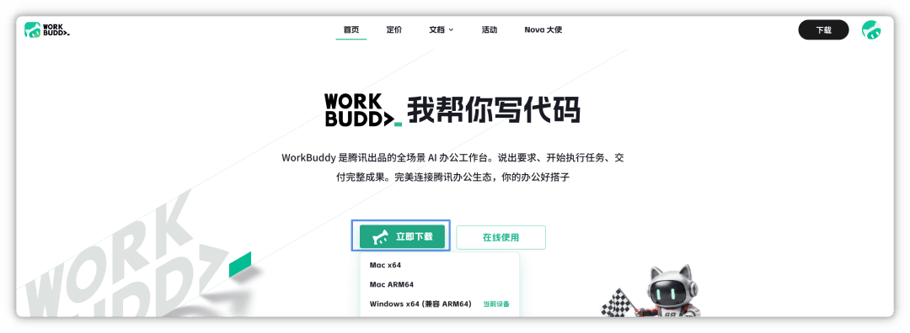
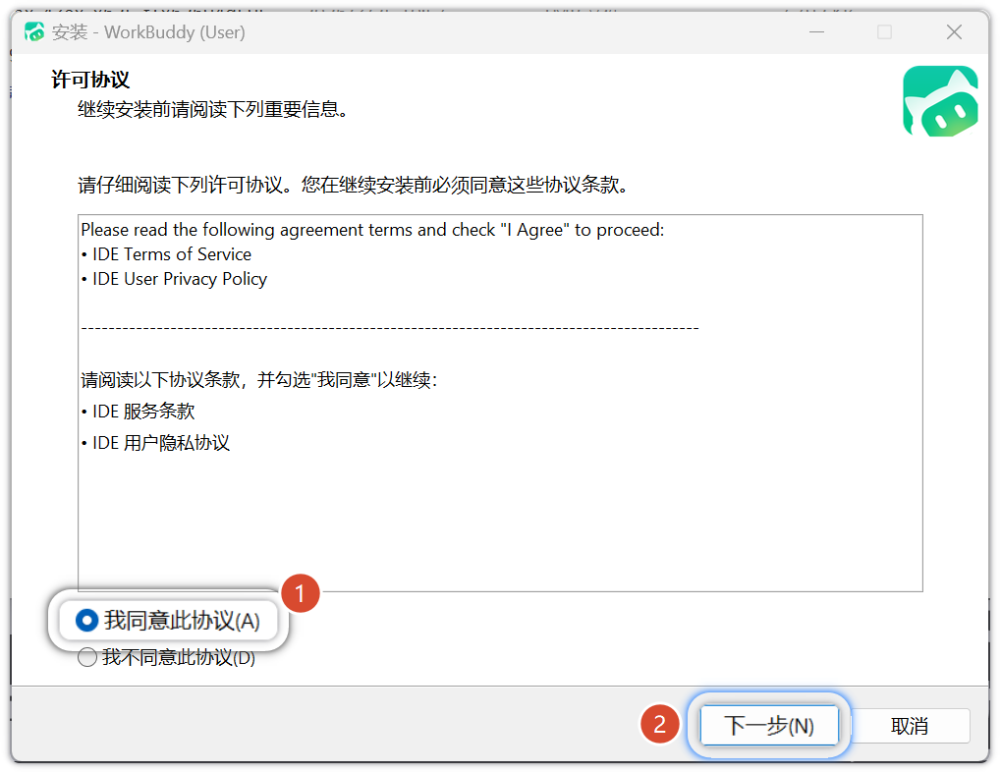
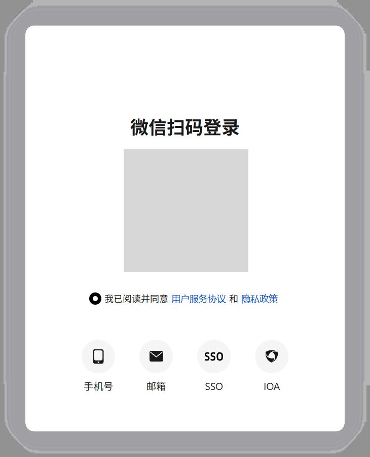
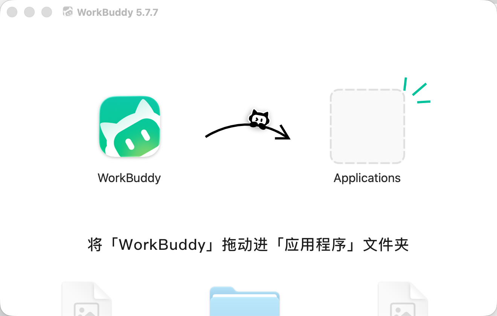
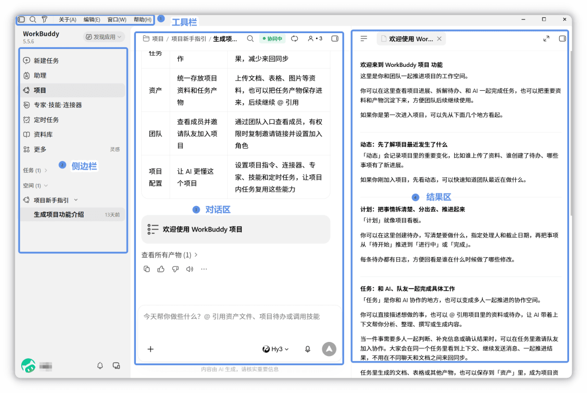
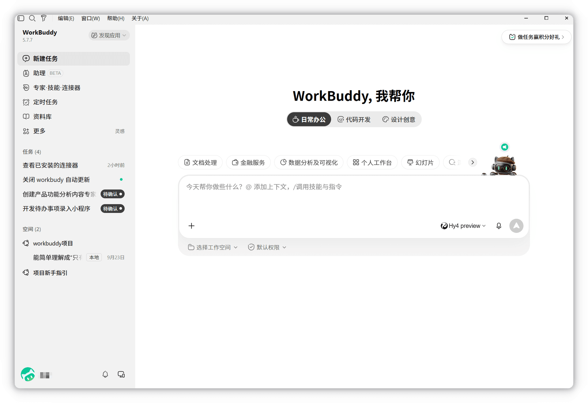
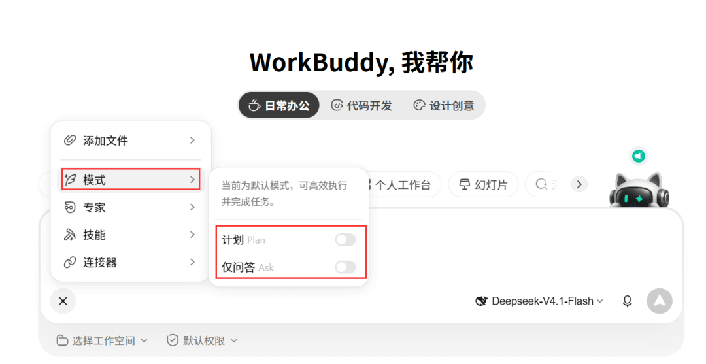
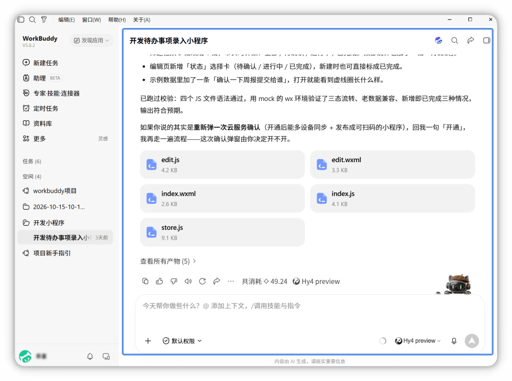

# Day 01 · 第一次用 AI：做好一张小清单

> [!IMPORTANT]
> 发布日期：2026-11-18（北京时间）。未安装或登录实测。界面图引用官方教学示意，清单为示例，不是运行记录。

[课程首页](../README.md) · [可复制提示词](resources/prompts.md) · [验收记录表](resources/checklist.md)

<a id="section-01"></a>
## 开始前：你需要准备什么

- 一台允许自行安装软件的 Windows 10 及以上 x64 电脑，或 macOS 12 及以上的 Mac；Windows ARM 请先读下面的支持冲突提醒。
- 可以访问官网的网络，以及按官网当前流程完成登录的条件。账号权益和模型可用性不作保证。
- Windows 记事本或 Mac 文本编辑，用来亲手保存。今天不安装连接器，不交出任何私密文件。
- 输出目标是一份由你检查过、保存后能重新打开的 5 分钟清单；不是让 AI 真的整理桌面。

> 练习是否通过，看的是文末验收清单。遇到付费、权限、目录或安装异常，可以暂停，不用为了完成课文扩大授权。

## 本章目录

- [先说今天要做成什么](#section-02)
- [一、AI、模型、WorkBuddy，到底谁是谁？](#section-03)
- [二、先认准官网，再检查电脑](#section-04)
- [三、Windows：下载、安装、登录](#section-05)
- [四、别怕按钮多：今天只认这几个地方](#section-06)
- [五、发出第一条要求：做一张整理书桌清单](#section-07)
- [六、别换新任务，在原地把它改到能用](#section-08)
- [七、先验收，再亲手保存最后一版](#section-09)
- [八、卡住时怎么停，不靠反复乱点](#section-10)
- [动手验收：全部做到再打勾](#section-11)
- [九、今天的毕业标准，不是“我装好了”](#section-12)
- [Mac 独立支线](#mac)

<a id="section-02"></a>
## 先说今天要做成什么

如果你连 AI 是什么都说不清，也没关系。今天不考试，不背术语。我们把 WorkBuddy 当成一个刚来报到、会写东西但还需要你把关的帮手，一起做一张《十分钟整理书桌清单》。

走完这篇，你会经历：认识 AI → 从官网安装登录 → 找到输入框 → 提一个具体要求 → 追问修改 → 检查答案 → 自己保存。不是一天学会全部软件，而是学会一次有头有尾的合作。安装和网络情况因人而异，不承诺固定时间完成。

练习不用上传照片、身份证、工作文件，也不用连接微信、邮箱或购买第三方连接器。我们只让 AI 写文字，不让它整理电脑文件。账号可能有用量限制；本文不承诺免费或固定额度，若出现套餐、积分不足等提示，先停下看官方说明，不要为了完成练习急着付款。

<a id="section-03"></a>
## 一、AI、模型、WorkBuddy，到底谁是谁？

AI 是人工智能的简称。你可以先把它理解成一类能根据输入，帮助处理文字、图片等内容的技术。你用大白话说要求，它能帮你起草、归纳、改写；但它没有亲眼看过你的桌子，更不会自动知道你家的真实情况。

模型，是背后负责理解和生成内容的那部分能力。可以粗略比成帮手的“脑力”，不是一个真正的人。WorkBuddy 则是你打开的工作台：把输入框、模型和执行工具放在一起。就像厨房不是厨师，工作台也不等于模型；这个比喻只为帮助理解，不是严格的技术定义。

腾讯官方把 WorkBuddy 定义为全场景 AI 工作台：你用自然语言，也就是平时说话的方式描述要求，它可以规划、执行并交付成果。今天先用最轻的一种：仅问答，让它写一份清单。以后再学文件、表格和其他工具。

AI 不等于搜索引擎。搜索主要帮你找网页和来源；AI 还会组织、改写和生成内容，但说得像真的，不代表就是真的。没有查证的回答不能当成最新事实。涉及医疗、法律、投资等重要决定，要查可靠来源、请专业人士判断，不能把最终决定交给它。今天连“分钟数有没有加对”也要自己看一眼。

官网“适用场景”列了帮我写作、生活小知识、文档处理等用途。我们选清单写作，不从金融分析、批量删文件或账号接入开始。场景页是菜单，不是新手第一天必须全学的课程。

<a id="section-04"></a>
## 二、先认准官网，再检查电脑

请在浏览器地址栏打开 WorkBuddy 中文官网。不要只看搜索结果里的名字，也不要从网盘、论坛附件或别人转发的安装包下载。旧教程里的下载入口可能跳转到中文官网，以当前官网为准。

WorkBuddy 社区蓝皮书是第三方社区手册，可以辅助学习，不是腾讯官网。它和官方文档有不同版本的截图，遇到冲突按当前官方说明走。本文主要按中文官网讲；国际站的登录方式可能不同，不要把两套页面混着操作。

Windows 读者：先打开系统“设置 → 系统 → 关于”，查看 Windows 版本和系统类型。官方要求 Windows 10 及以上、支持 Windows x64，不支持 Windows 7/8/8.1。如果看到 ARM，请先暂停：安装指南说 ARM64 以当前版本说明为准，但同日官方常见问题仍说 Windows 11 ARM64 暂不支持。下载菜单里的“兼容 ARM64”不能代替这项核对。公司电脑不允许安装时，找 IT 确认，不要绕过安全策略。

下面先走 Windows 主线。Mac 读者请看后面的独立支线；其他系统不在本文教学范围内，不要照搬安装步骤。

<a id="section-05"></a>
## 三、Windows：下载、安装、登录

第 1 步，在官网找到下载入口。当前官方 Windows 安装指南写的是点“立即下载”，选择 Windows。蓝皮书旧图写“下载 WorkBuddy”，按钮字样可能改版；以当前官网为准。下载后等浏览器显示完成，再去“下载”文件夹找刚下载的文件，不要连续点出好几个安装包。



*图 1｜下载入口与系统包菜单。官方示意；按钮与 ARM 支持以当前说明为准。*

第 2 步，双击安装包。若系统弹出安全提示，先核对来源与发布者；不认识、拿不准就取消，不要顺手选择强行运行。官方文档示意中的文件名和版本号只是当时的样子，不必和截图逐字相同。

第 3 步，阅读协议。愿意接受才选“我同意此协议”，点“下一步”。接下来依次是安装路径、开始菜单文件夹，通常可以沿用默认；到附加任务页，官方建议创建桌面快捷方式。其他不理解的附加项不要为了赶进度随意改动。确认后点“安装”，等向导提示完成，再点“完成”。不要在安装还没结束时反复重开安装包。



*图 2｜安装向导中的协议与“下一步”。官方示意。*

第 4 步，打开 WorkBuddy，点欢迎页中间的“登录”。官方中文指南说明，浏览器会打开 workbuddy.cn 的登录页面；阅读并同意用户协议、隐私政策后，可微信扫码，也支持手机号、邮箱、SSO 等方式。SSO 大致是单位统一账号登录，个人新手不必为它另找公司账号。按你当前页面提供的方式操作即可，不必每一种都试。



*图 3｜中文登录方式示意，二维码已由本文完全遮盖。官方示意。请用自己当前页面上的二维码，不要扫文章配图。*

第 5 步，网页显示登录成功后，手动切回已打开的 WorkBuddy 窗口。官方说的是成功后“返回客户端”，不要把它理解成每次都会自动跳回。如果仍是登录页，先看文末排查，不要连扫十次。账号、验证码和密码都由你自己保管，不发给本文作者或陌生人。看到工作台后，Windows 安装登录这一段就完成了。

顺手做一个小记录：系统版本、下载包类型、客户端版本号。不要照抄图里的版本。更新入口按官方指南是左下角头像 → 检查更新；需要更新时先等更新结束再练习，不把重要文件放进程序安装目录。

<a id="mac"></a>
<details markdown="1">
<summary>Mac 支线：核对芯片、拖入应用程序后再登录</summary>


点击左上角苹果图标 → 关于本机，查看系统和芯片。官方要求 macOS 12（Monterey）及以上：M 系列芯片选 Mac ARM64，Intel 选 Mac X64。别只凭“这是苹果电脑”就随便下一个。官网无法识别时可能默认给 X64，仍请按芯片核对。

下载后双击 .dmg，把 WorkBuddy 图标拖进 Applications，也就是“应用程序”。等拷贝完成，从应用程序打开，再按上一节完成登录。不要一直从 .dmg 磁盘映像里运行：官方明确提醒，这会影响自动更新。如果已这样运行，先按官方提示移动到应用程序，再重新打开。



*图 4｜Mac 要先拖入“应用程序”再启动。官方示意；图中版本不是本文承诺的当前版本。*


</details>

<a id="section-06"></a>
## 四、别怕按钮多：今天只认这几个地方

打开后的工作台大致分三块。左边是任务列表，像一摞作业本，负责新建和找回任务；中间是对话区，你在这里提要求、看回复、继续改；右边是结果区，主要看生成的文件等成果。今天只生成文字，右边没有文件也是正常的，不是失败。



*图 5｜左侧任务、中间对话、右侧结果的位置关系。官方示意；图中是另一个项目，只认区域，不照做其任务。*

现在请点左侧“新建任务”。如果有“日常办公、代码开发、设计创意”等分类，留在“日常办公”。它们是场景入口，不需要全部点一遍。找到中间大输入框和右下角向上箭头形的发送按钮，先别发。图里的任务历史属于官方示例，不是你的账号丢了资料，也不是你应该先建好的任务。



*图 6｜新建任务、输入框与右下角发送位置。官方示意；侧栏历史和模型名与读者实际界面可能不同。*


*图 6 局部｜输入框、左下角“＋”、默认权限和右下角发送位置，裁自同一张官方示意。未输入本课提示词，不是实测画面。*

先把今天的操作范围缩小：点输入框左下角的“＋” → 模式 → 打开“仅问答 Ask”。官方解释是只咨询、不执行任务。开启后输入框下方会显示对应模式标识；“计划”和“仅问答”不能同时开启。不是在所有入口里寻找一个叫“问一问”的按钮，旧蓝皮书的 Ask/Craft 名称与当前指南不完全相同。



*图 7｜“＋ → 模式 → 仅问答 Ask”的官方入口。官方示意；截图中开关尚未打开，读者需自行开启“仅问答”。*

输入框底部的权限保持“默认权限”，不要打开“允许完全访问”。权限就是允许它能动哪些东西；完全访问会影响当前客户端里的所有任务，不是这一次聊天的加速键。今天不用读本地文件，不用给桌面、文档或整块硬盘授权。工作空间可以理解为任务用的文件夹；官方允许不手选，由系统创建独立目录，今天不必挑一个存有私密资料的文件夹。

模型栏先保持当前可用选择，不用追着截图切成同名模型。若没有可用模型或页面提示额度不足，暂停看官方账户说明。要是找不到“仅问答”，先核对客户端更新和本节官方指南，不要擅自用“完全访问”代替。

<a id="section-07"></a>
## 五、发出第一条要求：做一张整理书桌清单

提示词没有那么神秘，就是你交代给 AI 的话。想让它少猜，就讲清楚四件事：要什么、已有条件、不要做什么、答案长什么样。请把下面整段复制进输入框，先看一眼，再点发送。多行内容建议直接粘贴，今天不用摸索 Enter 与换行的快捷键差异。

```text
请帮我写一份《十分钟整理书桌清单》，给从没做过整理的新手看。
条件：一张普通书桌，上面有散纸、笔、空杯子和电脑。工具只有一个收纳盒和一块干布。
请分成5步，每步写清“做什么、怎么做、预计几分钟”，时间合计10分钟。用简短的编号清单，不要表格。
不要建议丢弃未确认用途的纸张，不碰插座和电线，不移动或擦拭电脑，不用水或清洁剂。
这只是文字练习：只在对话里回答，不读取或修改电脑文件，不联网，不调用外部工具，不创建文件，也不发送或发布任何内容。
```

发送后，官方指南说会进入对话页，执行过程和回复出现在中间。先等这一轮回答结束，不必重复点发送。成功的第一个信号不是生成了 Word，而是你能看到一份针对这段要求的文字清单；左侧也会出现对应任务。

你得到的措辞、标题、时间分配不一定相同。下面只是为了说明答案的样子，不是本文实测，也不是保证每次出现的结果。

```text
示例，非实测
1. 留出操作区（1分钟）：先把空收纳盒放在桌边，不动电脑。
2. 暂存散纸（3分钟）：把纸张叠齐放入盒中，不确定用途的纸都保留。
3. 收拢文具（2分钟）：把散落的笔集中放入收纳盒一角。
4. 移开空杯（1分钟）：把空杯移到稳固、不靠电器的位置。
5. 整理空白桌面（3分钟）：用干布擦空出的桌面，避开电脑、电线和插座。
合计：10分钟。
```

注意：你写“不要联网”是给它的任务要求，不是系统级的绝对隔离保证。还要结合“仅问答”和默认权限看执行过程。若它仍要求读取目录、运行命令、安装工具或连接账号，先不要批准；点输入框区域出现的停止入口，并按后文收窄要求。这个小练习没有理由读取你的文件。

<a id="section-08"></a>
## 六、别换新任务，在原地把它改到能用

第一版不合适很正常。你不需要重新打招呼，也不要再点“新建任务”。留在同一个任务，找到底部输入框，把修改要求接着发进去。这样它才能接住前面说过的条件，这就叫上下文：这一本作业本里已经聊过的内容。



*图 8｜同一任务底部可以继续输入要求。官方示意。图中是开发任务的结果，不是本课清单的预期输出；只参考继续输入的位置。*


*图 8 局部｜只看同一任务底部的继续输入框。裁自上图官方示意，去掉开发任务正文与文件产物，非实测。*

```text
请修改刚才的清单，不要另起一个新主题。
我现在只有5分钟，请仍分5步，时间合计5分钟。保留“不丢未确认纸张、不碰电脑电线、不用水和清洁剂”的限制。
每一步以动词开头，删去空话，用编号清单输出完整最新版。最后单独写“时间合计：5分钟”。仍然只在对话里回答，不操作文件、不联网、不调用工具。
```

这次要观察变化：总时间从10分钟变成5分钟，仍然5步，限制没有丢。不是看它说一句“已修改”就算完成，要看它是否真的给了完整新版。没改到位，可以继续说：“第2步还写3分钟，请重新分配5步时间，逐项相加，合计必须5分钟。”这叫具体反馈，比“写好一点”更有用。

今天用“补发一条修改要求”就够了，不用学历史消息的编辑、回退、重新生成。这些功能可能改变后面的对话和产物，新手先别为了改一句话误点回退。也不要点分享图标，它和保存到自己电脑不是一回事。

<a id="section-09"></a>
## 七、先验收，再亲手保存最后一版

验收就是对照要求检查，不是挑 AI 说话好不好听。请自己核对：是不是5步？每步有没有明确动作和分钟数？把5个数字自己加一遍，是不是5分钟？有没有建议扔掉未确认的纸张、擦电脑或碰电线？这些动作对你实际桌面是否合适？有一项不对，就指出那一项再改，不能只让它自称“检查通过”。

现在把满意的最新版留下来。官方“任务对话”指南说明，选中回复文字后，会出现“复制”和“添加到对话”的操作栏。请用鼠标从标题拖选到最后一行，只选最终清单，不把两版回复都选进去，然后点“复制”；也可以在选中文字后按 Windows 的 Ctrl+C，Mac 按 Command+C。


*图 9｜选中文字后的“复制”和“添加到对话”。局部裁切；官方示意。*

Windows：从开始菜单打开“记事本”，新建一个空白文档。点击正文空白处，按 Ctrl+V 粘贴。按 Ctrl+Shift+S 打开“另存为”（若当前版本不同，从文件菜单找“保存/另存为”），在左侧选“文档”或你自己的练习文件夹，文件名填“我的第一份AI清单.txt”，保留文本格式，确认编码为 UTF-8（如界面提供），点击保存。这里是你亲手保存，不是给 WorkBuddy 开文件权限。

Mac：打开系统自带的“文本编辑”，新建文稿，从“格式”菜单选“制作纯文本”（如果显示“制作多信息文本”，说明当前已是纯文本）。按 Command+V 粘贴，再按 Command+S，命名为“我的第一份AI清单.txt”，选择自己的文稿或练习文件夹保存。系统自带应用界面会因版本不同略有变化。

最后，在资源管理器或 Finder 中找到刚保存的文件，双击重新打开。确认汉字没有乱码、内容是5分钟最终版、没有漏掉结尾。这一步通过，才叫“成果真的在我手里”。对话留在侧栏，不等于你已经另存了副本。今天没有让 AI 生成文件，所以右侧“产物”为空不必补救，更不用上传云端。

<a id="section-10"></a>
## 八、卡住时怎么停，不靠反复乱点

安装包打不开：先核对系统与芯片、确认从官网下载。若提示来源未知或损坏，取消并从官方入口重下；仍不行，记下报错，不强行关闭系统防护。公司设备先找 IT。Mac 若不能更新，先检查是不是还从 .dmg 运行。

登录没反应：官方常见问题列出默认浏览器、目录权限、安全软件拦截等原因。先确认系统有默认浏览器，再重新打开客户端尝试；若客户端提供“复制链接”，只把自己的登录链接放到自己的浏览器，别公开它。网页登录成功但客户端没变化时手动切回查看；仍失败就保留报错，不反复扫码。官方 FAQ 中涉及改目录权限的命令，不懂就不要复制执行。

回答一直跑或方向错了：在正在执行时，输入框区域会显示停止入口，点它可中断当前执行。停止不是撤销已完成的操作。今天是问答练习，停止后可以接着发：“只按我给的文字写5步清单，不联网，不执行工具，不处理文件。”不要靠开完全访问来解决。

按钮找不到：先放大窗口、确认自己在桌面客户端的本地任务，不是在助理、移动端或另一个网站；再对照本页对应的官方指南。页面改版时不要凭图硬点。右侧结果区不用时无需打开；后续真的生成文件，官方“结果查看”说明产物卡片的“⋯ → 另存为”可以保存，但那不是今天文字练习的必要步骤。

仍不行：记录操作停在哪一步、系统版本、客户端版本、错误原文与发生时间。官方 FAQ 提供“帮助 → 诊断工具 → 开始检测”；能打开客户端时可按其说明自查，个人账号显示的检查项可能较少。准备反馈前先检查截图、日志，遮掉账号、登录二维码、文件路径中的姓名等私密信息，不要把原始日志随意发到群里。官方常见问题。

<a id="section-11"></a>
## 动手验收：全部做到再打勾

- [ ] 我能区分 AI、模型和 WorkBuddy，知道 AI 可能说错。
- [ ] 我认准官网，核对系统和芯片；没有关闭系统防护或绕过公司规则。
- [ ] 我选择了“仅问答”，保持默认权限，没有授权私密目录或连接外部账号。
- [ ] 我发出了 10 分钟清单要求，看到了完整文字回答，而不是只等一句“完成”。
- [ ] 我在同一个任务追问，获得完整的 5 步、合计 5 分钟最新版。
- [ ] 我自己加过分钟数，并检查没有丢纸、碰电脑电线、用水或清洁剂的建议。
- [ ] 我只复制最后一版，亲手保存为文本文件，再双击打开核对内容和汉字。
- [ ] 我知道停止不等于撤销；异常要求读文件、联网、运行命令时不批准。

需要留记录时，用[验收记录表](resources/checklist.md)。示例清单只能帮你理解格式，不能替代自己的运行和检查。

<a id="section-12"></a>
## 九、今天的毕业标准，不是“我装好了”

请合上文章，试着回答：AI 会不会一本正经地说错？模型和 WorkBuddy 是不是一回事？你从哪里下载？你有没有在同一任务里把10分钟改成5分钟？你是不是亲自检查并重新打开了保存的文件？

如果这几件事能做到，你已经完成一次真正的入门：说清要求、看结果、提修改、自己把关、亲手保存。还不用会接账号、做 PPT、写程序，更不代表已经掌握所有 AI。下一次再学如何安全地给它一份资料，让它在小范围里处理文件。

本文依据 2026-11-18（北京时间）查阅的官方文档与社区蓝皮书编写。本文未安装或登录实测；所有界面图为官方教学示意，清单样例明确为“示例，非实测”。按钮、可用模型、账号用量和实际行为以当前官方说明及你的客户端为准。

<a id="section-13"></a>
<details markdown="1">
<summary>资料与图片说明（展开查看）</summary>

## 参考与配图出处

- [适用场景：本课从写作与生活信息整理入手](https://www.workbuddy.cn/docs/workbuddy/Scenarios)

- [简介：产品定义与界面区域](https://www.workbuddy.cn/docs/workbuddy/Overview)

- [Windows 安装指南](https://www.workbuddy.cn/docs/workbuddy/From-Beginner-to-Expert-Guide/Installation-Win-Guide)

- [Mac 安装指南](https://www.workbuddy.cn/docs/workbuddy/From-Beginner-to-Expert-Guide/Installation-Mac-Guide)

- [开启你的第一个任务](https://www.workbuddy.cn/docs/workbuddy/FirstTask)

- [创建任务](https://www.workbuddy.cn/docs/workbuddy/Create-Task)

- [新建任务栏：仅问答与模型、目录入口](https://www.workbuddy.cn/docs/workbuddy/From-Beginner-to-Expert-Guide/Function-Description/Task-Bar)

- [任务对话：持续追问、复制与停止](https://www.workbuddy.cn/docs/workbuddy/Conversation)

- [结果查看：文件产物与另存为](https://www.workbuddy.cn/docs/workbuddy/Results)

- [默认权限与安全沙箱](https://www.workbuddy.cn/docs/workbuddy/From-Beginner-to-Expert-Guide/Function-Description/Permission-Modes)

- [常见问题](https://www.workbuddy.cn/docs/workbuddy/From-Beginner-to-Expert-Guide/FAQ)

- [社区蓝皮书（第三方，交叉核对第1—3章）](https://workbuddy.homes/bluebook/)

图1—3来自官方 Windows 安装指南，图4来自 Mac 安装指南，图5来自“简介”，图6—7来自“新建任务栏”，图8—9来自“任务对话”。原作者版权保留。


[逐图出处与处理记录](SOURCES.md)

</details>

---

[返回课程首页](../README.md) · 上一篇：无（本课为第一篇） · 下一篇：Day 02 工作目录与权限（未发布，不提供空链接）

<sub>by Fee · 发布日期 2026-11-18（北京时间） · 未安装或登录实测。官方示意不等于作者实操证据；第三方图片版权归原作者，未获独立再分发授权，详见折叠的资料说明。</sub>
