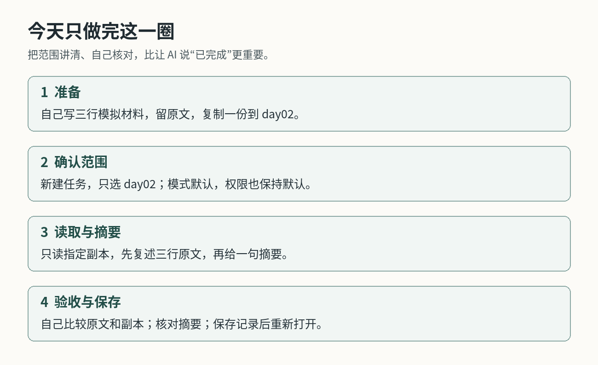
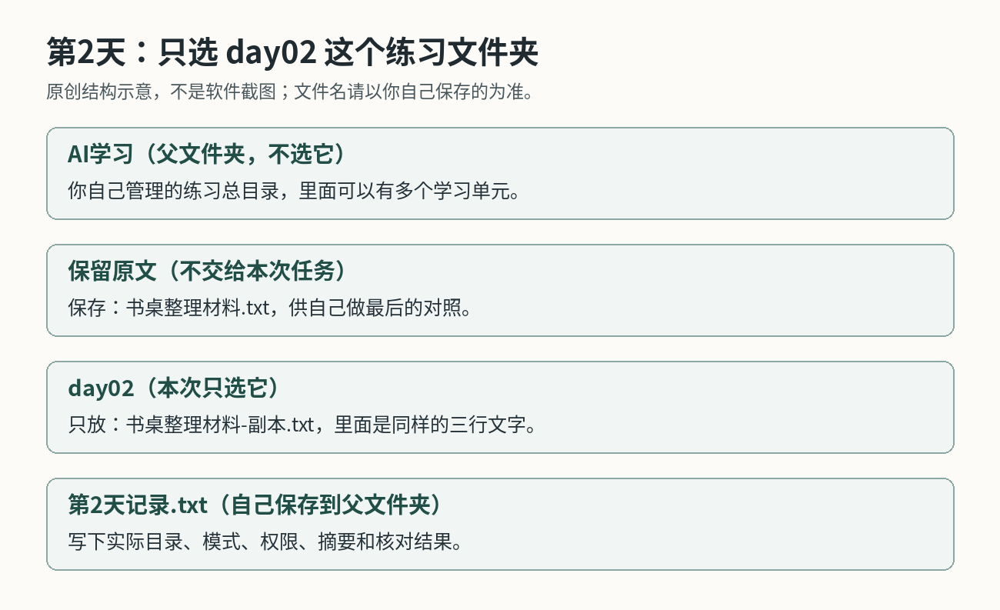
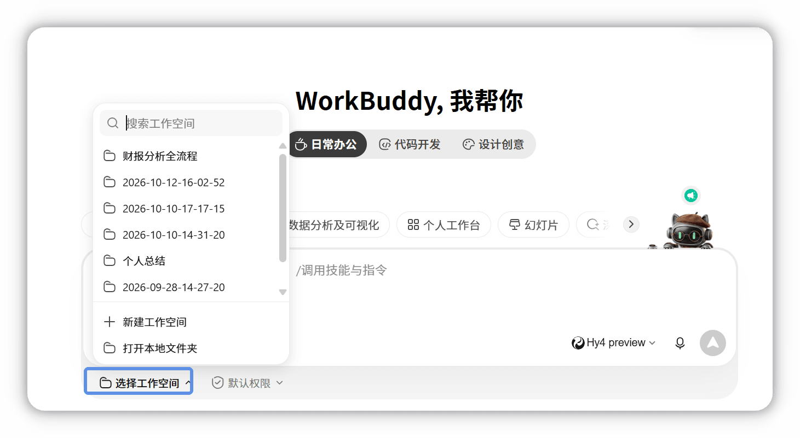
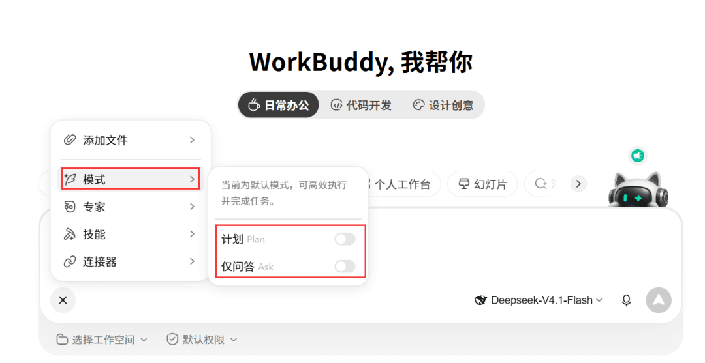
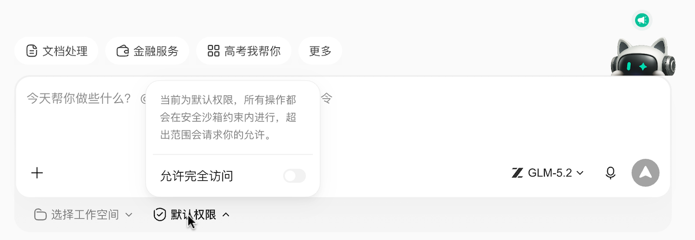
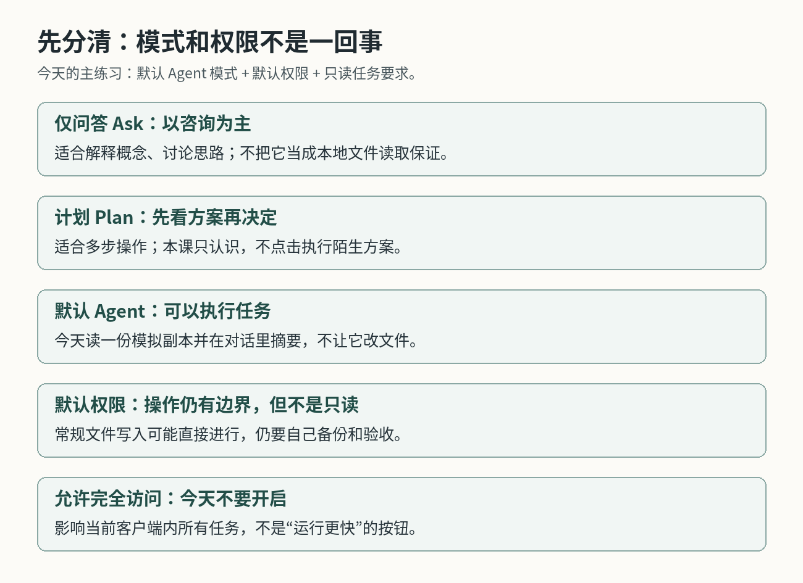

# WorkBuddy 第2天：先给 AI 一个练习文件夹，再让它读一份小材料

[课程首页](../README.md) · [21单元学习路线](../docs/LEARNING-ROADMAP.md) · [第1天](../day01/README.md)

建议用时：60—75分钟。前置条件：已完成第1天，能在自己的电脑上打开 WorkBuddy。本文依据官方资料编排，未在客户端实测；示例不是运行回执。任务是只读，但默认 Agent 模式和默认权限**并非系统级只读锁**。

> 下载本仓库后，不要把整个仓库、文章目录 `day02` 或 `practice` 选为工作空间。正文要求你亲手建立自己的 `AI学习/day02`，里面只放指定副本；两处目录同名，不是同一个位置。

## 本章目录

- [一、先认识三个词，不用背定义](#concepts)
- [二、亲手准备：一个原文，一份副本](#prepare)
- [三、新建任务，只把 day02 选进去](#workspace)
- [四、两种“默认”，一定分清楚](#mode-permissions)
- [五、发第一条任务：先复述原文，再给摘要](#first-prompt)
- [六、检查回答，不只看那句“读完了”](#check-answer)
- [七、自己核对文件，再留下记录](#save-record)
- [八、遇到这些情况，先停在哪里](#troubleshooting)
- [今天学会的，不只是让 AI 读文件](#wrap-up)
- [提示词与练习附件](#resources)


第一天，我们让 WorkBuddy 写了一张清单，自己检查，再保存下来。今天往前走一小步：不再只是把文字贴进聊天框，而是让它读取一份你准备好的练习文件。

先别拿工资表、合同或工作群资料来试。我们只用三行自己写的假材料。今天最重要的不是“AI 能读多少文件”，而是你能说清楚：**它读的是哪一份？我允许它做什么？做完后，文件有没有被改？**


*以Fee照片为参考的情景插画：从一件可掌握的小事开始练习。*

这节建议预留60—75分钟，卡住可以分两次做。最后应留下两样东西：一段有原文依据的摘要，一份自己保存的《第2天记录》。今天不安装插件，不连接外部账号，不要求 AI 新建或修改文件。

<a id="concepts"></a>

## 一、先认识三个词，不用背定义

**文件夹**，就是电脑里装文件的地方。今天先建一个单独的练习文件夹，只放一份不重要的副本。

**工作空间**，是你给当前任务选定的主要读写目录。文件夹是电脑里实际存在的东西；把其中一个文件夹选给 WorkBuddy，这个任务就围绕它工作。

**权限**，是软件对访问和操作范围的控制。选对工作空间，不等于 AI 从此绝对碰不到外面，也不等于目录里的文件不能被改。我们还要保持默认权限、写清任务限制，并在结束后自己核对。

你可以把今天记成一句话：先缩小材料范围，再交代清楚动作，最后检查结果。不要把整个桌面、整盘资料交给它，再盼着一句“请小心”替你兜底。



*本课步骤总览：准备、确认范围、读取摘要、验收保存。原创说明图，非软件界面。*

<a id="prepare"></a>

## 二、亲手准备：一个原文，一份副本

### 第1步：建立自己的练习总目录

Windows 用户按 `Win+E` 打开文件资源管理器，在自己能管理的位置新建文件夹，命名为 `AI学习`。可以使用“新建”菜单里的文件夹选项，也可以在空白处右键选择新建文件夹。

Mac 用户打开 Finder，在自己能管理的位置通过“文件”菜单新建文件夹，同样命名为 `AI学习`。

不要选择公司共享盘、别人的目录或存着重要资料的现成文件夹。桌面和“文档”也可能被 OneDrive、iCloud 等同步；文件在本机可见，不等于一定不会同步。今天材料是模拟文字，不放任何个人信息。

打开 `AI学习`，在里面再建两个文件夹：`保留原文` 和 `day02`。后者就是稍后唯一要选给 WorkBuddy 的目录。

### 第2步：自己写三行文字

Windows 打开“记事本”，新建空白文档；Mac 打开“文本编辑”，新建文稿并切换为纯文本。把下面三行复制进去：

```text
周六上午整理书桌，保留用途不明的纸张。
只使用干布和收纳盒，不碰电脑、电线与插座。
用时十分钟，完成后把文具放回收纳盒。
```

这些是**自制模拟材料**，不是工作记录，也没有隐含任务。用纯文本，是为了先排除 Word 版式、扫描件和识别错误等额外难题。

保存到 `AI学习/保留原文`，命名为 `书桌整理材料.txt`。Windows 如果提供编码选项，使用 UTF-8。Mac 若当前是富文本，先从“格式”切为纯文本，再保存。文件名中的 `.txt` 是文本文件的扩展名，不是正文。

### 第3步：复制，不要移动

关闭刚才的文档，回到文件夹。选中 `书桌整理材料.txt`，复制，然后打开 `day02`，粘贴，把复制出来的文件改名为 `书桌整理材料-副本.txt`。

Windows 可以用 `Ctrl+C`、`Ctrl+V`；Mac 可以用 `Command+C`、`Command+V`。先复制再粘贴，不用剪切：我们要让原文继续留在外面，方便最后对照。

双击副本，确认能正常显示三行汉字，然后关闭。`day02` 里现在应当只有这一份练习文件。



*目录关系图：保留原文留在外面，本次只选day02。原创结构示意，非资源管理器截图。*

**常见小坑：**电脑可能隐藏扩展名。看不到 `.txt` 时，可在文件管理器的“查看”相关选项中显示文件扩展名后再核对，界面因系统版本而异。不要反复往文件名后面补 `.txt`，最后变成 `材料.txt.txt`。如果你看到的是 `.rtf`，回文本应用另存为纯文本，不是只改后缀。

<a id="workspace"></a>

## 三、新建任务，只把 day02 选进去

打开 WorkBuddy，点“新建任务”。不要接着第一天的聊天继续做，这次需要一个范围明确的新任务。

在输入框下方找到“选择工作空间”。点开后，按当前界面选择本地文件夹；官方示意图中的菜单有“打开本地文件夹”。随后在系统选择窗口里，进入你刚才的 `AI学习/day02`，确认选择这个文件夹。

这里选的是**文件夹**，不是双击那份 `.txt` 文件；也不是选择上一级 `AI学习`。确认前停两秒，看末尾是不是 `day02`。



*官方界面：选择工作空间与打开本地文件夹的入口。图中历史目录不是本课材料。*

选完后，核对界面显示的目录名；若有路径或悬停详情，再检查完整位置。名字相同不代表位置相同，别选到以前下载目录里的另一个 `day02`。

如果误选了“桌面”或“文档”根目录，**先不要发送任务**，回到工作空间入口重新选择。实在拿不准，就取消这次新建，重新来一遍。今天没有需要赶进度的操作。

官方说明也允许不手选目录，由系统创建任务目录。但本课特意练“自己选、自己认”，所以不要跳过。不会选目录时先停下来，不靠在提示词里写一句路径来代替界面核对。

<a id="mode-permissions"></a>

## 四、两种“默认”，一定分清楚

第一天我们用“仅问答 Ask”写清单。今天要读取本地文件，改用默认 Agent 模式。这里最容易把两个不同开关混在一起：

- **模式管任务怎么做。**Ask 主要咨询、不执行；Plan 先出方案，等确认后执行；默认 Agent 可以执行任务，也能修改文件。
- **权限管操作受什么限制。**本课保持“默认权限”，不打开“允许完全访问”。

所以今天是：**默认 Agent 模式，配默认权限；任务要求只读指定副本。**“默认”不是“不会动文件”的同义词。

在输入框左侧点“＋”，找到“模式”。如果“仅问答 Ask”或“计划 Plan”开着，把它关掉；官方说明两者关闭后回到默认模式。非默认模式也可能在输入框下方显示标识，可以用标识上的“×”退出。对照自己当前界面，不用追着截图里的模型名称改。



*官方模式菜单：本课让Plan和Ask保持关闭，回到默认模式。*

再看输入框底部的权限状态，应保持“默认权限”。点开查看时，“允许完全访问”保持关闭，确认后收起面板即可。



*官方权限面板：保留默认权限，不开启完全访问。*

默认权限不是只读锁。官方较详细的权限指南写明，工作空间内常规文件操作可能直接进行，普通写入不一定逐次询问；重要删除、敏感路径、命令或网络等会按实际规则处理。**不要因为“没弹窗”，就断定“没改文件”。**

“允许完全访问”会影响当前客户端里的所有任务，包括后来新建的任务，不只是当前聊天。今天用不到，也不拿它解决读不到文件的问题。



*模式与权限对照：一个管执行方式，一个管访问边界。原创说明图，非软件界面。*


*以Fee照片为参考的情景插画：发送前先停一下，核对范围和要求。*

<a id="first-prompt"></a>

## 五、发第一条任务：先复述原文，再给摘要

发送前最后看一眼：目录是 `day02`，里面只有模拟副本；模式是默认 Agent，权限仍为默认。准备好后，把下面整段复制到输入框，再发送：

```text
这是一次本地文件读取练习。请只处理当前工作空间根目录中的
“书桌整理材料-副本.txt”。

目标：读取这一份文件，先逐行复述文件里的三行原文，再给一句不超过60字的摘要。
输出请按顺序分为：实际读取的文件名、三行原文、摘要。

范围与限制：
1. 只读取这一个指定文件，不递归扫描目录，不访问上级或其他目录。
2. 不新建、修改、删除、移动或重命名任何文件，不创建摘要文件。
3. 不联网，不连接外部账号，不安装工具或运行脚本。
4. 如果读不到文件，请直接说明失败原因，不猜原文，不扩大查找范围。
5. 如果必须运行命令或申请额外权限才能继续，请先停下来解释，不执行。

请只在对话中回答。
```

这里没有把三行原文再贴给 AI。这样你才能检查：它是真的读到了指定文件，还是在复述你聊天框里已经给它的材料。

我们也不让它先扫描整个文件夹。目标文件名已经明确，直接指定这一份就够了。提示词里的“不修改”是任务限制，不是系统强制的只读设置，仍要观察执行过程和最后的文件状态。

如果出现权限请求，先看操作对象和完整路径。今天不需要放行删除、写文件、访问其他目录、联网或脚本命令。看不懂就取消，不要为了得到摘要一路点“允许”。即便提示看起来是在读文件，也先确认路径确实是这份模拟副本，再决定是否继续。

<a id="check-answer"></a>

## 六、检查回答，不只看那句“读完了”

成功不是它写“已经完成”，而是你能对上三件事。

**第一，文件名对不对。**实际读取的是 `书桌整理材料-副本.txt`，不是原文、不是第一天的清单。若它显示完整路径，目录应指向你选的 `day02`；不要把包含自己用户名的路径截图直接发到网上。

**第二，三行原文对不对。**回到文件夹，双击副本自己查看。留意“十分钟”有没有变成“五分钟”，“保留”有没有变成“丢弃”，“不碰电脑”有没有被漏掉。不要只让 AI 自己宣布核对通过。

**第三，摘要有没有添戏。**例如下面这样，信息就有原文依据：

> 示例，非本文客户端实测：周六用十分钟整理书桌，使用干布和收纳盒，保留不明纸张，避开电脑及电线插座，最后收好文具。

你的回答不必一字不差。但不能凭空增加“下午”“购买收纳架”“丢掉旧文件”等内容。摘要是压缩，不是给材料补剧情。

若摘要漏掉限制，留在同一任务继续发：

```text
请只修改上一条回答中的摘要，不重新读取其他文件。
摘要要保留“十分钟、保留用途不明的纸张、不碰电脑电线插座”这三个要点。
仍只在对话中回答，不写入文件。没有原文依据的内容不要添加。
```

若连原文都对不上，先停止，回头检查选的目录、文件名、是否保存成功；这时不要靠反复润色摘要掩盖读取失败。

<a id="save-record"></a>

## 七、自己核对文件，再留下记录

摘要合格后，先回文件管理器，分别打开 `保留原文` 里的原文和 `day02` 里的副本，一行一行对照。这三行很短，肉眼就能看完。

检查原文字句是否保留、副本是否仍是原来的三行、`day02` 有没有出现意外新文件。如果发现差异，先记录和停止，不让 AI 擅自“恢复一下”，否则可能覆盖问题现场。今天的原文留在另一个文件夹，就是为了让你有对照。

对这份纯文本小材料，逐字对照可以检查可见内容是否变化；仅看文件名、修改时间，或者相信一句“我没有修改”，都不够。更严格的逐字节校验以后再学，不把今天的人工核对夸成绝对技术保证。

接着自己打开记事本或文本编辑，把下面模板填好，保存为 `第2天记录.txt`，放在 `AI学习` 父文件夹，而不是交给 AI 代写到练习目录。

```text
我的WorkBuddy第2天记录

练习目录：（自己填写实际选择的位置，不公开个人路径）
实际读取文件：书桌整理材料-副本.txt
工作模式：默认 Agent
权限状态：默认权限；允许完全访问关闭

三行原文是否与文件一致：（自己核对后填）
最终摘要：（复制满意的最终版）
原文与副本的内容是否一致：（自己核对后填）
day02是否出现意外文件：（填写看到的实际情况）
遇到的请求或错误、自己如何处理：（没有就写无）
```

保存后关闭，再找到 `第2天记录.txt` 双击打开。内容没有乱码，摘要是最终版，检查项是你自己核对的结果，今天才算完成。若尚未读到文件，记录“读取未通过”和卡点，不填成全部通过。


*以Fee照片为参考的情景插画：把结果检查清楚，再安心收尾。*

<a id="troubleshooting"></a>

## 八、遇到这些情况，先停在哪里

**它说找不到文件。**先自己打开 `day02`，看副本是否真的在那里、文件名和扩展名是否一致、编辑器里的内容有没有保存。再核对工作空间，不让 AI 搜整个硬盘。改好后仍失败，就记录客户端版本和错误原文，留到排查，不开完全访问碰运气。

**它直接问我要原文。**把三行粘贴给它当然能做摘要，但那属于第一天的文字练习，不等于本地读取成功。你可以用粘贴法继续练摘要，同时诚实记下“本地读取尚未通过”。

**它要运行命令。**有些任务可能会用命令读取文件，但本课选择先不执行。不懂命令就取消，请它说明原因；若没有你能理解的读取方式，保留卡点即可。学会停下，比复制一段陌生命令更重要。

**弹出“信任工作区”。**这不是每个空白文件夹都会出现的必经步骤。官方说明，在包含某些开发配置目录、且尚未受信任时可能触发。今天目录本应只有你自己放的文本副本，若出现陌生配置，先取消，回去核对是否选错目录或使用了别人打包的材料，不照着陌生教程点“正常打开”。

**任务一直跑，或开始操作别的材料。**用执行中的停止入口中断，拒绝不理解的请求。停止不等于撤销已经发生的变化，随后检查文件。不要把暂停当成已经恢复原样。

**“本地文件”是不是就不上传了？**不是这个意思。本地说的是文件位置，选工作空间也不等于离线运行。模型处理内容、同步目录和云端功能各有数据规则，不能把这节课理解成保密承诺；这也是我们只用自制模拟材料的原因。

<a id="wrap-up"></a>

## 今天学会的，不只是让 AI 读文件

不看上面的步骤，你能不能自己指出那份副本、说明两种“默认”的区别、复述任务不允许的操作，再检查原文有没有变化？能做到这些，今天的练习就有价值。

第3天再往前一步：让 AI 根据小材料生成第一份文件，练习新建结果、核对内容和重新打开。今天先不抢跑。先把小范围里的事情做明白，后面才更容易判断“大任务”到底交付得靠不靠谱。

---

资料与图片说明：本文为原创教学编排，操作依据为腾讯 WorkBuddy 官方《创建任务》《新建任务栏》《默认权限与安全沙箱》，核查于2026年11月19日（北京时间）。界面图为官方示意，非作者客户端实测；人物情景插画以作者本人照片为参考，目录和流程图为原创说明图。界面可能随版本变化，遇到不一致以当前官方说明为准。


<a id="resources"></a>

## 提示词与练习附件

- [全部可复制提示词](resources/prompts.md)，与正文四个文本块逐字一致。
- [人工验收表](resources/checklist.md)，读不到文件时记“未通过”，不要代填成功。
- [示例摘要（非实测）](resources/example-not-tested.txt)，只用于比较，不是读取成功证据。
- [目录与权限记录卡](practice/第2天记录-模板.txt)，由你手动填写，保存到自己的 `AI学习` 父目录。
- [练习材料说明](practice/README.md)，附自制原文与副本供核对；不能把整套材料当成工作空间。
- [资料与图片归属](SOURCES.md)，保留官方示意与未实测说明，不另加自有图片许可证。

[返回第1天](../day01/README.md) · [返回课程首页](../README.md)

第3天仍仅为规划，尚无课文链接；请先完成本章验收。
