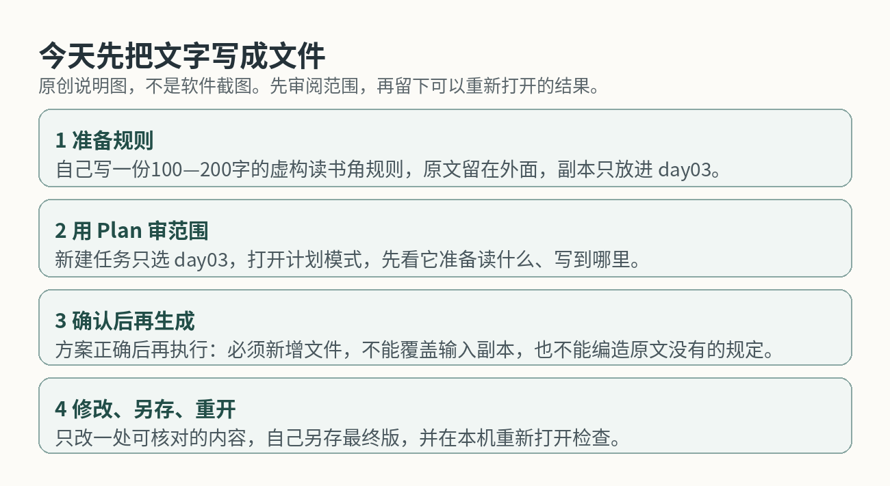
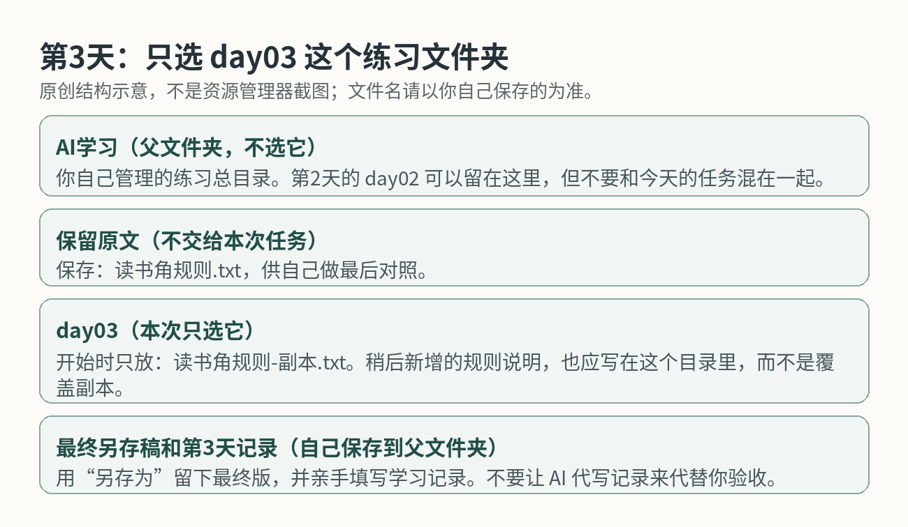
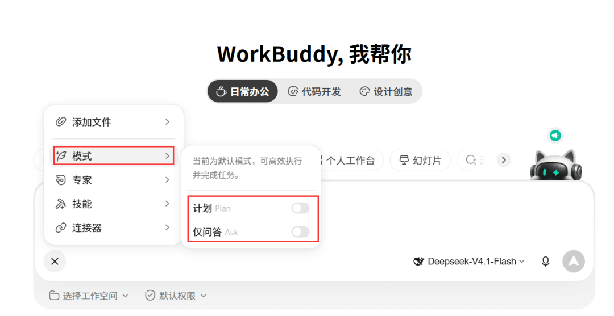
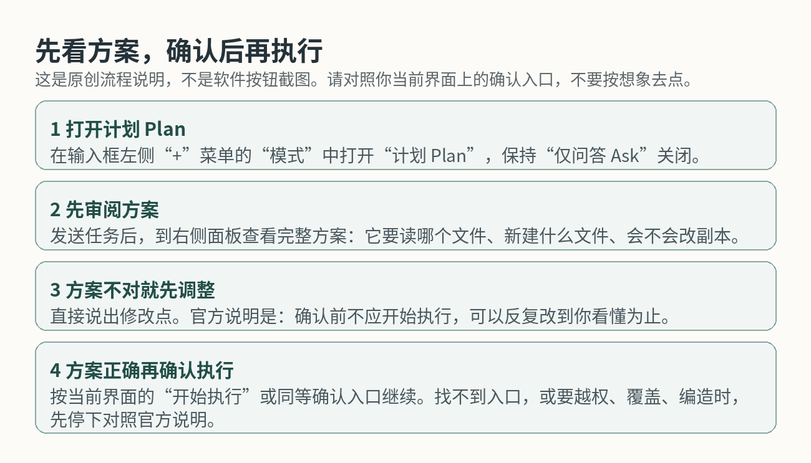
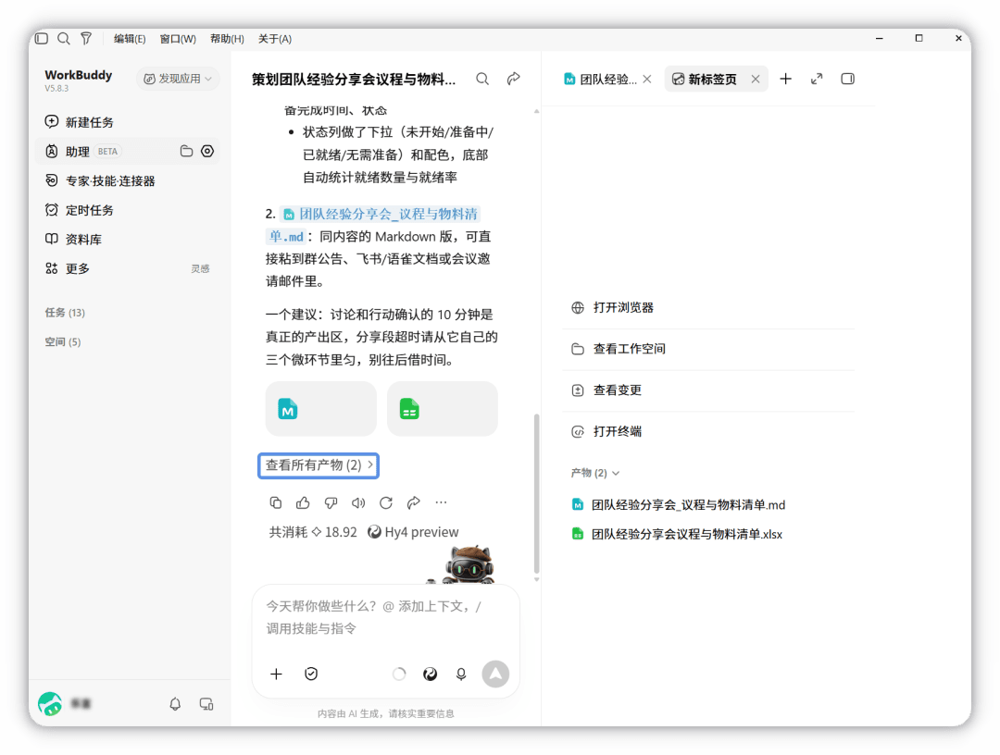
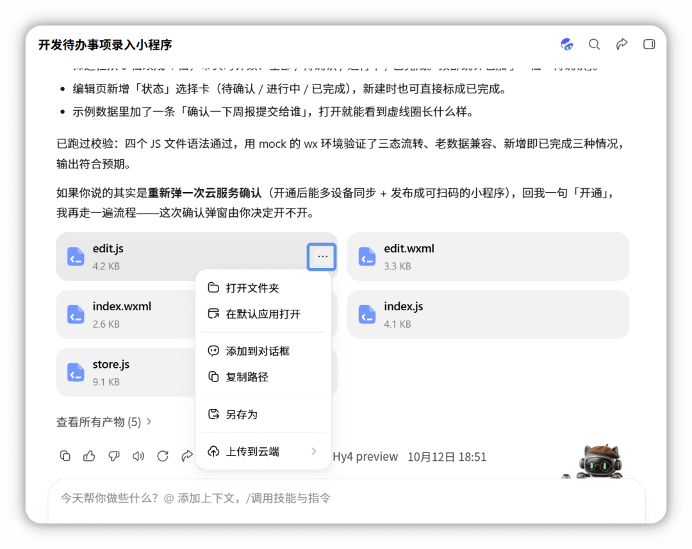
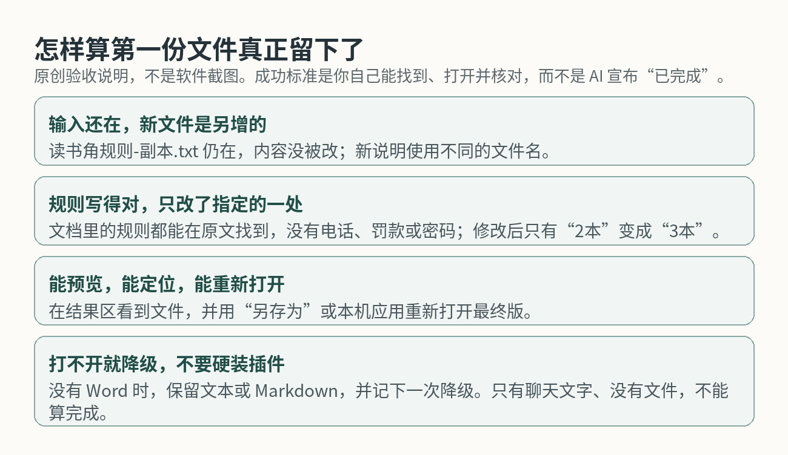

# WorkBuddy 第3天：先看方案，再把规则写成第一份文件

[课程首页](../README.md) · [21单元学习路线](../docs/LEARNING-ROADMAP.md) · [第2天](../day02/README.md)

建议用时：75—90分钟。前置条件：已完成第2天，能在自己的电脑上建立练习目录并核对副本。本文依据官方资料编排，未在客户端实测；文中示例不是运行回执。第一次生成使用计划 Plan 和默认权限。打开 Plan 不等于权限变成只读。必须新增文件，不得覆盖输入。只把「每次最多借2本」改为「每次最多借3本」。Word 不可用时降为 TXT 或 Markdown，并自己另存后重新打开。

> 下载本仓库后，不要把整个仓库、文章目录 `day03` 或 `practice` 选为工作空间。正文要求你亲手建立自己的 `AI学习/day03`，里面开始时只放指定副本；两处目录同名，不是同一个位置。

## 本章目录

- [一、先认识今天要用的几个词](#concepts)
- [二、亲手准备：一份规则，一份副本](#prepare)
- [三、新建任务：只选 day03，并打开计划模式](#workspace)
- [四、发第一条任务：先让它交出方案](#plan-prompt)
- [五、看方案，确认后再执行](#review-plan)
- [六、到结果区去找文件，不要只看“已完成”](#results)
- [七、只改一处，再自己另存最终版](#revise-save)
- [八、遇到这些情况，先停在哪里](#troubleshooting)
- [今天学会的，不只是“让 AI 写一份 Word”](#wrap-up)
- [提示词与练习附件](#resources)

第2天，我们给练习划了一个小工位：只选 `day02`，让 WorkBuddy 读一份三行副本，再自己对照原文。今天往前走一步：不再只停留在聊天里的文字，而是留下一份可以预览、找到位置、并在本机重新打开的文件。

仍然不要拿合同、通知或真实通讯录来试。我们只用一份自己写的虚构读书角规则。今天最重要的不是“AI 会不会排版”，而是你能说清楚：**它是新建了一份文件，还是改掉了原文？规则有没有添戏？我能不能自己找到并打开它？**


*以Fee照片为参考的情景插画：从聊天走到第一份文件，仍从一件能核对的小事开始。*

这节建议预留75—90分钟，卡住可以分两次做。最后应留下三样东西：一份一页规则说明、仍然完整的输入材料，以及一条你自己保存的修改记录。优先争取 Word 文档；如果当前环境给不了这种格式，就保存为纯文本或 Markdown，并明确记下这次降级。今天不安装插件，不连接外部账号，也不把文件分享或上传到云端。

<a id="concepts"></a>

## 一、先认识今天要用的几个词

**计划（Plan）**，是一种先出方案、等你确认后再执行的工作模式。第2天我们用默认 Agent 模式去读文件；今天要新建文件，步骤比“只读三行”多一点，所以先让它说明打算读什么、写到哪里、会不会改你的输入，你看过再动手。

**新文件**，就是另外创建的一份结果，而不是把原来的规则副本直接改掉或覆盖保存。聊天框里出现一段漂亮的文字，也不等于文件已经写到文件夹里。

**结果区**，是任务界面里集中查看产物的地方。官方说明里，这里可以预览文件、查看工作空间里的内容、打开所在文件夹，或把文件“另存为”到你指定的位置。今天就要练这几步，不要求使用分享或上传。

**Markdown** 先记住一句话就够：它是带少量格式标记的普通文本，例如标题前加 `#`，列表前加 `-`。今天不要求你学会这些记号；打不开 Word 时，能用记事本或文本编辑打开并对照原文，就可以先完成练习。

还要记住第2天已经核对过的边界，今天仍然有效：

- 模式管任务怎么做，权限管操作受什么限制。默认 Agent 模式可以执行任务，也可以修改文件，它不等于“只读”。
- 本课保持“默认权限”，不打开“允许完全访问”。默认权限不是保险锁，工作空间里的普通写入不一定每次都来问你。
- “允许完全访问”会影响当前客户端里的所有任务，包括后来新建的任务，不只是这一次聊天。今天用不到，也不拿它解决写不出文件的问题。



*本课步骤总览：准备规则、用Plan审范围、确认后生成新文件、修改并另存重开。原创说明图，非软件界面。*

<a id="prepare"></a>

## 二、亲手准备：一份规则，一份副本

如果第2天已经建好了 `AI学习` 和 `保留原文`，今天直接沿用，不必重做安装，也不必把整个练习目录推倒重来。还没有这两个文件夹的同学，可以在自己能管理的位置新建 `AI学习`，再在里面新建 `保留原文`。不要选公司共享盘、别人的目录，或已经堆着重要资料的文件夹。

打开 `AI学习`，再建一个新文件夹，命名为 `day03`。这是今天唯一要选给 WorkBuddy 的目录。不要把 `day02` 和 `day03` 混在一次任务里，也不要直接选上一级 `AI学习`。

### 第1步：写一份100—200字的虚构规则

Windows 打开“记事本”，新建空白文档；Mac 打开“文本编辑”，新建文稿并切换为纯文本。把下面整段复制进去。这是**自制模拟材料**，不是真实小区或机构的规定，也不含个人信息。

```text
社区读书角模拟规则（虚构材料，仅供练习）

开放时间：每周六、周日下午14:00—17:00，周一到周五不开放。
借阅对象：仅限本楼居民，每次最多借2本，借期7天，到期前可续借1次，续期7天。
归还要求：书要放回原架，不折角、不涂写。如有污损，先记在借阅本上，再告知管理员。
现场约定：安静阅读，不大声通话；饮用水可带入，食物请放在门外桌面。期刊和工具书不外借。
管理员联系方式、罚款金额和门禁密码均未提供，请勿编造。
```

这段大约150多字，关键数字很清楚：周六周日下午两点到五点、每次最多借2本、借期7天、可续借1次。最后一句也故意写明：联系方式、罚款和密码都没有提供。后面检查时，就看 AI 有没有把这些“没有写的东西”编出来。

保存到 `AI学习/保留原文`，命名为 `读书角规则.txt`。Windows 如果提供编码选项，使用 UTF-8。Mac 若当前是富文本，先从“格式”切为纯文本，再保存。

### 第2步：复制到 day03，不要移动

关闭文档，回到文件夹。选中 `读书角规则.txt`，复制后打开 `day03`，粘贴，并把复制出来的文件改名为 `读书角规则-副本.txt`。Windows 可用 `Ctrl+C`、`Ctrl+V`，Mac 可用 `Command+C`、`Command+V`。先复制再粘贴，不用剪切，这样原文继续留在外面，方便最后对照。

双击副本，确认内容完整、汉字正常，然后关闭。开始练习前，`day03` 里应当只有这一份文件。



*目录关系图：保留原文留在外面，本次只选day03；最终另存稿和学习记录放回父文件夹。原创结构示意，非资源管理器截图。*

<a id="workspace"></a>

## 三、新建任务：只选 day03，并打开计划模式

打开 WorkBuddy，点“新建任务”。不要接着第2天的聊天继续写文件，今天需要一个范围明确的新任务。

在输入框下方找到“选择工作空间”，按当前界面选择本地文件夹，进入 `AI学习/day03` 后确认。这里选的是**文件夹**，不是双击那份 `.txt` 文件，也不是误选 `day02` 或上一级 `AI学习`。确认前停两秒，看末尾是不是 `day03`。选错了，先不要发送任务，回到入口重选；拿不准就取消这次新建，重新来一遍。

不会选目录时先停下来，不靠在提示词里写一句路径来代替界面核对。官方说明也允许不手选目录、由系统创建任务目录，但本课要练的是“自己选、自己认”，所以不要跳过。

接着保持“默认权限”，不要打开“允许完全访问”。然后在输入框左侧点“＋”，找到“模式”，打开“计划 Plan”，并确认“仅问答 Ask”是关闭的。两者同时只能开一个；官方说明里，非默认模式还会在输入框下方显示标识，可以用标识上的“×”退出。



*官方界面：在模式菜单中打开计划Plan，保持仅问答Ask关闭。图中模型名称是官方示意，不必照改。*

今天是：**计划 Plan 模式，配默认权限；先审阅范围，确认后再生成新文件。** 打开 Plan，不等于权限已经变成只读，也不等于可以放心交给它随便写。

<a id="plan-prompt"></a>

## 四、发第一条任务：先让它交出方案

发送前再看一眼：目录是 `day03`，里面暂时只有规则副本；模式是计划 Plan，权限仍为默认。准备好后，把下面整段复制到输入框，再发送。这里没有把规则正文再贴一遍，这样你才能检查：它是真的读到了指定文件，还是在发挥聊天框里已经出现的内容。

```text
这是一次本地文件生成练习。请只处理当前工作空间根目录中的
“读书角规则-副本.txt”。

请先阅读这一份文件，再给出一份可审阅的执行方案，等我确认后再执行。

目标：根据该文件中的规则，在当前工作空间根目录新建一份一页的规则说明文档。
优先保存为 Word（.docx）。如果无法生成 Word，再保存为 Markdown 或纯文本，并明确说明降级原因和实际文件名。

方案和最终文档都必须遵守：
1. 只使用该文件里已经写明的规则，不要增加联系方式、罚款、密码、开放日或借阅数量等原文没有的内容。
2. 必须新增文件，不得覆盖、修改、删除、移动或重命名“读书角规则-副本.txt”，也不得改写上级目录或其他目录中的文件。
3. 新文件不要使用与输入副本相同的文件名。
4. 不联网，不连接外部账号，不安装工具或插件，不运行我看不懂的脚本。
5. 如果读不到文件，或必须申请额外权限、访问其他目录才能继续，请先停下来说明原因，不要执行。

请在方案中写清：将读取哪个文件、将新建的文件名与格式、是否会改动输入副本，以及材料中未提供因而不会写入的信息。
```

官方对 Plan 的说明是：开启后，模型不会立刻给出最终结果，而是先补齐信息、交出一份可审阅的方案，等你确认后再执行。方案生成后，可在右侧面板查看完整内容。如果它先向你提问，而问题涉及材料里没有的联系方式、罚款或密码，可以明确回复：这些信息原文没有提供，请不要假设，并在方案里标明“未提供”。不要为了让任务尽快开始，就随口补一个电话或金额。



*计划模式的审阅流程：先看方案，不对就调整，对了再确认执行。原创说明图，不是软件按钮截图。*

<a id="review-plan"></a>

## 五、看方案，确认后再执行

方案出来后，不要急着往下点。先核对这几件小事：

- 它要读的是 `读书角规则-副本.txt`，不是第2天的三行材料，也不是外面的原文。
- 它准备新建一份文件，并且文件名与输入副本不同。
- 它明确不会覆盖或修改输入副本。
- 它不会把联系方式、罚款、密码等原文没有的内容写进去。
- 它只在当前 `day03` 里写入，不要求打开完全访问、不要求安装插件、不要求访问其他目录。

只要有一条对不上，就先调整方案，不要确认执行。可以把下面这段复制过去：

```text
请先不要执行。请按下面三点调整方案后再给我看：
1. 必须新增文件，不能覆盖或修改“读书角规则-副本.txt”。
2. 不要补充材料里没有的联系方式、罚款或密码。
3. 文件只写在当前工作空间根目录。
调整后请再次列出：读取的文件、新建的文件名、会不会改输入副本。
```

官方说明里，调整计划就是直接说出修改点，模型重新输出；确认前不应开始执行。你可以反复改到看懂为止。

方案正确后，再按当前界面提供的确认或“开始执行”入口继续。不同版本上的按钮名称可能不完全一样。若找不到这类入口，或出现你不认识的授权、命令、安装请求，先停下来，对照最新的官方《新建任务栏》说明，不要为了看到文件一路点“允许”。


*以Fee照片为参考的情景插画：方案看清楚，再决定是否开始执行。*

如果出现权限请求，先看操作对象和完整路径。今天可以理解的，通常只是在已选的 `day03` 里新建一份说明文档。删除输入副本、改写其他目录、联网、安装或运行你看不懂的命令，都先取消。提示词里的限制是任务要求，不是系统强制锁，仍要观察它实际准备做什么。

<a id="results"></a>

## 六、到结果区去找文件，不要只看“已完成”

确认执行后，成功不是它写“文档已生成”，而是你能在结果里指出那份新文件，并核对内容。

先看对话里是否出现产物卡片，或“查看所有产物”这类入口；再看右侧结果区。官方说明里，结果区可以把产物、工作空间文件和变更分开查看。你要确认的是：新文件出现了，输入副本也还在。



*官方示意：结果区可以看到产物卡片，并进入工作空间或查看产物。图中文件和数字是官方示例，不是本课读书角练习，也不是作者实测。*

如果只在聊天里看到一段规则文字，却没有任何文件，先分清两件事：是它只输出了文字、还没有写入文件夹，还是文件已经生成、但你还没找到路径。这时不要急着让它“再写一遍”，以免覆盖现场。可以先到结果区查看产物和工作空间文件；仍没有文件，就记录“尚未生成文件”，不要把聊天稿说成已经交卷。

找到文件后，先做内容检查：

**第一，输入副本还在吗？** 回到 `day03`，双击 `读书角规则-副本.txt`，确认仍是原来的规则，没有少句，也没有被改成“最终版”。再看 `保留原文` 里的原文，两者应保持一致。

**第二，新文件是另外增加的吗？** 文件名不应与输入副本相同。优先看到 `.docx` 这类 Word 文档；如果实际是 `.md` 或 `.txt`，记下这是一次格式降级，并看它是否说明了原因。Markdown 用文本应用打开即可，不必先去学语法。

**第三，规则有没有添戏？** 打开原文对照。开放时间应仍是周六周日下午14:00—17:00，每次最多借2本，借期7天，可续借1次；期刊和工具书不外借。若出现管理员电话、罚款金额、门禁密码，或平日也开放，那就是编造，先标出来，不要当作正式规定。

例如下面这样，就属于把没有的信息写进去了：

> 示例，非本文客户端实测：若文档里出现“请联系张老师，电话13800000000，逾期每天罚款1元”，这些内容在原文中并不存在，不能保留。

预览时，官方图里可能会看到分享、上传或云端入口。今天只用预览、定位和稍后的“另存为”，不要把练习文件发到微信或上传资料库。

<a id="revise-save"></a>

## 七、只改一处，再自己另存最终版

新文件的内容核对完毕后，再提一次具体修改。官方的文档实践建议：生成后不必手工把全文重写一遍，直接说明要改的差异即可。这一处改动很明确，可以先关掉 Plan，回到默认 Agent 模式，再发送下面这段。如果 Plan 还开着，就当作又一次方案来审阅，确认后再执行。

在输入框左侧的“模式”里关闭“计划 Plan”，或点输入框下方标识上的“×”，回到默认模式。权限仍保持默认，不要打开完全访问。然后复制：

```text
请只修改刚才新生成的那份规则说明文档，不要改“读书角规则-副本.txt”，也不要再新建无关文件。

具体修改只有一处：把“每次最多借2本”改为“每次最多借3本”。
其他规则保持原文，不要增加材料里没有的内容。
改完后，请说明实际修改的文件名，以及改了哪一句话。
不联网，不安装工具，不访问其他目录。若必须申请额外权限才能继续，请先停止并说明。
```

改完后再次检查：输入副本仍应写着“2本”；新的说明文档里，这一处应改为“3本”，其他规则不应被顺手改掉，也不应新增电话或罚款。若它把副本也改了，先停止并记录，不要让它“再恢复一下”以免覆盖现场。

确认无误后，自己留下最终版。在产物卡片右侧找到“⋯”，按当前界面打开菜单。官方示意图中，这里有“打开文件夹”“在默认应用打开”“复制路径”和“另存为”。今天请使用“另存为”，把最终版保存到 `AI学习` 父文件夹，文件名可写成 `读书角规则说明-最终版.docx`，或按实际格式改成 `.md`、`.txt`。不要另存到输入副本上，也不要覆盖 `保留原文`。



*官方示意：产物卡片右上的菜单里可以看到另存为、打开文件夹和在默认应用打开。图中文件是官方示例，不是本课材料；今天不要使用上传到云端。*

另存后，到刚才选择的位置，双击最终版，确认能重新打开，并且“3本”这一处还在。也可以先点“在默认应用打开”，用系统里已有的 Word、WPS 或文本应用查看。这就是今天说的“本地重新打开”：不是只在聊天里看过一眼，而是你自己能再次找到这份文件。

如果 Word 打不开，先保留已经得到的文本或 Markdown 版本，并在记录里写明降级。不要为了打开文件去安装来路不明的插件或转换工具。你的电脑里暂时没有 Word，不等于这次练习失败；失败的是把聊天文字当成已经保存的文件，或为了交差而覆盖原文。



*验收要点：输入还在、新文件可定位，另存后能重新打开，改动只有指定的一处。原创说明图，非软件界面。*

最后，自己打开记事本或文本编辑，把下面模板填好，保存为 `第3天记录.txt`，放在 `AI学习` 父文件夹，不要交给 AI 代写到 `day03` 里代替你验收。

```text
我的WorkBuddy第3天记录

练习目录：（自己填写实际选择的位置，不公开个人路径）
工作模式：第一次生成使用计划 Plan；后续小修改：（填写当时模式）
权限状态：默认权限；允许完全访问关闭

输入副本是否仍在，内容是否未改：（自己核对后填）
新生成的文件名与格式：（填写）
是否降级为 TXT 或 Markdown：（是/否，原因）
文档规则是否都能在原文中找到，有无编造：（自己核对后填）
具体修改是否只改了“2本”为“3本”：（自己核对后填）
是否在结果区预览到文件：（填写）
是否用“另存为”或本机应用重新打开最终版：（填写打开方式）
遇到的请求或错误、自己如何处理：（没有就写无）
```

保存后关闭，再找到 `第3天记录.txt` 双击打开。内容没有乱码，检查项是你自己核对的结果，今天才算完成。若尚未生成可打开的文件，记录“文件未完成”和卡点，不要填成全部通过。


*以Fee照片为参考的情景插画：自己另存并重新打开，把结果检查清楚再收尾。*

<a id="troubleshooting"></a>

## 八、遇到这些情况，先停在哪里

**只得到文字，没有文件。** 先区分：是聊天里有正文、文件夹里没有新文件，还是文件已生成但你没找到。到结果区查看产物和工作空间文件，或用菜单中的“打开文件夹”“复制路径”定位。仍没有文件，就记录卡点，不要反复让它重写，也不要打开完全访问碰运气。

**输入副本被改了，或只剩下一份“最终稿”。** 先停止，保留现场，对照 `保留原文`。不要立刻让 AI“恢复”或“整理目录”。今天的成功标准之一，就是原文和副本都还在。

**文档里出现电话、罚款、密码，或开放时间被改掉。** 把没有原文依据的句子标出来，可以在同一任务要求它删掉编造内容；在删除完成前，不要把这份说明当作可对外使用的规定。

**打不开 Word，或提示缺少软件。** 先改用文本或 Markdown 版本完成核对和另存，记下降级。不安装不明插件，也不要只改一个后缀就以为它变成了 Word。

**它要运行命令、安装工具，或申请完全访问。** 看不懂就取消，请它说明原因。没有你能理解的写入方式，就保留卡点。学会停下，比复制一段陌生命令更重要。完全访问会影响当前客户端的所有任务，今天不要用它解卡。

**任务一直跑，或开始处理 day03 以外的材料。** 用执行中的停止入口中断，拒绝不理解的请求。停止不等于撤销已经发生的变化，随后检查文件夹。不要把暂停当成已经恢复原样。

**弹出“信任工作区”。** 这不是每个练习文件夹都会出现的必经步骤。若出现陌生配置，先取消，回去核对是否选错目录，不照着陌生教程点“正常打开”。

**界面和本文示意图不完全一样。** 官方图是示意，不是你这一版的实测截图，图中的文件内容、版本号、模型和消耗数字都不要当作本课结果。以你当前界面和最新官方说明为准；对不上时先停，不靠猜测点击。

<a id="wrap-up"></a>

## 今天学会的，不只是“让 AI 写一份 Word”

不看上面的步骤，你能不能自己说出：为什么先用 Plan；新文件和覆盖原文有什么区别；结果区里要看什么；另存之后如何重新打开；以及那一处“2本改3本”改在了哪份文件上？能做到这些，今天的练习就有价值。

第4天会用一份小表练习核对数字。今天先把“聊天文字变成可打开的文件”做明白，后面再用表格、图表，才更容易判断结果是不是真的留下了、数字是不是经得起核对。

---

资料与图片说明：本文为原创教学编排，操作依据为腾讯 WorkBuddy 官方《新建任务栏》《实践二：文档生成与编辑》《结果查看》《默认权限与安全沙箱》，核查于2026年11月19日（北京时间）。界面图为官方示意，非作者客户端实测，图中示例文件也不是本课材料；人物情景插画以作者本人照片为参考，复用第2天已确认的形象插画；步骤和目录图为原创说明图。界面可能随版本变化，遇到不一致以当前官方说明为准。官方文档入口：[新建任务栏](https://www.workbuddy.cn/docs/workbuddy/From-Beginner-to-Expert-Guide/Function-Description/Task-Bar)、[结果查看](https://www.workbuddy.cn/docs/workbuddy/Results)。

<a id="resources"></a>

## 提示词与练习附件

- [全部可复制提示词](resources/prompts.md)，与正文五个文本块逐字一致。
- [人工验收表](resources/checklist.md)，没有可打开的文件时记“未完成”，不要代填成功。
- [编造反例（非实测）](resources/example-not-tested.txt)，只用来识别原文没有的内容，不是生成成功回执。
- [目录与修改记录卡](practice/第3天记录-模板.txt)，由你手动填写，保存到自己的 `AI学习` 父目录。
- [练习材料说明](practice/README.md)，附自制原文与副本供核对；不能把整套材料当成工作空间。
- [资料与图片归属](SOURCES.md)，保留官方示意与未实测说明，不另加自有图片许可证。

[返回第2天](../day02/README.md) · [返回课程首页](../README.md)

第4天仍仅为规划，尚无课文链接；请先完成本章验收。
