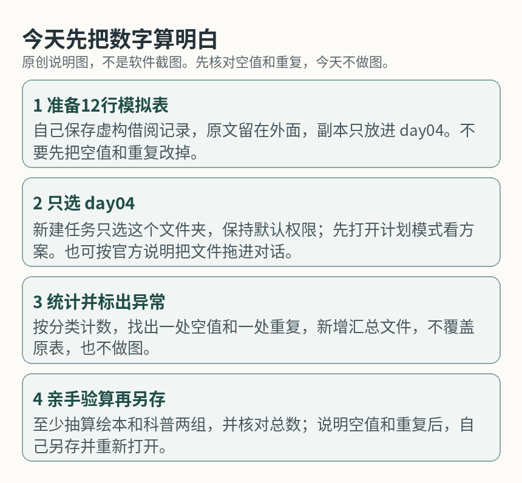
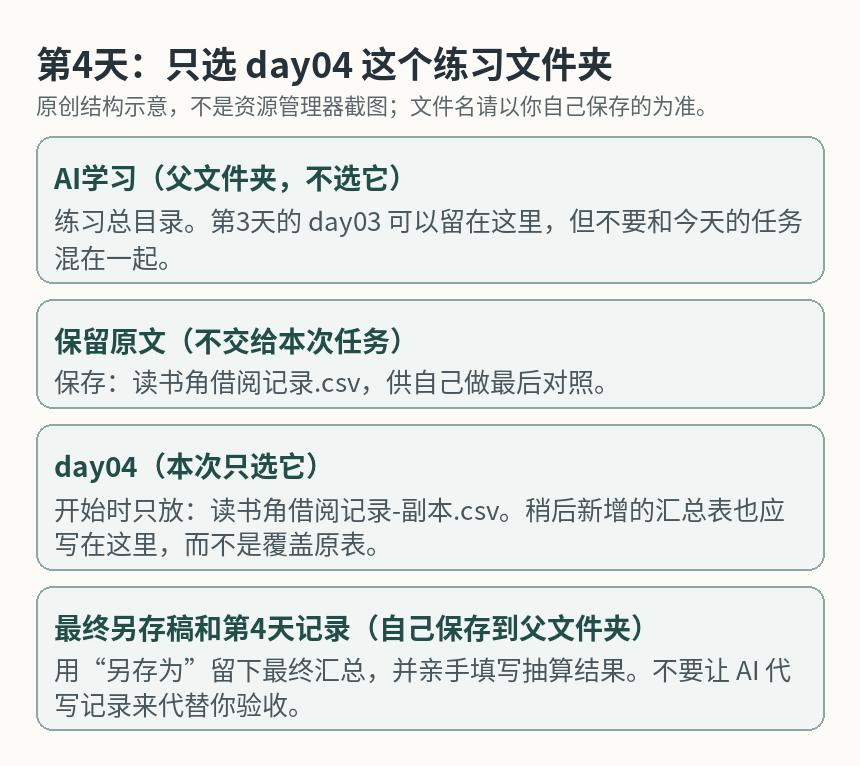
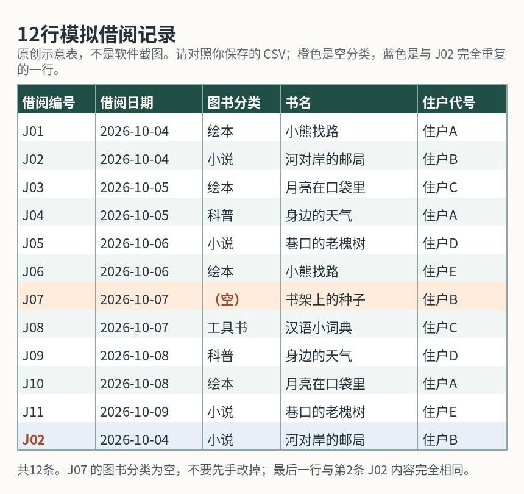
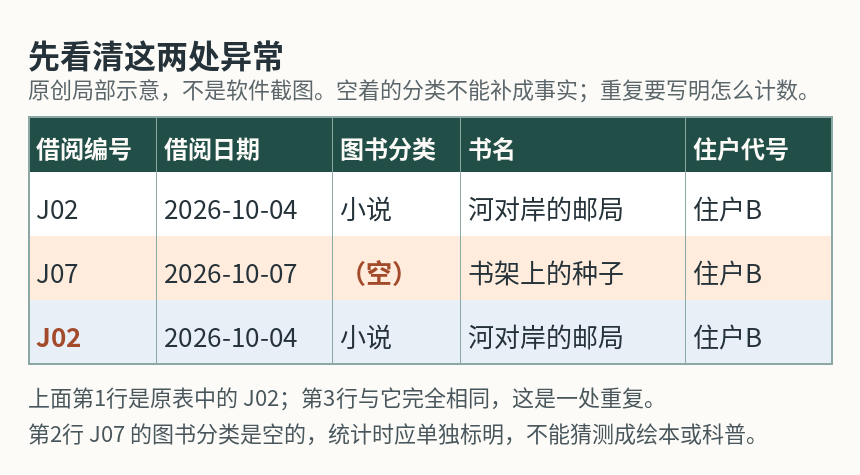
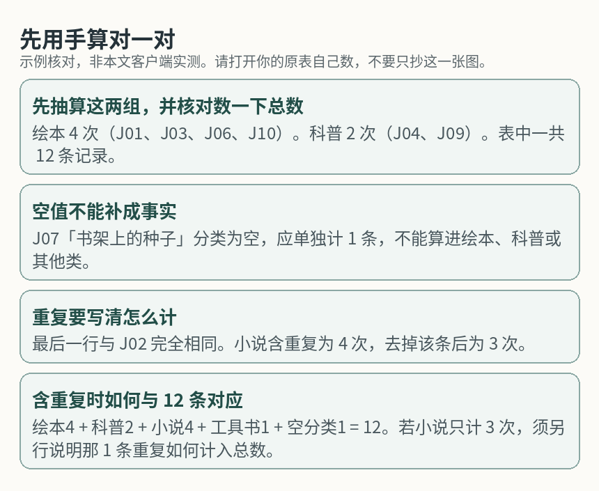
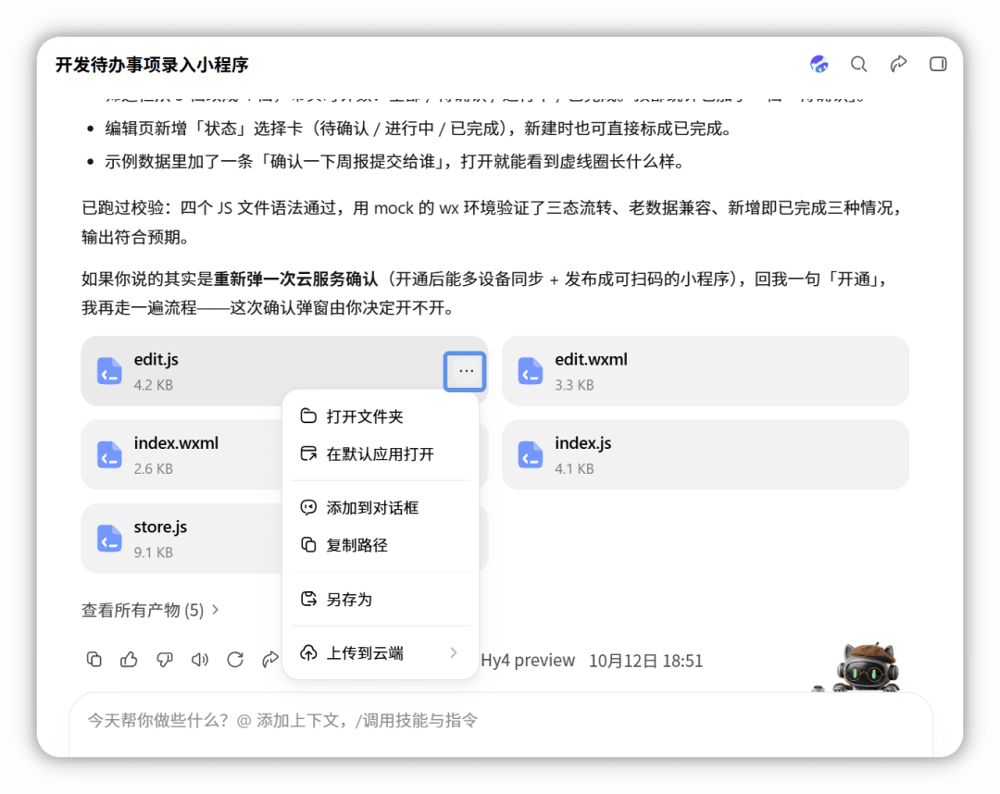

# WorkBuddy 第4天：先把一张小表里的数字算明白

[课程首页](../README.md) · [21单元学习路线](../docs/LEARNING-ROADMAP.md) · [第3天](../day03/README.md)

建议用时：60—90分钟。前置条件：已完成第3天，能预览、另存并重新打开一份文件。本文依据官方资料编排，未在客户端实测；文中手算对照是编辑示例，不是运行回执。第一次统计使用计划 Plan 和默认权限。打开 Plan 不等于权限变成只读。必须新增汇总，不得覆盖原表。空分类保持为空；重复必须写明怎么计数。今天不做图。Word 或表格打不开时，保留 TXT 或 Markdown 并自己另存后重新打开。

> 下载本仓库后，不要把整个仓库、文章目录 `day04` 或 `practice` 选为工作空间。正文要求你亲手建立自己的 `AI学习/day04`，里面开始时只放指定副本；两处目录同名，不是同一个位置。

## 本章目录

- [一、先认识今天要用的几个词](#concepts)
- [二、亲手准备：12行模拟借阅记录](#prepare)
- [三、新建任务：只选 day04，再决定怎么把表交给它](#workspace)
- [四、发第一条任务：先统计，不先做图](#first-prompt)
- [五、自己抽算两组，不要只看“已统计完成”](#check)
- [六、补一段异常说明，再自己另存最终版](#save)
- [七、遇到这些情况，先停在哪里](#troubleshooting)
- [今天学会的，不只是“让 AI 数一数”](#wrap-up)
- [提示词与练习附件](#resources)

第3天，我们先看方案，再把虚构的读书角规则写成第一份可以重新打开的文件。今天不往图表或幻灯片上赶，只做一件更基础的事：让 WorkBuddy 读一张只有12行的小表，按类别数清楚次数，并找出一处空值和一处重复。

仍然不要拿真实的借阅系统、学生名单或客户表来试。我们只用自己写的模拟记录，住户只用代号。今天最重要的不是“AI 会不会做表”，而是你能说清楚：**每类到底有几条？空着的那一格有没有被悄悄补上？重复的那一条是怎么算的？原表还在不在？**


*以Fee照片为参考的情景插画：先从一张能亲手核对的小表开始。*

这节建议预留60—90分钟，卡住可以分两次做。最后应留下三样东西：原来的模拟表、一份汇总表，以及写清楚空值和重复如何处理的说明。今天不要求做图，那是第5天的事。也不安装插件，不连接外部账号，不把练习文件分享或上传到云端。

<a id="concepts"></a>

## 一、先认识今天要用的几个词

**CSV**，就是用逗号把每一列隔开的纯文本表格。它不是一种特殊软件，用记事本、文本编辑，或电脑里已有的表格软件都可以打开。文件名后面的 `.csv` 只是告诉电脑“这是一张用逗号分开的表”，本身不含秘密格式。

**空值**，就是某个格子里什么都没写。今天的表里，有一条记录的“图书分类”是空的。空着就是空着，不能靠猜测补成“绘本”或“科普”，然后再把这个猜测当成事实去统计。

**重复记录**，就是有两条内容完全相同的行。今天的表里，有一条借阅记录出现了两次。你可以选择“两条都计入次数”，也可以选择“只计一次”，但必须写清楚用的是哪一种，不能只报一个数，却不说明有没有把重复算进去。

**汇总表**，是根据原表新做出来的统计结果，例如每类借了几次。它是另存的一份文件，不是把原表直接改掉。

还要记住已经核对过的边界，今天仍然有效：

- 模式管任务怎么做，权限管操作受什么限制。默认 Agent 模式可以执行任务，也可以修改文件，它不等于“只读”。
- 本课保持“默认权限”，不打开“允许完全访问”。默认权限不是保险锁，工作空间里的普通写入不一定每次都来问你。
- “允许完全访问”会影响当前客户端里的所有任务，包括后来新建的任务。今天用不到，也不拿它解决读不懂表格的问题。



*本课步骤总览：准备12行模拟表、只选day04、统计并标出异常、亲手验算后再另存。原创说明图，非软件界面。*

<a id="prepare"></a>

## 二、亲手准备：12行模拟借阅记录

如果前几天已经建好了 `AI学习` 和 `保留原文`，今天直接沿用，不必重做安装。还没有这两个文件夹的同学，可以在自己能管理的位置新建它们。不要选公司共享盘、别人的目录，或已经堆着重要资料的文件夹。

打开 `AI学习`，再建一个新文件夹，命名为 `day04`。这是今天唯一要选给 WorkBuddy 的目录。不要和 `day03` 混在一次任务里，也不要直接选上一级 `AI学习`。

### 第1步：把这张小表保存为 CSV

Windows 打开“记事本”，新建空白文档；Mac 打开“文本编辑”，新建文稿并切换为纯文本。把下面整段复制进去。这是**自制模拟材料**，不是真实借阅系统的导出，也不含个人真实姓名或联系方式。

```text
借阅编号,借阅日期,图书分类,书名,住户代号
J01,2026-10-04,绘本,小熊找路,住户A
J02,2026-10-04,小说,河对岸的邮局,住户B
J03,2026-10-05,绘本,月亮在口袋里,住户C
J04,2026-10-05,科普,身边的天气,住户A
J05,2026-10-06,小说,巷口的老槐树,住户D
J06,2026-10-06,绘本,小熊找路,住户E
J07,2026-10-07,,书架上的种子,住户B
J08,2026-10-07,工具书,汉语小词典,住户C
J09,2026-10-08,科普,身边的天气,住户D
J10,2026-10-08,绘本,月亮在口袋里,住户A
J11,2026-10-09,小说,巷口的老槐树,住户E
J02,2026-10-04,小说,河对岸的邮局,住户B
```

请先自己看两眼，不要急着“把表整理干净”。这里故意留了两处供今天练习的问题：

- `J07` 那一行，`借阅日期` 后面连续有两个逗号，表示“图书分类”是空的。
- 最后一行与第2条 `J02` 的内容完全相同，这是一处重复记录。

保存到 `AI学习/保留原文`，命名为 `读书角借阅记录.csv`。Windows 如果提供编码选项，使用 UTF-8。Mac 若当前是富文本，先从“格式”切为纯文本，再保存。文件名里的 `.csv` 要保留，不要存成 `.txt` 后再改一个看起来像 CSV 的名字。

### 第2步：复制到 day04，不要移动

关闭文档，回到文件夹。选中 `读书角借阅记录.csv`，复制后打开 `day04`，粘贴，并把复制出来的文件改名为 `读书角借阅记录-副本.csv`。先复制再粘贴，不用剪切，这样原文继续留在外面，方便最后对照。

双击副本，确认能看见12条记录、汉字正常，然后关闭。开始练习前，`day04` 里应当只有这一份文件。如果你用表格软件打开后，所有内容挤在第一列，或中文变成乱码，先不要开始统计：回到记事本或文本编辑查看原文字是否完整，再决定是否重新按 UTF-8 保存。不要把已经乱掉的表交给 AI 继续汇总。



*目录关系图：保留原文留在外面，本次只选day04；汇总和记录不要覆盖原表。原创结构示意，非资源管理器截图。*



*自制12行模拟借阅记录：请对照你保存的文件，J07分类为空，最后一行与J02完全重复。原创示意表，不是软件截图。*

<a id="workspace"></a>

## 三、新建任务：只选 day04，再决定怎么把表交给它

打开 WorkBuddy，点“新建任务”。不要接着第3天的聊天继续做表，今天需要一个范围明确的新任务。

在输入框下方找到“选择工作空间”，按当前界面选择本地文件夹，进入 `AI学习/day04` 后确认。这里选的是**文件夹**，不是只点那一份 `.csv` 文件，也不是误选 `day03` 或上一级 `AI学习`。确认前停两秒，看末尾是不是 `day04`。选错了，先不要发送任务，回到入口重选。

今天把表交给 WorkBuddy，可以用下面两种办法，选一种即可：

- **工作空间里已有文件：** 副本已经放在 `day04` 里，选对目录后，在提示词中写明文件名。这和前几天指定文本文件的方法一样。
- **拖入对话：** 官方说明，可以把本地文件拖到页面上，看到“松开即可添加文件”后再松开。文件会进入输入框的附件区域，**不会自动发送**，你还可以继续改提示词。也可以使用添加文件或上传入口，具体名称以当前界面为准。


*官方界面：把文件拖到页面时，会出现松开即可添加文件的提示。图为官方示意，非作者实测，也不是本课的借阅表。*

两种方法都不要把同一份表再复制到桌面或其他目录去“多导入一次”，以免后来分不清读的是哪一份。如果拖入后提示文件类型不受支持，先取消，改用“选中 day04、写明文件名”的方式；不要为了导入成功去安装未知插件，或打开完全访问。

接着保持“默认权限”，不要打开“允许完全访问”。然后在输入框左侧点“＋”，找到“模式”，打开“计划 Plan”，并确认“仅问答 Ask”是关闭的。今天要读表、统计、说明异常并新增文件，步骤不止一件，所以先看方案再执行。打开 Plan，不等于权限变成只读，也不等于可以跳过你自己的验算。

<a id="first-prompt"></a>

## 四、发第一条任务：先统计，不先做图

发送前再看一眼：目录是 `day04`，里面暂时只有借阅记录副本；模式是计划 Plan，权限仍为默认。准备好后，把下面整段复制到输入框，再发送。这里没有把12行记录再贴一遍，这样你才能检查：它是真的读到了指定文件，还是在发挥聊天框里已经出现的内容。

```text
这是一次本地表格核对练习。请只处理当前工作空间根目录中的
“读书角借阅记录-副本.csv”。

请先阅读这一份文件，再给出一份可审阅的执行方案，等我确认后再执行。

目标：
1. 按“图书分类”统计每类出现的次数。
2. 找出表中一处空值（分类为空的记录）和一处重复记录，并写清楚位置。
3. 在当前工作空间根目录新增一份汇总表，建议文件名为“借阅分类汇总.csv”。如果无法生成 CSV，可保存为 TXT 或 Markdown，并说明降级原因和实际文件名。
4. 在汇总中写明：各类次数、空值在哪一条、重复是哪一条、重复是按“计两次”还是“只计一次”处理的，以及这些次数如何与总条数对应。

必须遵守：
1. 只使用该文件里的记录，不要联网补充图书或读者信息，不要给空分类补上你猜测的类别。
2. 必须新增文件，不得覆盖、修改、删除或重命名“读书角借阅记录-副本.csv”，也不得改写其他目录中的文件。
3. 今天不要生成图表或演示文稿。
4. 不连接外部账号，不安装工具或插件，不运行我看不懂的脚本。
5. 如果读不到文件、出现乱码，或必须申请额外权限、访问其他目录才能继续，请先停下来说明原因，不要执行。

请在方案中写清：将读取哪个文件、将新建的文件名、会不会改动原表、空值是否保持为空、重复准备如何计数。
```

方案出来后，先核对这几件小事，再确认执行：

- 它要读的是 `读书角借阅记录-副本.csv`，不是第3天的规则文档，也不是外面的原文。
- 它准备新增汇总文件，并且不会覆盖或修改输入副本。
- 它不会把 `J07` 的空分类补成某一类书。
- 它会说明重复记录怎么计数。
- 它今天不画图，不要求打开完全访问，不要求安装插件，也不访问其他目录。

只要有一条对不上，就先调整方案，不要确认执行。可以把下面这段复制过去：

```text
请先不要执行。请按下面几点调整方案后再给我看：
1. 必须新增汇总文件，不能覆盖或修改“读书角借阅记录-副本.csv”。
2. 分类为空的记录保持为空，不要补类别。
3. 写明重复记录按“计两次”还是“只计一次”。
4. 今天不要生成图表。
调整后请再次列出：读取的文件、新建的文件名、空值如何处理、重复如何计数。
```

方案正确后，再按当前界面的确认或“开始执行”入口继续。若找不到这类入口，或出现你不认识的授权、命令、安装请求，先停下来对照最新官方说明，不要为了看到汇总一路点“允许”。


*以Fee照片为参考的情景插画：数字出来以后，先停一下，自己对一对。*

<a id="check"></a>

## 五、自己抽算两组，不要只看“已统计完成”

确认执行后，成功不是它写“汇总已完成”，而是你能指着原表，把关键数字对上。

先到结果区查看产物或工作空间文件，确认汇总是**新增加的文件**，再打开 `day04` 里的 `读书角借阅记录-副本.csv`，用记事本、文本编辑或已有表格软件自己数。今天至少抽算下面两组，并核对数一下总共有多少条：

- **绘本**应是 4 条：J01、J03、J06、J10。
- **科普**应是 2 条：J04、J09。
- **总条数**应是 12 条（含 1 条空分类和 1 条完全重复的记录）。

这两行，是今天用来验收的“标准答案”中最容易亲手核对的部分。小说和工具书也可以再数，但先把这两组和总数对上，比一次相信全部类别更稳妥。

接着检查两处异常，不要略过：



*异常行局部：J07的图书分类是空的；表末又出现一条与J02完全相同的记录。原创示意，不是软件截图。*

**空值有没有被补成事实？** `J07` 的书名是“书架上的种子”，分类本来就是空的。如果汇总里把它写成绘本、科普或其他类别，再据此加了一次，这就是把猜测当成了事实。应标成“分类为空，未计入任何一类”，或单独列为“空分类 1 条”。

**重复是怎么处理的？** 最后一行与 `J02` 完全相同。小说若“含重复”计为 4 次，去掉那条完全相同的记录后是 3 次。两种算法都可以，但汇总必须写明用的是哪一种，并且能和 12 条对上：含重复时，绘本 4、科普 2、小说 4、工具书 1，再加空分类 1 条，合计 12；若小说只计 3 次，则需要另外说明那 1 条重复记录是如何计入总数的。

下面是一组供对照的手算结果，**示例，非本文客户端实测**：



*汇总与手算对照：先核对绘本和科普，再看空值与重复是否被说清楚。原创说明图，不是软件截图。*

还要确认：输入副本仍在，12 行内容没有被改写；`保留原文` 里的原表也还在。如果发现原表被改，或只剩下“清理后的最终表”，先停止并记录，不要立刻让 AI“恢复一下”以免覆盖现场。

如果只在聊天里看到一串数字，却没有任何汇总文件，先分清：是只输出了文字，还是文件已生成但还没找到。可到结果区查看产物，或用“打开文件夹”“复制路径”定位。仍没有文件，就记录“尚未生成汇总文件”，不要把聊天稿说成已经交卷。打不开表格文件时，先保留文本或 Markdown 版本，并记下降级，不安装不明插件。

<a id="save"></a>

## 六、补一段异常说明，再自己另存最终版

如果第一份汇总已经把空值、重复和两类抽算都写清楚，这一步就做一次小确认，要求它把说明补进汇总文件，避免只写在聊天里。如果空值被补上了，或重复没说明，也用同一段提示词要求改正。先关掉 Plan，回到默认 Agent 模式，再发送；如果 Plan 还开着，就当作又一次方案来审阅，确认后再执行。权限仍保持默认。

```text
请只修改刚才新生成的汇总文件，不要改“读书角借阅记录-副本.csv”，也不要生成图表。

请补上或改准以下说明：
1. 空分类必须保持为空，不要补成任何图书类别；写明是哪一条（借阅编号）。
2. 分别写出“含重复记录时”和“去掉那条完全重复记录后”的各类次数。
3. 核对：含重复时，各类次数加上空分类条数，是否等于表中的 12 条。

不联网，不安装工具，不访问其他目录。若必须申请额外权限才能继续，请先停止并说明。
```

改完后再看一遍：绘本仍是 4，科普仍是 2，`J07` 仍不被归入任何一类，重复说明清楚，原表没被改。确认后，在产物卡片右侧找到“⋯”，按当前界面使用“另存为”，把最终汇总保存到 `AI学习` 父文件夹，文件名可写成 `借阅分类汇总-最终版.csv`，或按实际格式改成 `.txt`、`.md`。不要另存到输入副本上，也不要覆盖 `保留原文`。



*官方示意：产物卡片菜单里可以看到另存为、打开文件夹和在默认应用打开。图中文件是官方示例，不是本课材料；今天不要使用上传到云端。*

另存后，到刚才选择的位置双击最终版，确认能重新打开，并且绘本 4、科普 2、空值和重复说明都还在。也可以先点“在默认应用打开”。这就是今天的“本地重新打开”：不是只在聊天里看过一眼数字，而是你自己能再次找到这份汇总。

最后，自己打开记事本或文本编辑，把下面模板填好，保存为 `第4天记录.txt`，放在 `AI学习` 父文件夹，不要交给 AI 代写到 `day04` 里代替你验收。

```text
我的WorkBuddy第4天记录

练习目录：（自己填写实际选择的位置，不公开个人路径）
工作模式：第一次统计使用计划 Plan；后续补充说明：（填写当时模式）
权限状态：默认权限；允许完全访问关闭

输入副本是否仍在，12行内容是否未改：（自己核对后填）
汇总文件名与格式：（填写）
是否降级为 TXT 或 Markdown：（是/否，原因）
亲手抽算：绘本次数、科普次数、总条数：（自己填写）
空分类是否保持为空，对应哪一条：（自己核对后填）
重复记录如何计数，是否写清楚：（自己核对后填）
是否用“另存为”或本机应用重新打开最终版：（填写打开方式）
遇到的乱码、分隔问题或权限请求、自己如何处理：（没有就写无）
```

保存后关闭，再找到 `第4天记录.txt` 双击打开。内容没有乱码，检查项是你自己核对的结果，今天才算完成。若数字对不上，或尚未生成可打开的汇总，记录“未完成”和卡点，不要填成全部通过。


*以Fee照片为参考的情景插画：数字对上了，再把汇总另存并重新打开。*

<a id="troubleshooting"></a>

## 七、遇到这些情况，先停在哪里

**中文乱码，或所有内容挤在一列。** 先用记事本或文本编辑打开副本，确认逗号和汉字还在。常见原因是编码不是 UTF-8，或表格软件没有按逗号分列。先修正小样本的打开方式，不要把已经错乱的内容继续拿去汇总。

**数字变成了文字，或日期、编号被改样。** 例如 `J07` 变成其他编号，或次数对不上你亲手数的结果。先停止，回到原表核对，不能把错误输入接着写成报告。

**它把空分类补成了某一类书。** 这不算统计完成。要求它改回“分类为空”，并说明是哪一条。在此之前，不要采用这份汇总里的分类总数。

**它只给出漂亮的图表，没有可核对的汇总表。** 今天的任务不是做图。可以保留聊天里的说明，但请它改回输出汇总表和异常说明；第5天再在核对过的数字上做一张图。

**只得到文字，没有文件。** 先到结果区查找产物和工作空间文件。仍没有文件，就记录卡点，不要反复让它重写，也不要打开完全访问碰运气。

**输入副本被改了，或只剩下一份“清洗后的表”。** 先停止，对照 `保留原文`。今天的成功标准之一，就是原表还在。

**它要运行命令、安装工具，或申请完全访问。** 看不懂就取消。完全访问会影响当前客户端的所有任务，今天不要用它解卡。分隔符或编码问题，应在小范围内排查，而不是扩大权限。

**任务一直跑，或开始处理 day04 以外的材料。** 用执行中的停止入口中断。停止不等于撤销已经发生的变化，随后检查文件夹。

**界面和本文示意图不完全一样。** 官方图是示意，不是你这一版的实测截图，图中的文件内容也不是本课借阅表。以你当前界面和最新官方说明为准；对不上时先停，不靠猜测点击。

<a id="wrap-up"></a>

## 今天学会的，不只是“让 AI 数一数”

不看上面的步骤，你能不能自己说出：绘本和科普各有几条、空着的那一格为什么不能补、重复的那一条你打算怎么算，以及汇总文件是另外新增的还是把原表改掉了？能做到这些，今天的练习就有价值。

第5天会只用已经核对过的汇总数，回答“哪类图书借得最多”，并做一张图。今天先把数字本身算明白，后面的图才有根据。现在不要提前做图，也不要把这12行模拟记录说成某个城市的阅读趋势。

---

资料与图片说明：本文为原创教学编排，操作依据为腾讯 WorkBuddy 官方《创建任务》《实践三：数据分析与可视化》《新建任务栏》《结果查看》《默认权限与安全沙箱》，核查于2026年11月22日（北京时间）。界面图为官方示意，非作者客户端实测，图中示例文件也不是本课材料；人物情景插画以作者本人照片为参考，复用第2、第3天已确认的形象插画；步骤图和样例表为原创说明图。界面可能随版本变化，遇到不一致以当前官方说明为准。官方文档入口：[创建任务](https://www.workbuddy.cn/docs/workbuddy/Create-Task)、[实践三](https://www.workbuddy.cn/docs/workbuddy/From-Beginner-to-Expert-Guide/Practice-Cases/Practice-Three)、[结果查看](https://www.workbuddy.cn/docs/workbuddy/Results)。

<a id="resources"></a>

## 提示词与练习附件

- [全部可复制提示词](resources/prompts.md)，与正文五个文本块逐字一致。
- [人工验收表](resources/checklist.md)，数字对不上或没有可打开的汇总时记“未完成”，不要代填成功。
- [手算对照（非实测）](resources/example-not-tested.txt)，只用来对照母稿写明的抽算口径，不是软件生成的汇总。
- [目录与核对记录卡](practice/第4天记录-模板.txt)，由你手动填写，保存到自己的 `AI学习` 父目录。
- [练习材料说明](practice/README.md)，附自制原表与副本供核对；不能把整套材料当成工作空间。
- [资料与图片归属](SOURCES.md)，保留官方示意与未实测说明，不另加自有图片许可证。

[返回第3天](../day03/README.md) · [返回课程首页](../README.md)

第5天仍仅为规划，尚无课文链接；请先完成本章验收。
