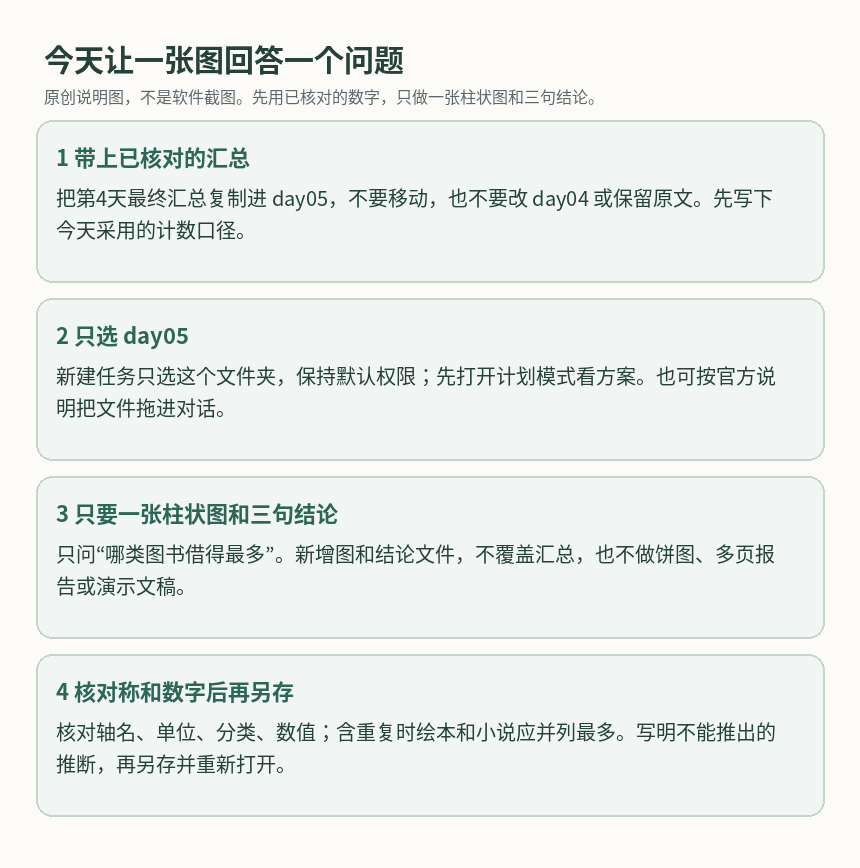
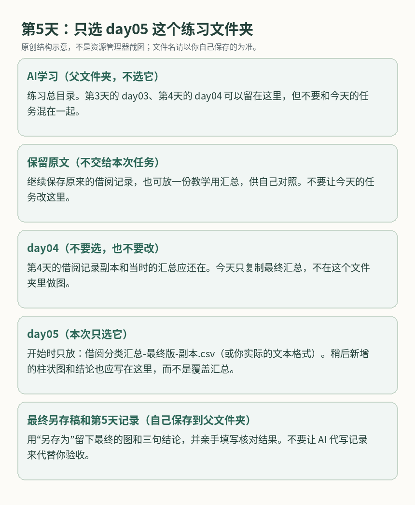
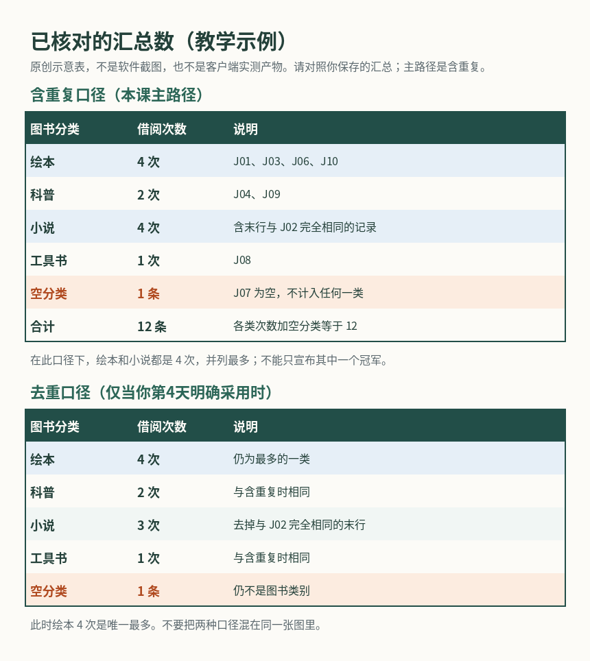
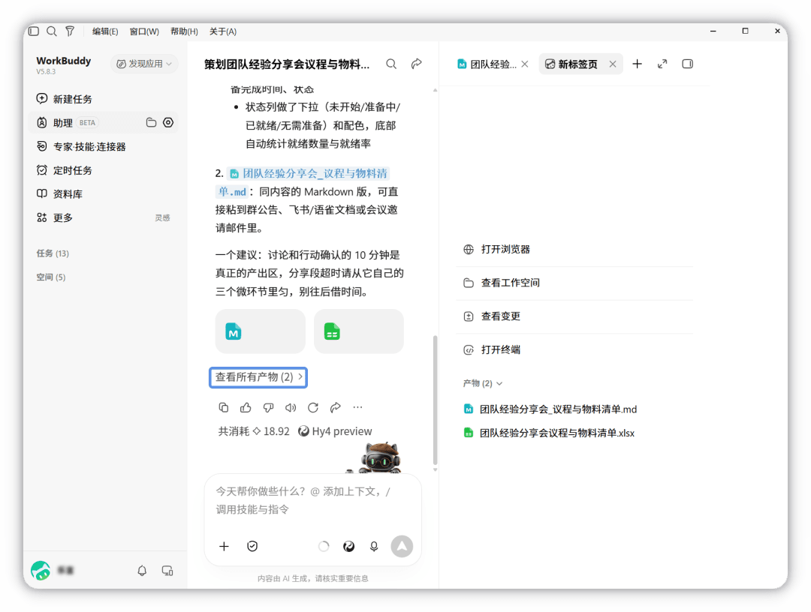
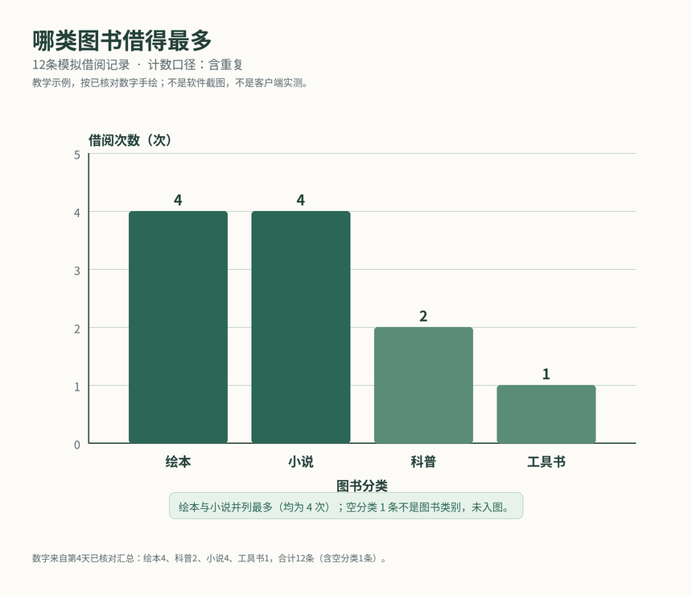
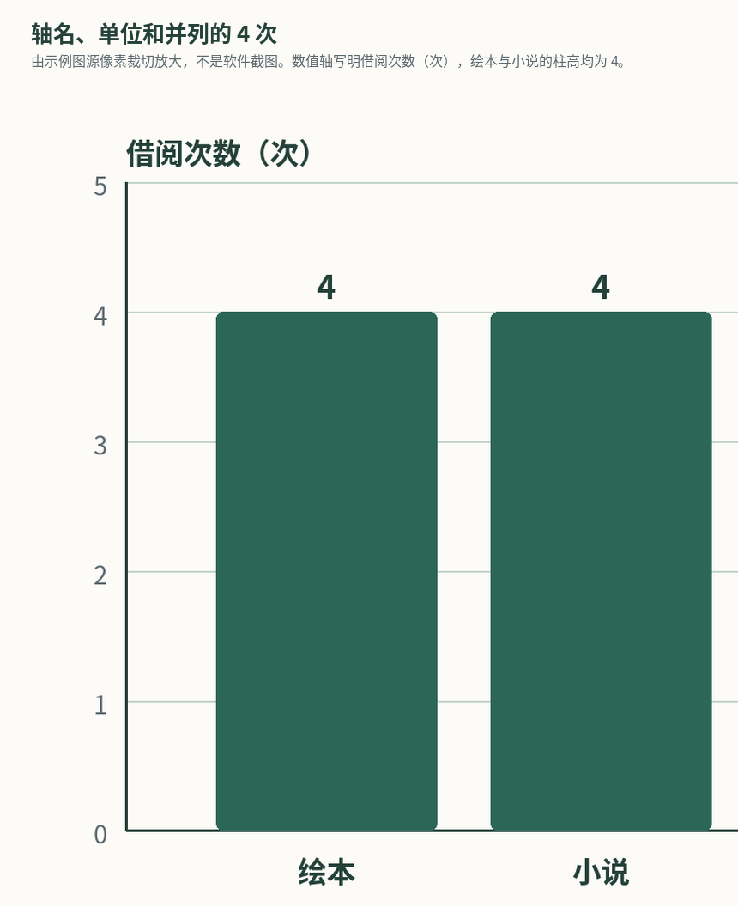
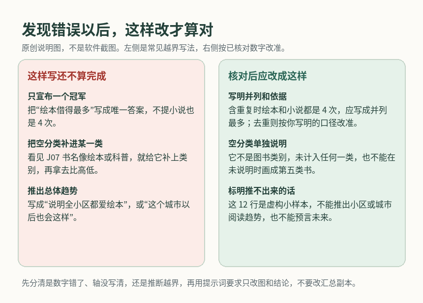
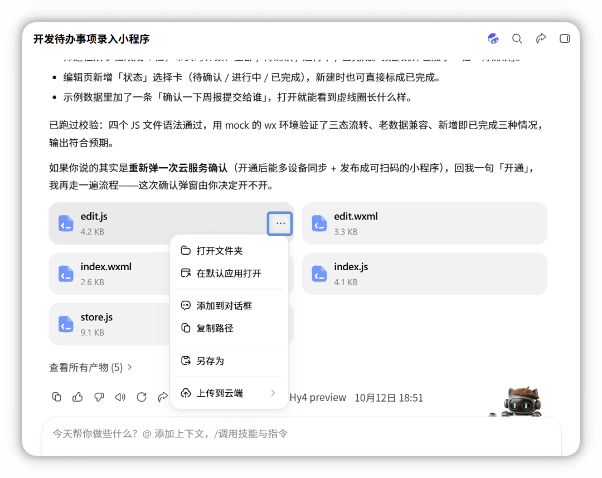

# WorkBuddy 第5天：让一张图回答一个问题

[课程首页](../README.md) · [21单元学习路线](../docs/LEARNING-ROADMAP.md) · [第4天](../day04/README.md)

建议用时：60—90分钟。前置条件：已完成第4天，手里有一份核对过的分类汇总。本文依据官方资料编排，未在客户端实测；文中的柱状图和三句结论示例不是运行回执。第一次做图使用计划 Plan 和默认权限。打开 Plan 不等于权限变成只读。必须新增图和结论，不得覆盖汇总。含重复时绘本和小说都是 4 次，并列最多；空分类不是图书类别，不画成第五类柱。去重口径只把小说改为 3，不能和含重复合用成唯一冠军。不能从这 12 行模拟记录推出小区或城市趋势。

> 下载本仓库后，不要把整个仓库、文章目录 `day05` 或 `practice` 选为工作空间。正文要求你亲手建立自己的 `AI学习/day05`，里面开始时只放汇总副本；两处目录同名，不是同一个位置。不要把 `借阅分类柱状图.png` 或 `借阅三句结论.txt` 提前放进这个练习目录。

## 本章目录

- [一、先认识今天要用的几个词](#concepts)
- [二、亲手准备：把核对过的汇总放进 day05](#prepare)
- [三、新建任务：只选 day05](#workspace)
- [四、发第一条任务：只问一个问题，只要一张柱状图](#first-prompt)
- [五、对着图核对四件事，再看三句结论](#check)
- [六、追问修改，再自己另存并重新打开](#revise-save)
- [七、遇到这些情况，先停在哪里](#troubleshooting)
- [今天学会的，不只是“让 AI 画一张图”](#wrap-up)
- [提示词与练习附件](#resources)

第4天，我们把12行虚构借阅记录的分类次数算明白了：空着的格子没有被补成事实，重复怎么计数也写清楚了。今天不重新统计一遍，也不提前做幻灯片。只做一件事：用已经核对过的汇总数，回答“哪类图书借得最多”。最后应留下一张能重新打开的柱状图，加上三句有数字依据的结论，并写明从这12行模拟记录里不能推出什么。

仍然不要拿真实的借阅系统、全城数据或学生名单来试。这12行是教学模拟，住户只有代号。今天最重要的不是图漂不漂亮，而是你能指着图说清楚：**轴叫什么、单位是什么、每一类的高度是不是和昨天核对过的数字一致？哪三句话站得住，哪一句其实推不出来？**


*以Fee照片为参考的情景插画：数字已经核对过，今天只用一张图回答一个问题。*

这节建议预留60—90分钟，卡住可以分两次做。如果图的渲染或字体出现异常，先保留已经核对过的汇总和文字结论；数据正确优先于图好看，修图可以再加一次练习。不安装插件，不连接外部账号，不把练习文件分享或上传到云端。

<a id="concepts"></a>

## 一、先认识今天要用的几个词

**柱状图**，就是用柱子的高低来比较数量。今天要比较的是各类图书的借阅次数：分类写在一条轴上，次数写在另一条轴上，单位是“次”。它不是装饰，而是把已经核对过的数字用高低表示出来，方便你一眼看到谁高、谁低、有没有打平。

**轴名、单位、分类、数值**，是看图时必须核对的四件事。轴名告诉你比较的是什么，单位告诉你数字的含义，分类名称要和汇总里的类别一致，柱子的高度（或标注的数字）要和核对过的次数一致。缺了其中一项，图再整齐也不能算通过。

**证据**，是图和汇总里已经写明的数字，例如“绘本 4 次”。**推断**，是在这些数字之外另外做出的更大判断，例如“全小区都爱绘本”。今天的三句结论必须能指回证据；推不出来的话，要明确写出来，不能让它混进结论里。

**并列最多**，就是两类（或更多类）的次数相同，都排在第一。这时应当如实写成并列，不能随便挑一个当“冠军”。

还要记住已经核对过的边界，今天仍然有效：

- 模式管任务怎么做，权限管操作受什么限制。默认 Agent 模式可以执行任务，也可以修改文件，它不等于“只读”。
- 本课保持“默认权限”，不打开“允许完全访问”。默认权限不是保险锁，工作空间里的普通写入不一定每次都来问你。
- “允许完全访问”会影响当前客户端里的所有任务，包括后来新建的任务。今天用不到，也不拿它解决图做不出来或字体不好看的问题。

官方《实践三》建议：先说清要回答什么问题，再决定图表形式；先产出基础版本，再逐轮补充。今天就按这个最小范围来——只回答一个问题，只做一张柱状图，再写三句结论。



*本课步骤总览：带上已核对的汇总、只选day05、要一张柱状图和三句结论、核对称后再另存。原创说明图，非软件界面。*

<a id="prepare"></a>

## 二、亲手准备：把核对过的汇总放进 day05

先在第4天用过的 `AI学习` 总目录里，新建一个名为 `day05` 的文件夹。不要接着第4天的聊天继续做图，今天需要一个范围明确的新任务。

把第4天你自己另存并重新打开过的最终汇总，**复制**一份到 `day05`，不要移动，也不要改 `day04` 里的文件。副本文件名可以写成 `借阅分类汇总-最终版-副本.csv`；如果你第4天保存的是 `.txt` 或 `.md`，就保持同样的扩展名，只在文件名里加上“副本”。`保留原文` 和 `day04` 都不要交给今天的任务去改。

如果第4天还没有留下最终汇总，可以使用本课练习材料里的教学汇总。它按第4天已经核对过的“含重复”口径写明：绘本 4、科普 2、小说 4、工具书 1、空分类 1，合计 12。这是编辑根据同一张12行模拟表整理的教学稿，**不是客户端实测产物**。把它复制进 `day05` 后，你仍然要自己再看一遍数字。需要自己新建这份文件时，可把下面这段保存为 `借阅分类汇总-最终版.csv`，再复制到 `day05` 并改名为副本。

```text
计数口径,图书分类,借阅次数,说明
含重复,绘本,4,J01、J03、J06、J10
含重复,科普,2,J04、J09
含重复,小说,4,含最后一行与J02完全相同的记录
含重复,工具书,1,J08
含重复,空分类,1,J07分类为空，未计入任何一类
含重复,合计,12,各类次数加空分类等于12条
```

若你第4天采用的是“去掉那条完全重复记录后，小说计 3 次”，请以你自己写明的口径为准，不要和这篇“含重复”的示例混用。两种口径都可以继续做今天的图，但图上的数字必须和你核对过的汇总一致。



*目录关系图：保留原文和day04都不要改；本次只选day05，放入汇总副本，稍后在这里新增图和结论。原创结构示意，非资源管理器截图。*

打开 `day05` 里的汇总副本，对照下面这张表，确认你今天准备采用的口径和数字。主教学路径是“含重复”：绘本和小说都是 4 次，后面回答“哪类借得最多”时，这是一个必须写清楚的并列，而不是可以随便选边的问题。



*已核对汇总数：含重复时绘本4、小说4并列最多；去重后绘本4为唯一最多。空分类1条不是图书类别。原创示意表，非软件截图、非实测产物。*

看完后在纸上或第5天记录里先写下一句：我今天用的是“含重复”还是“去重”，最多的是哪一类、各是几次。这句先由你自己写，不要等图出来再倒推。

<a id="workspace"></a>

## 三、新建任务：只选 day05

打开 WorkBuddy，点“新建任务”。不要接着第4天的聊天继续做图。

在输入框下方找到“选择工作空间”，按当前界面选择本地文件夹，进入 `AI学习/day05` 后确认。这里选的是**文件夹**，不是只点那一份汇总文件，也不是误选 `day04` 或上一级 `AI学习`。确认前停两秒，看末尾是不是 `day05`。选错了，先不要发送任务，回到入口重选。

今天把汇总交给 WorkBuddy，可以用下面两种办法，选一种即可：

- **工作空间里已有文件：** 副本已经放在 `day05` 里，选对目录后，在提示词中写明文件名。这和前几天指定文件的方法一样。
- **拖入对话：** 官方说明，可以把本地文件拖到页面上，看到“松开即可添加文件”后再松开。文件会进入输入框的附件区域，**不会自动发送**。也可以使用添加文件或上传入口，具体名称以当前界面为准。

两种方法都不要把同一份汇总再复制到桌面去“多导入一次”，以免后来分不清读的是哪一份。如果拖入后提示文件类型不受支持，先取消，改用“选中 day05、写明文件名”的方式；不要为了导入成功去安装未知插件，或打开完全访问。

接着保持“默认权限”，不要打开“允许完全访问”。然后在输入框左侧点“＋”，找到“模式”，打开“计划 Plan”，并确认“仅问答 Ask”是关闭的。今天要读汇总、生成一张图、写出三句结论并新增文件，步骤不止一件，所以先看方案再执行。打开 Plan，不等于权限变成只读，也不等于可以跳过你自己对图的核对。

<a id="first-prompt"></a>

## 四、发第一条任务：只问一个问题，只要一张柱状图

发送前再看一眼：目录是 `day05`，里面此时应有汇总副本；模式是计划 Plan，权限仍为默认。准备好后，把下面整段复制到输入框，再发送。请把文件名改成你实际使用的名字。

```text
这是一次本地图表练习。请只处理当前工作空间根目录中的
“借阅分类汇总-最终版-副本.csv”。

请先阅读这一份汇总，再给出一份可审阅的执行方案，等我确认后再执行。

我要回答的唯一问题是：哪类图书借得最多？

已人工核对的计数口径如下（请严格使用，不要另改口径，也不要重新发明数字）：
含重复记录时：绘本 4 次，科普 2 次，小说 4 次，工具书 1 次，空分类 1 条，合计 12 条。
（如果该汇总文件明确写的是去重口径，则以文件中写明的数字为准，并在结论里注明。）

请完成：
1. 只用上面这些已核对的分类次数，做一张柱状图。分类轴为图书分类，数值轴为借阅次数，单位为“次”。图上应能看清轴名、单位、分类名称和数值。
2. 柱状图只比较绘本、科普、小说、工具书这四类；空分类 1 条不是图书类别，不要补进任何一类，也不要在未说明的情况下画成第五类书。
3. 另外新增一份结论文件，只写三句：哪类最多（若次数相同须写明并列）及依据的数字；其他类别和空分类如何处理；从这 12 行模拟记录不能推出小区、城市阅读趋势或未来还会怎样。
4. 建议文件名为“借阅分类柱状图.png”和“借阅三句结论.txt”。如果无法生成 PNG 或 TXT，可改用其他可打开的图片或文本格式，并说明降级原因和实际文件名。

必须遵守：
1. 只使用该汇总里已核对的数字，不要联网补充数据，不要重新统计原借阅明细来改口径。
2. 必须新增文件，不得覆盖、修改、删除或重命名“借阅分类汇总-最终版-副本.csv”，也不得改写其他目录中的文件。
3. 今天只要一张柱状图和三句结论，不要生成饼图、折线图、多页分析报告或演示文稿。
4. 不连接外部账号，不安装工具或插件，不运行我看不懂的脚本。
5. 如果读不到文件、图表渲染或字体出现异常，或必须申请额外权限、访问其他目录才能继续，请先停下来说明原因，不要执行。若图无法生成，请先保留文字结论和数字。

请在方案中写清：将读取哪个文件、采用哪种计数口径、将新建的图和结论文件名、会不会改动汇总、空分类如何处理、会不会另外做其他图表。
```

先看方案，不要急着点执行。方案里至少要能对上下面几点：

- 它读取的是 `day05` 里你指定的汇总，而不是重新去改 `day04` 或 `保留原文`。
- 它使用的计数口径和次数，和你刚刚写下的一致。
- 它只做一张柱状图，另外用一个文件写出三句结论；今天不生成饼图、折线图、多页分析报告或演示文稿。
- 空分类不被补成某一类书，也不在未说明的情况下冒充第五类图书。
- 它会新增文件，不会覆盖汇总副本。
- 它不要求打开完全访问，不安装插件，也不访问其他目录。

若方案把任务扩大成“完整可视化报告”，或准备同时做好几张图，先不要执行。用下面这段请它改回去，再看一版方案。

```text
请先不要执行。请按下面几点调整方案后再给我看：
1. 必须新增图和结论文件，不能覆盖或修改“借阅分类汇总-最终版-副本.csv”。
2. 只做一张柱状图，不要同时做饼图、折线图、多页报告或演示文稿。
3. 含重复时绘本和小说都是 4 次，须按并列最多来写；空分类不是图书类别，不能补类别。
4. 三句结论必须写明证据，并指出不能从这 12 行模拟记录推出小区或城市阅读趋势。
调整后请再次列出：读取的文件、计数口径、新建的文件名、空分类如何处理。
```

方案对得上以后，再按当前界面确认执行。执行过程中如果要停，可使用输入框附近的停止入口；中断后仍可补充说明，但停止不等于撤销已经发生的变化，随后要检查文件夹。

图和结论生成后，先到结果区查看产物或工作空间文件，确认是**新增加的文件**。可以在预览里先看一眼，但不要只看聊天里的缩略图或一段描述就当作已经交卷。



*官方示意：结果区可以查看产物、工作空间文件和预览。图为官方示意，非作者实测，图中文件也不是本课的借阅图。*

<a id="check"></a>

## 五、对着图核对四件事，再看三句结论

用“在默认应用打开”或本机已有的看图方式，打开那张柱状图。然后按下面四项逐项核对。本课主示例按“含重复”口径；如果你用的是去重口径，请改成与你汇总一致的数字。

- **轴名：** 一条轴应是“图书分类”（或同样清楚的类别名称），另一条轴应是“借阅次数”或“次数”。
- **单位：** 应能看出比较的是“次”，而不是百分比、人数或金额。
- **分类：** 应出现绘本、科普、小说、工具书。空分类 1 条不是图书类别，不应在未加说明的情况下，画成跟这四类并列的“第五类书”，更不能被补进其中一类。
- **数值：** 含重复时，绘本 4、科普 2、小说 4、工具书 1。绘本和小说一样高，都是最多；不能只给绘本一根更高的柱，或把小说画成 3 却声称这是含重复的结果。

下面这张是编辑根据已核对数字手绘的教学示例，用来示范轴名、单位、分类和数值应如何对上。它**不是** WorkBuddy 客户端截图，也不是本次练习的实测产物。请打开你自己生成的图来核对，不要只抄这张示意图。



*教学示例柱状图：含重复口径下绘本与小说均为4次，并列最多。原创说明图，不是软件截图，也不是客户端实测结果。*

再看局部：分类名称有没有写全，柱上或轴上的数字是不是 4、2、4、1，单位是不是“次”。手机上看整图觉得挤时，就对着这一类局部看。



*轴与数字局部：分类轴为图书分类，数值轴为借阅次数（次），绘本与小说的柱高均为4。原创局部示意，由示例图源像素放大，不是软件截图。*


*以Fee照片为参考的情景插画：图出来以后，先停一下，核对称和数字。*

三句结论要能指回这些数字，并写明不能推出的推断。可以对照下面这个主示例（含重复口径）检查，但最终以你打开的结论文件为准：

1. 在这 12 条模拟记录、按“含重复”核对过的汇总数里，绘本和小说都是 4 次，并列最多；不能只宣布其中一类“借得最多”。
2. 科普 2 次，工具书 1 次；空分类有 1 条，它不是图书类别，不能补进任何一类后再比较高低。
3. 不能从这 12 行虚构记录推出某个小区或城市的阅读趋势，也不能据此判断“以后还会这样”或“大家更爱某一类书”。

若你采用去重口径，第 1 句应改为：去掉那条完全重复记录后，绘本 4 次是最多的一类，小说为 3 次；第 2、第 3 句的限制仍然成立。

如果图是对的，但结论写成了“绘本独一最多，说明全小区都爱绘本”，这不算完成。如果结论写对了，图上的数字却对不上，同样要改。发现错误后，先分清是数字错了、轴没写清，还是推断越界，再用下一节的提示词要求修改。



*发现错误后的修正对照：左侧把并列说成独一冠军并推出全小区趋势，右侧按数字写明并列，并标明不能推出的推断。原创说明图，不是软件截图。*

<a id="revise-save"></a>

## 六、追问修改，再自己另存并重新打开

如果第一份图和结论已经把轴、单位、分类、数值和三句限制都写清楚，这一步就做一次小确认，要求它把需要保留的说明写进结论文件，避免只写在聊天里。如果数字错了、漏了轴名，或把推断写成了结论，也用同一段提示词要求改正。先关掉 Plan，回到默认 Agent 模式，再发送；如果 Plan 还开着，就当作又一次方案来审阅，确认后再执行。权限仍保持默认。

官方说明，你可以在同一个任务里补充要求、调整已有结果或继续追问，不必把背景再讲一遍。请把下面这段里的文件名改成你实际看到的名字。

```text
请只修改刚才新生成的柱状图和结论文件，不要改“借阅分类汇总-最终版-副本.csv”，也不要新增饼图、报告或演示文稿。

请按下面几点补上或改准：
1. 图上必须有清楚的轴名和单位（借阅次数，单位为次），分类和数值必须与已核对汇总一致。
2. 含重复时，绘本 4 次与小说 4 次应并列最多，不能只宣布其中一类独一最多；若我的汇总是去重口径，则按该口径改准。
3. 空分类保持为“不是图书类别，未计入任何一类”，不要补进某一类。
4. 结论只保留三句，并且必须写明：不能从这 12 行模拟记录推出小区、城市阅读趋势或未来趋势。

不联网，不安装工具，不访问其他目录。若必须申请额外权限才能继续，或图的渲染、字体仍不正常，请先停止并说明，同时保留正确的文字结论和数字。
```

改完后再看一遍：数字仍与你的口径一致，含重复时绘本和小说仍是并列的 4 次，空分类没有被补进某一类，三句结论里有不能推出的说明，原来的汇总副本还在。确认后，在产物卡片右侧找到“⋯”，按当前界面使用“另存为”，把最终的图和结论保存到 `AI学习` 父文件夹。图的文件名可写成 `借阅分类柱状图-最终版.png`（若实际是其他图片格式，就保留实际扩展名）；结论可写成 `借阅三句结论-最终版.txt` 或 `.md`。不要另存到汇总副本上，也不要覆盖 `day04` 或 `保留原文`。



*官方示意：产物卡片菜单里可以看到另存为、打开文件夹和在默认应用打开。图中文件是官方示例，不是本课材料；今天不要使用上传到云端。*

另存后，到刚才选择的位置双击最终版，确认图能重新打开，轴和数字还在；再打开结论，确认三句话和“不能推出”的说明都还在。也可以先点“在默认应用打开”。这就是今天的“本地重新打开”：不是只在聊天里看过一眼图，而是你自己能再次找到这两份文件。


*以Fee照片为参考的情景插画：图和结论核对后，再另存并重新打开。*

最后，自己填写一份 `第5天记录.txt`，保存在 `AI学习` 父文件夹，不要让 WorkBuddy 代写验收结果。可复制下面这一段，按实际情况填写。

```text
我的WorkBuddy第5天记录

练习目录：（自己填写实际选择的位置，不公开个人路径）
工作模式：第一次做图使用计划 Plan；后续修改：（填写当时模式）
权限状态：默认权限；允许完全访问关闭

采用的计数口径：（含重复 / 去重，自己填写）
亲手写下的最多类别及次数：（自己填写，含重复时应写出是否并列）
汇总副本是否仍在，内容是否未改：（自己核对后填）
柱状图文件名与格式：（填写）
结论文件名与格式：（填写）
是否降级为其他可打开格式：（是/否，原因）
轴名、单位、分类、数值是否与汇总一致：（自己核对后填）
三句结论是否都有数字依据，是否写明不能推出的推断：（自己核对后填）
是否用“另存为”或本机应用重新打开最终版的图和结论：（填写打开方式）
遇到的渲染、字体、权限请求或越界推断、自己如何处理：（没有就写无）
```

保存后关闭，再找到 `第5天记录.txt` 双击打开。内容没有乱码，检查项是你自己核对的结果，今天才算完成。若图打不开、数字对不上，或结论里出现了没有依据的趋势判断，记录“未完成”和卡点，不要填成全部通过。

<a id="troubleshooting"></a>

## 七、遇到这些情况，先停在哪里

**图出现乱码、缺字，或柱子高度和数字对不上。** 先保留已经核对过的汇总和文字结论，不要为了“把图做漂亮”反复重做。数据正确优先于图好看；可以再加一次练习专门修图，但不扩大权限，也不改口径去迁就错误的图。

**它只给出漂亮的多页分析报告，或一次做了饼图、折线图和许多张图。** 今天的任务不是完整报告。可以保留聊天里的说明，但请它改回：一张柱状图，外加三句有依据的结论。官方文档里确有更复杂的可视化报告示例，那不是今天的练习范围。

**结论写成了全小区、全城或“以后都会这样”。** 这 12 行是虚构的小样本，推不出总体趋势。要求它改掉这类推断，并写明不能得出的判断。在此之前，不要把这份结论当作已经交卷。

**含重复时，它只宣布“绘本借得最多”，却不提小说也是 4 次。** 这不是完整答案。请它改成并列最多，或按你写明的去重口径改准数字。

**它把空分类补成了某一类，或画成未加说明的第五类书。** 先改回“分类为空，未计入任何一类”，再谈图。

**只在聊天里看到图的说明，却没有任何可打开的图文件。** 先到结果区查找产物和工作空间文件。仍没有文件，就记录卡点，不要反复让它重写，也不要打开完全访问碰运气。若图格式打不开，先保留文字结论，并记下降级。

**汇总副本被改了，或 day04、保留原文里的文件被改动。** 先停止，对照你事先留好的文件。今天的输入应还在，新增的是图和结论。

**它要运行你看不懂的命令、安装工具，或申请完全访问。** 看不懂就取消。完全访问会影响当前客户端的所有任务，今天不要用它解卡。渲染问题先降级为文字结论，而不是扩大权限。

**任务一直跑，或开始处理 day05 以外的材料。** 用执行中的停止入口中断。停止不等于撤销已经发生的变化，随后检查文件夹。

**界面和本文示意图不完全一样。** 官方图是示意，不是你这一版的实测截图，图中的文件内容也不是本课材料。以你当前界面和最新官方说明为准；对不上时先停，不靠猜测点击，也不提权解卡。

<a id="wrap-up"></a>

## 今天学会的，不只是“让 AI 画一张图”

不看上面的步骤，你能不能自己说出：今天回答的是哪一个问题、你用的是哪一种计数口径、哪一类（或哪两类）借得最多、依据是哪几个数字，以及从这 12 行模拟记录里不能推出什么？能做到这些，并且图能重新打开、结论还在，今天的练习就有价值。

第6天会用已经检查过的材料和这张图，做一份只有四页的小汇报：目的、规则、借阅图、下一步。今天先把“一张图回答一个问题”做完整，不要提前做演示文稿，也不要把这 12 行模拟记录说成某个城市的阅读趋势。

---

资料与图片说明：本文为原创教学编排，操作依据为腾讯 WorkBuddy 官方《实践三：数据分析与可视化》《任务对话》《结果查看》《默认权限与安全沙箱》《创建任务》，核查于2026年11月23日（北京时间）。界面图为官方示意，非作者客户端实测，图中示例文件也不是本课材料；人物情景插画以作者本人照片为参考，复用第2、第3、第4天已确认的形象插画；步骤图、汇总数表、示例柱状图和对照图为原创说明图，其中柱状图是按已核对数字绘制的教学示例，不是客户端截图或实测产物。界面可能随版本变化，遇到不一致以当前官方说明为准。官方文档入口：[实践三](https://www.workbuddy.cn/docs/workbuddy/From-Beginner-to-Expert-Guide/Practice-Cases/Practice-Three)、[任务对话](https://www.workbuddy.cn/docs/workbuddy/Conversation)、[结果查看](https://www.workbuddy.cn/docs/workbuddy/Results)。

<a id="resources"></a>

## 提示词与练习附件

- [全部可复制提示词](resources/prompts.md)，与正文五个文本块逐字一致。
- [人工验收表](resources/checklist.md)，图打不开或结论越界时记“未完成”，不要代填成功。
- [三句结论对照（非实测）](resources/example-not-tested.txt)，只用来对照母稿写明的口径，不是软件生成的结论文件。
- [目录与核对记录卡](practice/第5天记录-模板.txt)，由你手动填写，保存到自己的 `AI学习` 父目录。
- [练习材料说明](practice/README.md)，附教学汇总供核对；不能把整套材料当成工作空间。
- [资料与图片归属](SOURCES.md)，保留官方示意与未实测说明，不另加自有图片许可证。

[返回第4天](../day04/README.md) · [返回课程首页](../README.md)

第6天仍仅为规划，尚无课文链接；请先完成本章验收。
