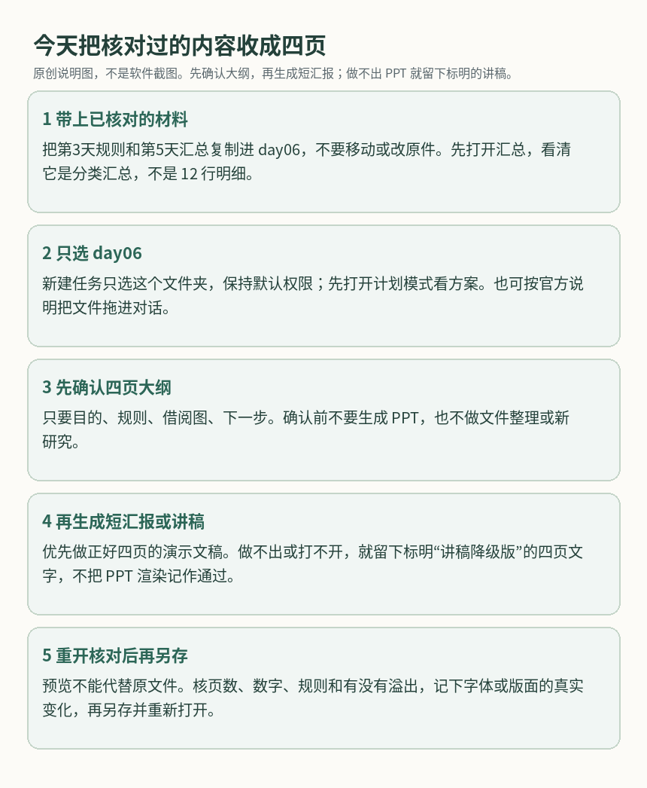
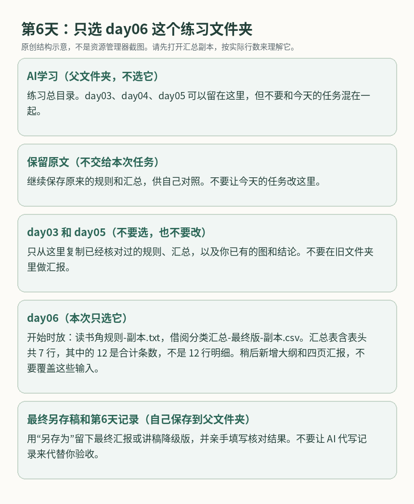
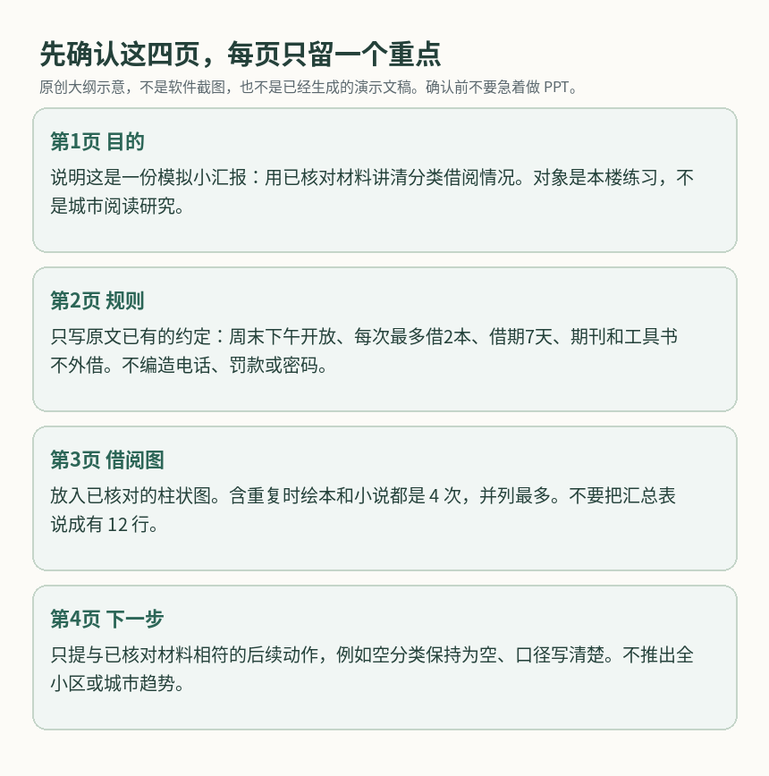
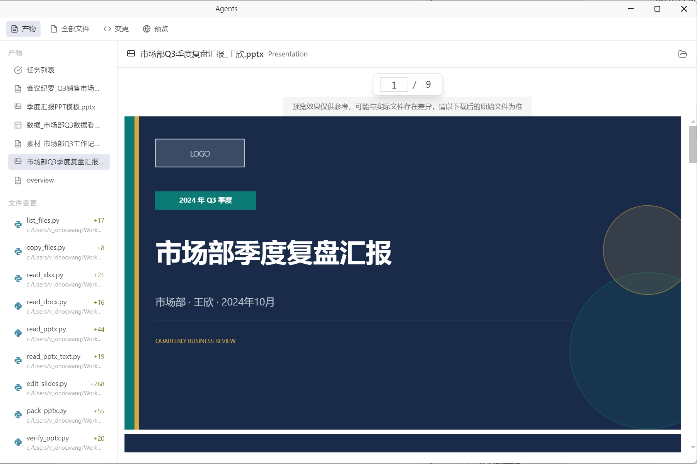
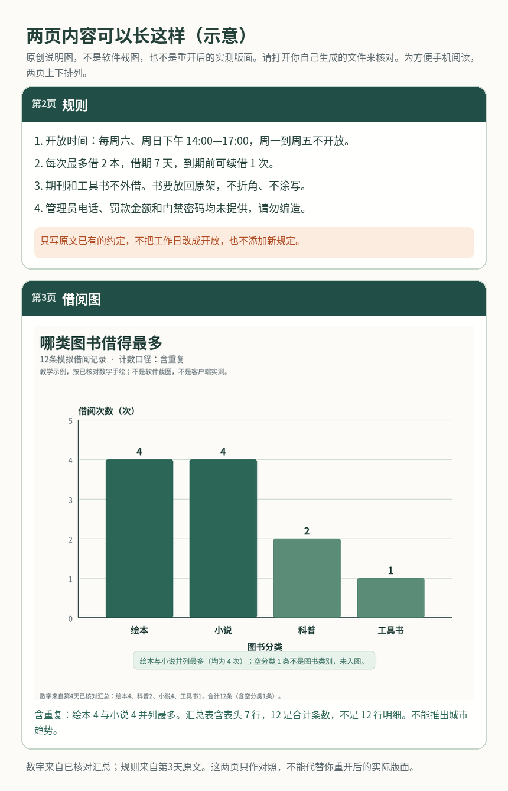
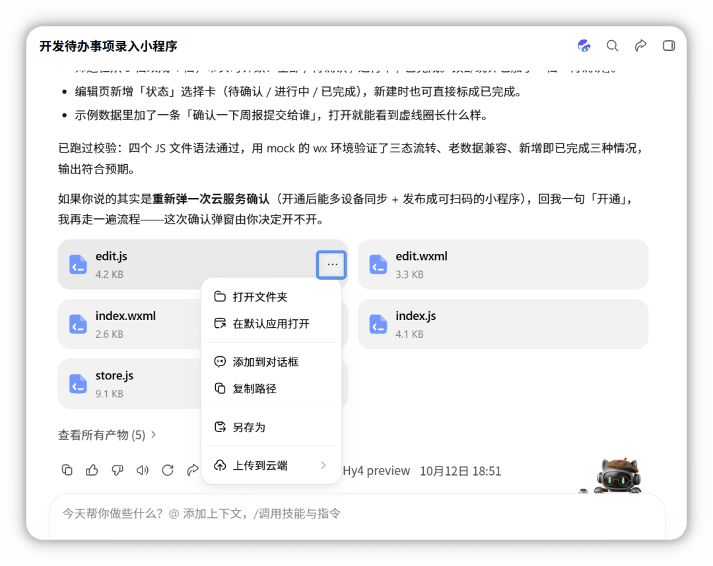
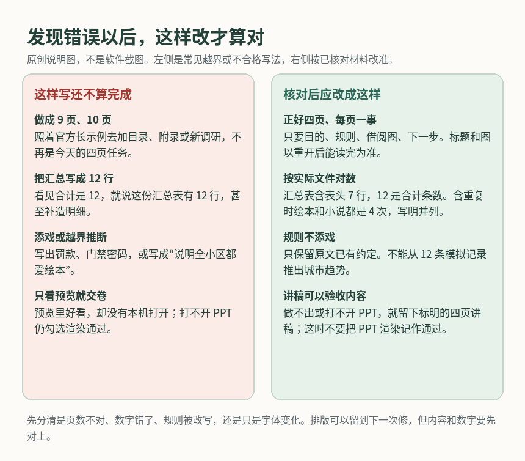

# WorkBuddy 第6天：把核对过的内容做成四页小汇报

[课程首页](../README.md) · [21单元学习路线](../docs/LEARNING-ROADMAP.md) · [第5天](../day05/README.md)

建议用时：75—90分钟。前置条件：已完成第3天和第5天，手里有核对过的规则、汇总和借阅图。本文依据官方资料编排，未在客户端实测；文中的大纲、示意页和讲稿示例不是运行回执。先确认正好四页的大纲，再生成演示。页次是目的、规则、借阅图、下一步。讲稿降级可以核对内容，但不能记成 PPT 已经通过。预览不等于本机重新打开。默认权限不是只读锁。不能从这 12 条模拟记录推出小区或城市趋势。不要覆盖输入副本，也不要改 `day03` 和 `day05`。

> 下载本仓库后，不要把整个仓库、文章目录 `day06` 或 `practice` 选为工作空间。正文要求你亲手建立自己的 `AI学习/day06`。两处目录同名，不是同一个位置。这个练习目录开始时只放输入副本，不要提前放入做好的大纲、PPT 或最终版讲稿。

## 本章目录

- [一、先认识今天要用的几个词](#concepts)
- [二、亲手准备：把已核对的材料放进 day06](#prepare)
- [三、新建任务：只选 day06](#workspace)
- [四、先确认四页大纲，先不要生成 PPT](#outline)
- [五、再生成四页短汇报，打不开就留下讲稿](#generate)
- [六、追问修改，再自己另存并重新打开](#revise-save)
- [七、遇到这些情况，先停在哪里](#troubleshooting)
- [今天学会的，不只是“让 AI 做一套 PPT”](#wrap-up)
- [提示词与练习附件](#resources)

第5天，我们用已经核对过的汇总数，回答了“哪类图书借得最多”，留下一张柱状图和三句有依据的结论。第3天，我们也留下过一份虚构的读书角规则。今天不再重新统计，也不做新的资料搜集或文件整理。只做一件事：把这些已经检查过的材料，做成一份只有四页的小汇报——目的、规则、借阅图、下一步。先确认大纲，再生成短的演示文稿。如果当前环境做不出或打不开 PPT，就留下一份标明“讲稿降级版”的四页文字；这时内容仍可验收，但不能把 PPT 渲染记作通过。

仍然不要拿真实的工作汇报、全城数据或学生名单来试。材料都是教学模拟，住户只有代号。今天最重要的不是把幻灯片做得多华丽，而是你能说清楚：**四页各讲一件什么事？数字是不是和已核对的汇总一致？规则有没有被添戏？我能不能在本机重新打开，并记下版面或字体的真实变化？**


*以Fee照片为参考的情景插画：材料已经核对过，今天只做一份四页小汇报。*

这节建议预留75—90分钟。如果只是标题位置、字体或空隙需要再修，可以把排版修正留到下一次，不必今天硬做完所有美化。不安装插件，不连接外部账号，不把练习文件分享或上传到云端。

<a id="concepts"></a>

## 一、先认识今天要用的几个词

**大纲**，就是先用很短的文字列出这四页各写什么，给你看过、确认以后，再去生成完整文件。官方《实践二》建议：先说清目标读者，一次把页数和必须包含的模块讲清楚；修改时直接说差异，不必重写整段提示词。今天就把“先确认结构”当成正式步骤，而不是可有可无的客套。

**演示文稿（常被称为 PPT）**，是一页一页翻看的短汇报。今天只要 4 页，不是 9 页、10 页的季度复盘或年会方案。官方文档里确有更长的演示示例，那不是今天的练习范围。

**讲稿降级版**，就是在做不出或打不开演示文稿时，把同样的四页内容写成能打开的纯文本或 Markdown，并在文件名和开头标明这是降级版。它可以用来核对内容和数字，但**不能**因此在记录里勾选“PPT 已经渲染通过”。规划写得很清楚：若仅讲稿通过，不把 PPT 渲染记作通过。

**溢出**，是指标题、句子或图超出页面边缘，或挤成一行看不清。生成时在预览里看起来还行，并不等于你用本机应用打开后也一样。

还要记住已经核对过的边界，今天仍然有效：

- 模式管任务怎么做，权限管操作受什么限制。默认 Agent 模式可以执行任务，也可以修改文件，它不等于“只读”。
- 本课保持“默认权限”，不打开“允许完全访问”。默认权限不是保险锁，工作空间里的普通写入不一定每次都来问你。
- “允许完全访问”会影响当前客户端里的所有任务，包括后来新建的任务。今天用不到，也不拿它解决做不出 PPT 或字体不好看的问题。

官方《实践二》还提到，制作演示文稿时可以同时说明素材、页数、受众和风格；生成后可继续用一两句差异意见修改。文档里也提到可以调用文档生成相关的专家，这只是辅助方式，**今天的四页练习并不要求使用它**，本文也未实测该入口。



*本课步骤总览：带上已核对材料、只选day06、先确认四页大纲、再生成短汇报或讲稿、重开后再另存。原创说明图，非软件界面。*

<a id="prepare"></a>

## 二、亲手准备：把已核对的材料放进 day06

先在 `AI学习` 总目录里，新建一个名为 `day06` 的文件夹。不要接着第5天的聊天继续做幻灯片，今天需要一个范围明确的新任务。

把下面这些已经检查过的材料**复制**进 `day06`，不要移动，也不要改 `day03`、`day05` 或 `保留原文` 里的文件：

- 第3天的 `读书角规则.txt`（或你当时另存的、内容仍与原文一致的规则）。复制进 `day06` 后，改名为 `读书角规则-副本.txt`。
- 第5天的 `借阅分类汇总-最终版.csv`（如果你保存的是 `.txt` 或 `.md`，就保持同样的扩展名，只加上“副本”）。复制后的文件名可写成 `借阅分类汇总-最终版-副本.csv`。
- 如果你第5天已经另存了柱状图和三句结论，也各复制一份进来，不要改原件。

请先打开汇总副本，看它实际长什么样。这份文件是**分类汇总表**，不是 12 条借阅明细。用记事本或文本编辑打开后，含表头一般是 7 行：表头，再加上绘本、科普、小说、工具书、空分类和合计。其中的“12”是合计条数，来自第4天那张 12 条模拟借阅记录，**不是**这份汇总表自己有 12 行。不要为了凑 12 行去补造明细，也不要把这份表说成“有 12 行记录”。

若你第5天还没有留下汇总或图，可以使用本课练习材料里的教学汇总，以及第5天给出的教学示例图和三句结论。它们都是编辑根据已核对数字整理的教学稿，**不是客户端实测产物**。复制进 `day06` 后，你仍然要自己打开看一遍。

主教学口径仍是“含重复”：绘本 4 次、小说 4 次、科普 2 次、工具书 1 次、空分类 1 条，合计 12 条。绘本和小说并列最多。若你第4、第5天采用的是去重口径（小说计 3 次），以你自己写明的口径为准，不要和这篇示例混用。



*目录关系图：只选day06，放入规则副本和汇总副本；汇总表含表头共7行，12是合计条数，不是12行明细。原创结构示意，非资源管理器截图。*

看完文件后，在纸上或第6天记录里先写下一句：我今天用的是“含重复”还是“去重”，最多的是哪一类、各是几次；我也亲自看过汇总表的实际行数。这句先由你自己写，不要等幻灯片出来再倒推。

今天四页的任务也很明确，可以先记在心里，等会只要求它按这个结构来：



*四页大纲示意：目的、规则、借阅图、下一步，每页只保留一个重点。原创说明图，不是软件截图，也不是已生成的演示文稿。*

<a id="workspace"></a>

## 三、新建任务：只选 day06

打开 WorkBuddy，点“新建任务”。不要接着第5天的聊天继续做汇报。

在输入框下方找到“选择工作空间”，按当前界面选择本地文件夹，进入 `AI学习/day06` 后确认。这里选的是**文件夹**，不是只点其中一份文件，也不是误选 `day05` 或上一级 `AI学习`。确认前停两秒，看末尾是不是 `day06`。选错了，先不要发送任务，回到入口重选。

把材料交给它，可以用下面两种办法，选一种即可：

- **工作空间里已有文件：** 副本已经放在 `day06` 里，选对目录后，在提示词中写明文件名。这和前几天指定文件的方法一样。
- **拖入对话：** 官方说明，可以把本地文件拖到页面上，看到“松开即可添加文件”后再松开。文件会进入输入框的附件区域，**不会自动发送**。也可以使用添加文件或上传入口，具体名称以当前界面为准。

不要为了导入成功去安装未知插件，或打开完全访问。也不要把同一份材料再复制到桌面去“多导入一次”，以免后来分不清读的是哪一份。

接着保持“默认权限”，不要打开“允许完全访问”。然后在输入框左侧点“＋”，找到“模式”，打开“计划 Plan”，并确认“仅问答 Ask”是关闭的。今天要先写大纲、再生成文件，步骤不止一件，所以先看方案再执行。打开 Plan，不等于权限变成只读，也不等于可以跳过你自己对四页内容和数字的核对。

<a id="outline"></a>

## 四、先确认四页大纲，先不要生成 PPT

发送前再看一眼：目录是 `day06`，里面此时应有规则副本和汇总副本；模式是计划 Plan，权限仍为默认。准备好后，把下面整段复制到输入框，再发送。请把文件名改成你实际使用的名字。

```text
这是一次本地四页汇报练习。请只处理当前工作空间根目录中已有的材料，尤其是：
“读书角规则-副本.txt”
“借阅分类汇总-最终版-副本.csv”
如有“借阅分类柱状图”和“借阅三句结论”的副本，也一并阅读。

请先阅读这些文件，再给出一份可审阅的四页大纲，等我确认后再生成任何演示文稿或讲稿。

说明：
1. “借阅分类汇总-最终版-副本.csv”是分类汇总表，不是借阅明细。请先按实际文件核对行数：含表头共 7 行。其中的 12 是合计条数，不要把这份汇总表写成“有 12 行记录”，也不要补造 12 条明细。
2. 已人工核对的主口径（含重复）是：绘本 4 次，小说 4 次，科普 2 次，工具书 1 次，空分类 1 条，合计 12 条。绘本和小说并列最多。若汇总文件明确写的是去重口径，则以文件中写明的数字为准，并在大纲里注明。
3. 规则只使用“读书角规则-副本.txt”里已有的内容，不要编造管理员电话、罚款金额、门禁密码，或改开放时间。

请先只输出四页大纲，建议另存为“四页汇报大纲.md”或 TXT，必须包含：
第1页 目的：这份模拟小汇报要说明什么、给谁看；写明这是教学模拟，不是城市阅读研究。
第2页 规则：只列出原文已有的关键约定。
第3页 借阅图：说明将使用已核对的柱状图和数字，并写明并列最多与不能推出的推断。
第4页 下一步：只提与已核对材料相符、且不越界的后续动作。

必须遵守：
1. 今天只要这四页，不要增加页数，不要做文件整理或新的资料搜集。
2. 必须新增大纲文件，不得覆盖、修改、删除或重命名上述输入文件，也不得改写其他目录中的文件。
3. 确认前不要生成 PPT、长报告或其他演示文件。
4. 不连接外部账号，不安装工具或插件，不运行我看不懂的脚本，不必调用我没有要求的专家。
5. 如果读不到文件，或必须申请额外权限、访问其他目录才能继续，请先停下来说明原因，不要执行。

请在方案中写清：将读取哪些文件、汇总表按实际行数如何理解、四页各写什么、会不会改动输入、确认前会不会生成 PPT。
```

先看方案，不要急着点执行。方案里至少要能对上下面几点：

- 它读取的是 `day06` 里你指定的文件，而不是去改 `day03`、`day05` 或 `保留原文`。
- 它把汇总表按实际文件理解成分类汇总，而不是 12 行明细。
- 正好四页，标题为目的、规则、借阅图、下一步；确认前不生成 PPT。
- 规则不添戏，也不把 12 条模拟记录写成城市趋势。
- 它不要求打开完全访问，不安装插件，也不访问其他目录。

若方案准备直接做 9 页、10 页，或先去“搜集更多资料”“整理文件夹”，先不要执行。用下面这段请它改回去，再看一版方案。

```text
请先不要生成 PPT。请按下面几点调整大纲后再给我看：
1. 必须正好四页，标题为：目的、规则、借阅图、下一步。每页只有一个重点。
2. 汇总表按实际文件理解：含表头 7 行，12 是合计条数，不是 12 行明细。
3. 含重复时绘本和小说都是 4 次，须写明并列最多；空分类不是图书类别。
4. 规则不添戏；不能从这 12 条模拟记录推出小区或城市阅读趋势。
调整后请再次列出四页要点，以及将新建的大纲文件名。
```

方案对得上以后，再按当前界面确认执行。执行后先打开新增大纲，核对四页要点和数字。大纲不对，就还停留在这一步，不要进入生成演示文稿。

<a id="generate"></a>

## 五、再生成四页短汇报，打不开就留下讲稿

大纲确认后，先关掉 Plan，回到默认 Agent 模式，再发送下一段；如果 Plan 还开着，就当作又一次方案来审阅，确认后再执行。权限仍保持默认。请把文件名改成你实际使用的名字。

```text
我已确认刚才的四页大纲。请只按这份大纲，在当前工作空间根目录新增一份正好四页的短汇报，不要改已有的规则副本、汇总副本、大纲和其他目录中的文件。

要求：
1. 优先生成演示文稿，建议文件名为“读书角四页汇报.pptx”。如果无法生成 PPT，或你判断当前环境不能保证该格式可打开，请改为生成“读书角四页讲稿-降级版.txt”或 Markdown，并在文件开头用一句话标明这是讲稿降级版、以及降级原因和实际文件名。不要把讲稿伪装成已经通过的 PPT。
2. 必须正好四页（或讲稿中清晰标出四页）：目的、规则、借阅图、下一步。每页一个重点，标题和图像不要溢出到看不清。
3. 借阅图页必须使用已核对数字：含重复时绘本 4、小说 4、科普 2、工具书 1、空分类 1，合计 12。并列最多要写清。不要把汇总表说成 12 行明细。
4. 不要编造规则，不要写出小区或城市阅读趋势。
5. 不联网补充材料，不安装工具或插件，不运行我看不懂的脚本，不申请完全访问。若模板、字体、额度或权限出现问题，请先停下来，保留已确认的大纲和能打开的讲稿。

请先说明将新建的文件名和格式，再执行。
```

图和文件生成后，先到结果区查看产物或工作空间文件，确认是**新增加的文件**。可以在预览里先看一眼，但不要只看预览就当作已经交卷。官方演示文稿预览里写过：预览效果仅供参考，可能与实际文件存在差异，请以下载后的原始文件为准。下面这张是官方示意，图中是一份 9 页的示例汇报，**不是**本课的四页读书角材料，也不是作者实测。



*官方示意：结果区可以预览演示文稿，界面含产物、预览和页码。预览可能与原文件有差异。图为官方示意，非作者实测，图中文件也不是本课材料。*

手机上看整屏可能偏小，请再看这一处：页码、文件名，以及“预览仅供参考、以下载后的原文件为准”的说明。控件保持完整，未裁掉预览和页码。


*官方预览局部：页码与“预览效果仅供参考，可能与实际文件存在差异，请以下载后的原始文件为准”。由官方原图像素校准放大，非作者实测。*

接下来，用电脑里**已经有的、能打开该文件的应用**打开它。不要为了打开一份练习文件去安装不明软件。若没有任何应用能打开演示文稿，就改用讲稿降级版完成内容核对，并在记录里写明：本次未把 PPT 渲染记作通过。

打开后，按下面几项逐页看：

- **页数：** 正好 4 页，不要多出目录页、封底或一堆附录。
- **每页一个重点：** 第1页说目的，第2页说规则，第3页放借阅图和已核对数字，第4页只写不越界的下一步。
- **数字：** 含重复时，绘本 4、小说 4、科普 2、工具书 1、空分类 1，合计 12；绘本和小说应写明并列最多。不要把汇总表说成有 12 行。
- **规则：** 开放时间仍是周六、周日下午 14:00—17:00，每次最多借 2 本，借期 7 天，可续借 1 次；期刊和工具书不外借。若出现电话、罚款、门禁密码，或平日也开放，那就是添戏。
- **版面：** 标题和图没有明显溢出，文字能读完。字体、间距若和预览不一致，记下实际看到的情况，不要假装“和示意图一模一样”。
- **不能推出的话：** 仍然不能从这 12 条模拟记录推出某个小区或城市的阅读趋势。

下面两页是编辑按已核对材料手绘的内容示意，用来示范“规则页”和“借阅图页”可以怎样各保留一个重点。它们**不是**软件截图，也不是你重开后的实测版面。请打开你自己生成的文件来核对。



*教学示意：第2页只保留已有规则，第3页用已核对柱状图说明绘本与小说并列最多。原创说明图，不是软件截图，也不是客户端实测结果。*


*以Fee照片为参考的情景插画：文件打开以后，先停一下，核页数、数字和规则有没有被改写。*

<a id="revise-save"></a>

## 六、追问修改，再自己另存并重新打开

如果第一份四页汇报已经把页数、数字、规则和“不能推出”的说明都写清楚，这一步就做一次小确认，要求它把需要保留的说明写进文件，避免只出现在聊天里。如果页数不对、数字错了、标题溢出，或把推断写成了结论，也用同一段提示词要求改正。先确认仍是默认权限，再发送。

官方说明，你可以在同一个任务里补充要求、调整已有结果或继续追问，不必把背景再讲一遍。修改时直接说差异即可。请把下面这段里的文件名改成你实际看到的名字。

```text
请只修改刚才新生成的四页汇报或讲稿降级版，不要改规则副本、汇总副本和大纲。

请按下面几点补上或改准：
1. 必须正好四页，每页一个重点；标题和图如有溢出、挤成一团或缺页，请改到能完整阅读。
2. 数字必须与已核对汇总一致：含重复时绘本 4 与小说 4 并列最多；不要写成独一冠军，也不要把汇总表写成 12 行明细。
3. 规则不得添加电话、罚款、门禁密码或原文没有的开放时间。
4. 结论和第 4 页不得推出小区、城市阅读趋势或未来一定会怎样。
5. 若你无法生成或修好 PPT，请保留或改准讲稿降级版，并说明实际文件名。不要为了做出 PPT 而申请额外权限或安装工具。

不联网，不访问其他目录。若必须申请额外权限，或字体、模板仍不正常，请先停止并说明，同时保留能打开的四页文字。
```

改完后再看一遍：仍是四页，数字仍与口径一致，规则没有添戏，输入副本还在。确认后，在产物卡片右侧找到“⋯”，按当前界面使用“另存为”，把最终版保存到 `AI学习` 父文件夹。演示文稿可写成 `读书角四页汇报-最终版.pptx`（若实际是其他格式，就保留实际扩展名）；若是讲稿，可写成 `读书角四页讲稿-最终版.txt` 或 `.md`，并保持“降级版”的标明。不要另存到规则或汇总副本上，也不要覆盖 `day03`、`day05` 或 `保留原文`。



*官方示意：产物卡片菜单里可以看到另存为、打开文件夹和在默认应用打开。图中文件是官方示例，不是本课材料；今天不要使用上传到云端。*

另存后，到刚才选择的位置再打开一次最终版。确认还是四页、数字还在、规则没有被改写；并记下这次用的是哪个应用，标题或图有没有溢出，字体或版面有没有变化。这就是今天的“本地重新打开”：不是只在预览里看过一眼，而是你自己能再次找到这份文件，并承认重开后的真实样子。官方不承诺任意电脑都能原样展示，本文也未实测所有应用，所以不要把“预览里好看”写成“所有电脑打开都一样”。

若修了一次版面仍不理想，可以把排版修正留到下一次，先保住内容和数字。发现错误时，先分清是页数不对、数字错了、规则被添戏，还是只是字体变化，再用上面的提示词要求修改。



*发现错误后的修正对照：左侧页数过多、把汇总写成12行或推出城市趋势；右侧保持四页、数字与汇总一致，并标明讲稿不能算作PPT通过。原创说明图，不是软件截图。*


*以Fee照片为参考的情景插画：四页内容和数字核对后，再另存并重新打开。*

最后，自己填写一份 `第6天记录.txt`，保存在 `AI学习` 父文件夹，不要让 WorkBuddy 代写验收结果。可复制下面这一段，按实际情况填写。

```text
我的WorkBuddy第6天记录

练习目录：（自己填写实际选择的位置，不公开个人路径）
工作模式：第一次先确认大纲使用计划 Plan；生成汇报时：（填写当时模式）
权限状态：默认权限；允许完全访问关闭

采用的计数口径：（含重复 / 去重，自己填写）
汇总文件实际行数（含表头）：（自己打开后填写，不要抄成12行）
亲手写下的最多类别及次数：（含重复时应写出是否并列）
规则副本和汇总副本是否仍在、内容是否未改：（自己核对后填）
大纲文件名：（填写）
汇报文件名与格式：（PPT / 讲稿降级版 / 其他，填写实际扩展名）
是否降级为讲稿：（是/否，原因）
四页是否各有一个重点，数字是否与汇总一致：（自己核对后填）
用什么应用重新打开，标题或图是否溢出，字体或版面有无变化：（填写实际看到的情况）
若只有讲稿可打开，是否未把 PPT 渲染记作通过：（是/否）
遇到的权限请求、编造规则或越界推断、自己如何处理：（没有就写无）
```

保存后关闭，再找到 `第6天记录.txt` 双击打开。内容没有乱码，检查项是你自己核对的结果，今天才算完成。若文件打不开、数字对不上、规则被添戏，或只得到讲稿却勾选了“PPT 已通过”，记录“未完成”和卡点，不要填成全部通过。

<a id="troubleshooting"></a>

## 七、遇到这些情况，先停在哪里

**做不出 PPT，或提示模板、字体、额度不够。** 先保留已确认的大纲，并生成（或改准）标明“讲稿降级版”的四页文字。不要为了得到 `.pptx` 去安装不明插件，或打开完全访问。内容核对仍可继续；PPT 渲染不要记作通过。排版可以另约一次练习再修。

**本机没有应用能打开演示文稿，或打开后字体、版面和预览差很多。** 记下实际用的应用和看到的情况。能读完四页、数字正确，可先完成讲稿路径的验收；不要写成“所有电脑都会显示成示意图那样”。不承诺任意电脑都能原样展示。

**它一次做了 9 页、10 页，或加了目录、附录、新调研。** 今天只要四页。请它改回目的、规则、借阅图、下一步；不要把官方示例里的长汇报当成今天的任务。

**它把汇总表写成“有 12 行记录”，或补造了 12 条明细。** 先停下来，打开你的汇总副本核对实际行数。12 是合计条数，这份汇总表含表头是 7 行。改准之前，不要采用这份汇报里的数据表述。

**数字错了，或含重复时只宣布“绘本借得最多”。** 请它改回已核对口径。含重复时绘本和小说都是 4 次，应写明并列。

**规则里出现了电话、罚款、门禁密码，或工作日也开放。** 那是添戏。对照 `读书角规则-副本.txt` 改回原文已有的约定，再谈版式。

**结论或第4页写成了全小区、全城或“以后都会这样”。** 这 12 条是虚构的小样本，推不出总体趋势。先改掉这类推断。

**只在预览或聊天里看到内容，却没有可打开的新文件。** 先到结果区查找产物和工作空间文件。仍没有文件，就记录卡点，不要反复重写，也不要打开完全访问碰运气。

**规则副本、汇总副本被改了，或 day03、day05、保留原文里的文件被改动。** 先停止，对照你事先留好的文件。今天的输入应还在，新增的是大纲和四页汇报（或讲稿）。

**它要运行你看不懂的命令、安装工具，或申请完全访问。** 看不懂就取消。完全访问会影响当前客户端的所有任务，今天不要用它解卡。格式问题先降级为讲稿，而不是扩大权限。

**任务一直跑，或开始整理 day06 以外的文件夹、做新的检索。** 用执行中的停止入口中断。停止不等于撤销已经发生的变化，随后检查文件夹。今天不兼做文件整理或新研究。

**界面和本文示意图不完全一样。** 官方图是示意，不是你这一版的实测截图，图中的示例汇报也不是本课材料。以你当前界面和最新官方说明为准；对不上时先停，不靠猜测点击，也不提权解卡。

<a id="wrap-up"></a>

## 今天学会的，不只是“让 AI 做一套 PPT”

不看上面的步骤，你能不能自己说出：今天四页各讲什么、你用的是哪一种计数口径、哪一类（或哪两类）借得最多、汇总表实际有几行，以及从这 12 条模拟记录里不能推出什么？若演示文稿打不开，你是不是留下了标明的四页讲稿，并且没有把 PPT 渲染勾成通过？能做到这些，并且最终版能重新打开，今天的练习就有价值。

第7天会留一天来复做，把到目前为止最容易出错的一处再走一遍，避免错误接着往下滚。今天先把这四页小汇报做完整，不要提前开始复做，也不要把这 12 条模拟记录说成某个城市的阅读趋势。

---

资料与图片说明：本文为原创教学编排，操作依据为腾讯 WorkBuddy 官方《实践二：文档生成与编辑》《结果查看》《任务对话》《默认权限与安全沙箱》，核查于2026年11月24日（北京时间）。界面图为官方示意，非作者客户端实测，图中示例文件也不是本课材料；人物情景插画以作者本人照片为参考，复用第2至第5天已确认的形象插画；步骤图、四页大纲、示意页和对错对照为原创说明图，其中示意页是按已核对材料绘制的教学内容，不是客户端截图或重开后的实测版面。界面可能随版本变化，遇到不一致以当前官方说明为准。官方文档入口：[实践二](https://www.workbuddy.cn/docs/workbuddy/From-Beginner-to-Expert-Guide/Practice-Cases/Practice-Two)、[结果查看](https://www.workbuddy.cn/docs/workbuddy/Results)、[任务对话](https://www.workbuddy.cn/docs/workbuddy/Conversation)。

<a id="resources"></a>

## 提示词与练习附件

- [全部可复制提示词](resources/prompts.md)，与正文五个文本块逐字一致。
- [人工验收表](resources/checklist.md)，只有讲稿可打开时不要勾成 PPT 已通过。
- [口径与降级对照（非实测）](resources/example-not-tested.txt)，只用来对照母稿写明的数字和验收口径，不是已生成的演示文稿。
- [目录与核对记录卡](practice/第6天记录-模板.txt)，由你手动填写，保存到自己的 `AI学习` 父目录。
- [练习材料说明](practice/README.md)，附教学副本供核对；不能把整套材料当成工作空间。
- [资料与图片归属](SOURCES.md)，保留官方示意与未实测说明，不另加自有图片许可证。

[返回第5天](../day05/README.md) · [返回课程首页](../README.md)

第7天仍仅为规划，尚无课文链接；请先完成本章验收。
