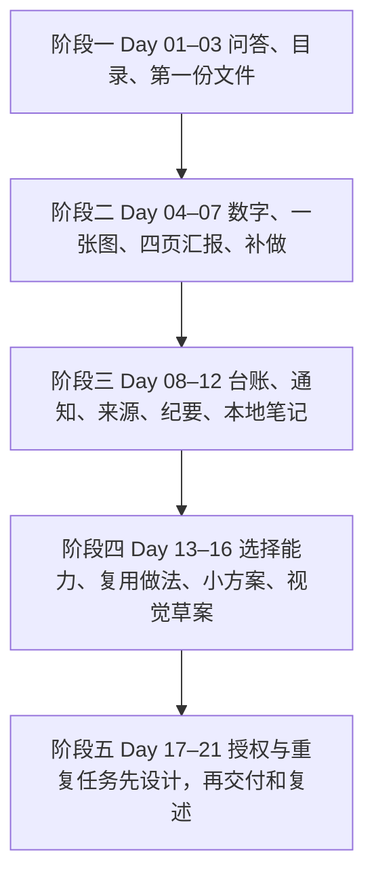

# WorkBuddy 学习路线：21 个单元

> [!IMPORTANT]
> 这是给初学者的练习路线。21 个单元不是 21 天保证精通，也不是开通每天自动运行。Day 01 至 Day 06 已有课文。Day 07–21 尚未成文，本页不提供那些课文的链接。路线依据 2026-11-18（北京时间）查阅的中文官方文档整理；已发布课文分别按各自核查日期编排，Day 06 于 2026-11-28（北京时间）发布。社区蓝皮书只作补充，不是腾讯官方文档。没有安装或登录实测，不承诺当前版本、免费额度或固定用时。

[返回课程首页](../README.md)

## 本页目录

- [这套路线给谁](#who)
- [为什么按这个顺序](#why)
- [五个阶段](#stages)
- [时间怎么安排](#pacing)
- [每单元都要守住的边界](#safety)
- [21 个单元](#units)
- [主线之外的选修](#electives)
- [官方场景分别放在哪里](#scenarios)
- [社区材料怎么用](#community)
- [资料与链接](#sources)

## 这套路线给谁

适合刚开始用 WorkBuddy、希望做出一份能检查、能保存、出错会停的小成果的人。不要求会编程，也不要求已经有企业账号。

它不适合用来一次学完全部菜单，也不适合一开始就连接真实账号、批量改文件、自动发消息或做无人值守。健康、法律和投资判断仍要交给可靠来源和专业人士。

## 为什么按这个顺序

先把文字问答做完整，再碰文件夹。先用副本、小文件、小数字和带来源的材料建立验收习惯，再谈技能、外部账号和重复运行。账号、远程和定时放在后面，是为了避免刚上手就授权或离开电脑不管。

文档、表格、图表和幻灯片分成不同单元，每个单元只交一件小成果。Day 07 用来补最薄弱的一项。Day 21 再用一份新样本独立重做，并试着把一课讲清楚。

官方列出的场景都有去处，但不是全部必修。有的只学方法，有的要具备环境才做，有的风险高，不放进第一次练习。

## 五个阶段

1. Day 01–03：从文字问答走到独立目录和第一份文件。要能说明读写范围，改一处要求，并保存后重新打开。
2. Day 04–07：核对数字，做一张图，做四页小汇报，再留一个单元补做。要能回到输入证明数字，不靠对话里的「已完成」。
3. Day 08–12：做台账、通知和翻译、带来源的简报、纪要、本地笔记。要能分开事实、建议、待确认和最终版。
4. Day 13–16：学习什么时候用普通对话就够，什么时候才写可复用说明、收窄需求、做一张视觉草案。
5. Day 17–21：授权和自动化先写成清单和运行说明，再用两种角色检查一篇稿，完成一个小交付，并换样本复述。主线不要求新开账号、启用定时或真正同时跑多个代理。

主线要练的是材料、输入、操作、追问、验收和保存。某项功能在自己的账号里不可用时，记下缺口并交最低成果，不把文字草稿记成那种文件格式已经测试通过。

## 时间怎么安排

多数单元按 60–90 分钟准备。21 个单元的核心练习大约 21–32 小时。安装排错、排队、制图、版式和选修另算时间。

一次大约 75 分钟可以分成：10 分钟复习和看来源，30 分钟跟着做，15 分钟追问修改，15 分钟验收并重新打开，5 分钟记下卡住的地方。读完本页不算做完。

Day 01 的安装、Day 06 的版式、Day 14 的导入可能超时。先交文字、范围或测试说明这些最低成果，把没通过的项目标出来，另找一次补。Day 07 优先补最薄弱的一项，不把前面所有欠账塞进同一个单元。

同一天可以做完多个单元。每天只有约 30 分钟时，把一个单元拆成读和准备、跟着做、验收三段，大约 6–9 周走完主线。每次结束都保存输入和最终文件，下次从记录接着做。

已经有经验的人，可以用一份新样本先做 Day 07 那种过关测试。能独立说清输入、权限、修改和验收的单元可以跳着读，把时间用在同类的真实小问题或一个选修上。隐私、证据和停止边界不能跳过。

想在主线之后再加练习，可以只加一个分支，大约 7 次：例如两次授权评估或测试、两次同一个媒体或开发小项目、一次失败处理、一次换样本重做、一次教学复盘。这 7 次不是把所有选修都做完。没有相应环境时，可以把这 7 次都用来把本地任务做深。

## 每单元都要守住的边界

每个单元都走同一小圈：先看材料和自己有没有使用权，再写清目标、输入、动作、约束、输出和验收，然后操作和追问，自己检查，保存并重新打开，最后记下失败。第一次见到的词就在当次解释。背下名称不算过关。

默认使用自己编写的模拟文本、小表和练习目录。先复制再处理，先列清单再动作。新手的第一项任务不用删除、批量改名或运行看不懂的脚本。

当前官方任务栏的说法是默认 Agent、计划 Plan、仅问答 Ask。非默认模式从输入框旁的「＋」菜单打开，打开后输入框附近会有模式标识。社区蓝皮书里旧的 Craft 按钮名称，不要当成现在的官方入口。仅问答 Ask 只咨询、不执行任务。计划 Plan 先出方案，确认后再做。默认 Agent 可以执行。计划和仅问答不能同时打开。

模式和权限不是同一个开关。模式决定这次是问答、先计划，还是可以执行。权限决定它能接触哪些目录和能力。默认权限不等于零风险，也不能保证不会误操作。完全访问会作用到当前客户端里已有和以后的任务，不能当作排错捷径。没有亲手选择目录时，系统可能创建独立空间；练习时仍应显式选中自己的小目录。

遇到越界、陌生工具、额度或结果异常，先停止或拒绝，再缩小输入。留下脱敏后的报错、系统版本、客户端版本和发生时间。停止当前执行不等于撤销已经做成的改动。

研究和写作不等于发送、分享或上线。连接器、项目邀请、云端上传、公开链接、消息推送、部署和定时运行各自还有确认关口。本路线不授权这些动作。

不要写成「所有数据永远不会上传」。本地目录、对话里粘贴的内容、外部连接器和官方资料库边界不同。官方资料库文档说明存在云端存储和主动分享：上传的办公与本地文件由腾讯网盘存储，WorkBuddy 创建的内容在 WorkBuddy 云端；不同空间的成员可见范围不同；发布为网站默认关闭，打开后持有链接的人可以访问。带私密资料之前先读对应规则。保存一份本地文件，不等于上传或分享。

定时任务在官方说明里分成本地、项目和云端，三者执行条件不同，不能概括成「电脑必须在线」。本地任务在本机客户端执行，需要电脑运行且客户端不退出。云端任务在云端沙箱执行，不需要电脑在线，但不能读取本机文件；编辑云端任务时不选择工作空间和权限，也不支持企业微信推送。项目任务是单独的一种，不套用本地或云端的条件，配置前以官方定时说明里该类型的原文为准。暂停只影响以后的执行，不会打断正在运行的那一次。对话里说「每天帮我……」也可能被创建成定时任务；主线只写方案，不创建定时。官方无人值守说明里若出现完全访问的建议，也不把它当成初学默认。

Windows ARM 的官方说法仍不一致：安装指南要求以当前版本说明为准，常见问题仍写 Windows 11 ARM64 暂不支持。下载菜单上的兼容字样不能当成已经支持。本路线没有做实机核实。

助理接入和定时也不是同一件事。中文助理指南列出微信、企业微信、QQ、飞书、钉钉等，并区分 App 的云端工作和连接电脑。旧的国际站平台清单不能当作中文读者的唯一前提。微信助理通过本地电脑执行，电脑休眠、断网或关闭 WorkBuddy 会中断；不能由此推出所有云端功能都依赖这台电脑。实际是否可用，仍看账号和版本。

技能、模型和套餐会变化。本路线不写固定免费数量、价格或版本号。

## 21 个单元

下面是练习设计，不是已经完成的操作记录。Day 01 至 Day 06 链接到已发布课文。Day 07–21 写明未发布，没有课文文件。

### Day 01｜第一次用 AI：做好一张小清单

状态：已发布。[阅读课文](../day01/README.md)。课文写明未安装或登录实测，界面图是官方示意，清单样例标明「示例，非实测」。

建议用时：60–90 分钟。首次安装另计。

主线还是可选：主线。

目标：用白话分清 AI、模型和 WorkBuddy，完成一次从提问、追问、检查到自己保存的闭环。装好软件不算毕业。

练习：从官网下载并登录。打开仅问答 Ask，权限保持默认。生成一份 10 分钟整理书桌清单，在同一个任务里追问，改成 5 分钟。自己检查分钟数和安全限制，把最终版复制到文本应用，保存后再打开。

要留下的成果：自己的最终版清单，以及系统和客户端版本记录。版本看自己的软件，不抄配图。

自己怎么检查：能说出 AI 会说错；5 步时间合计 5 分钟；限制还在；本地文件能重新打开。

卡住时：ARM 支持说法不一致、登录后没有回到客户端、找不到仅问答，或提示额度不足时，先停下，按官方指南核对。不要为了完成练习打开完全访问。

### Day 02｜先给 AI 一个练习文件夹，再让它读一份小材料

状态：已发布。[阅读课文](../day02/README.md)。路线短标题仍是「给练习划一个小工位」。课文写明未在客户端实测。具体步骤以课文为准：使用默认 Agent 和默认权限，这不是系统级只读锁；需要运行命令时先停止；模拟原文留在练习工作空间外面。

建议用时：60–75 分钟。

主线还是可选：主线。

目标：给练习一个独立小目录，并说清这次读的是哪一份副本。

练习：亲手建一个练习文件夹，放入自己写的三行文字副本。用选择工作空间的入口只选这个目录，请它列出文件名并写摘要，不要修改原件。对照仅问答 Ask、计划 Plan 和默认 Agent 各做什么。权限保持默认。

要留下的成果：一张目录与权限记录卡，以及那三行材料的摘要。

自己怎么检查：能指出读的是哪个文件；原副本没被改；能说明默认权限不是绝对保险，完全访问会影响当前客户端里的所有任务。

卡住时：目录选成桌面或个人文档根目录时，取消后重选。看不懂的越界授权就拒绝，不用完全访问来解卡。

### Day 03｜先看方案，再把规则写成第一份文件

状态：已发布。[阅读课文](../day03/README.md)。路线短标题仍是「从聊天文字走到第一份文件」。课文写明未在客户端实测。具体步骤以课文为准：先用计划 Plan 审方案，保持默认权限；必须新增文件，不得覆盖输入；只把「2本」改为「3本」；Word 不可用时降为 TXT 或 Markdown，并自己另存后重新打开。

建议用时：75–90 分钟。

主线还是可选：主线。

目标：在演练目录里新增一页文档，而不是只在对话里看到文字，也不是覆盖输入。

练习：准备 100–200 字虚构的读书角规则。先用计划 Plan 看范围，确认后再生成一页规则文档，只写入演练目录。随后提出一次具体修改，并自己另存最终版。

要留下的成果：一页文档、原材料和一条修改记录。优先使用 Word。打不开或无法生成时，保存 TXT 或 Markdown，并写明这是降级，不记成 Word 测试通过。Markdown 是带少量标记的文本，不要求先学语法。

自己怎么检查：规则没有被编造；输入还在；能在结果区预览、找到文件，并从本地重新打开。

卡住时：只有对话文字、没有文件时，先分清输出格式和路径。打不开就保留文本版，不安装来历不明的插件。

### Day 04｜先把一张小表里的数字算明白

状态：已发布。[阅读课文](../day04/README.md)。路线短标题仍是「一张小表，先把数字算明白」。课文写明未在客户端实测。具体步骤以课文为准：12 行模拟表，空分类保持为空，重复写明计数方式；绘本 4、科普 2、总条数 12；必须新增汇总，今天不做图；自己另存并重新打开。

建议用时：60–90 分钟。

主线还是可选：主线。

目标：用一份小表把数字算对，并看住空值和重复。这一单元不做图。

练习：使用自己编写的 12 行读书角借阅记录，不含真人信息。让 WorkBuddy 读这份 CSV，统计每类图书的借阅次数，检查一处空值和一处重复。保留原表，另出汇总表。CSV 是常见的纯文本表格，可以用已经安装的表格软件查看。

要留下的成果：模拟原表、汇总表和异常说明。

自己怎么检查：自己抽算两组，并核对总数。缺失值不能被补成事实。重复记录怎么处理要写清楚。

卡住时：分隔符不对、中文乱码或数字变成文字时，停在小样本上排查。不要拿错误的输入继续做汇报。

### Day 05｜让一张图回答一个问题

状态：已发布。[阅读课文](../day05/README.md)。正式题目与路线短标题都是「让一张图回答一个问题」。课文写明未在客户端实测。具体步骤以课文为准：用 7 行已核对汇总做一张柱状图和三句结论；含重复时绘本 4 与小说 4 并列最多；空分类不是第五类柱；去重只把小说改为 3，不能混用；不能推出小区或城市趋势。

建议用时：60–90 分钟。

主线还是可选：主线。

目标：用已经核对过的汇总，回答一个问题，并写明图不能推出什么。

练习：只问「哪类图书借得最多」。用 Day 04 的汇总做一张柱状图，加三句结论。要求指出证据，以及不能得出的推断。

要留下的成果：一张可以查看的图，和三句有数字依据的解释。

自己怎么检查：轴名、单位、分类和数值正确。不能从 12 行模拟记录推出整个城市的阅读趋势。

卡住时：渲染或字体异常时，先保留汇总和文字结论。数字正确优先于图好看。修图可以另加一次练习。

### Day 06｜把核对过的内容做成四页小汇报

状态：已发布。[阅读课文](../day06/README.md)。正式题目与路线短标题都是「把核对过的内容做成四页小汇报」。课文写明未在客户端实测。具体步骤以课文为准：先确认四页大纲，页次是目的、规则、借阅图、下一步；汇总含表头 7 行，12 是合计条数；含重复时绘本与小说并列最多；讲稿降级不能记成 PPT 通过；预览不等于本机重开。

建议用时：75–90 分钟。排版修正可以拆到下一次。

主线还是可选：主线。最低成果可以是四页讲稿；只有讲稿通过时，不把幻灯片渲染记成通过。

目标：把已经检查过的规则和图表收成四页，每页一个重点。

练习：只做四页：目的、规则、借阅图、下一步。先确认大纲，再生成短演示稿。这个单元不再另做文件整理或新的研究。

要留下的成果：四页演示稿，或清楚标明的四页讲稿降级版。记下打不开或字体变化的问题。

自己怎么检查：每页一个重点；数字和已核对的表一致；用自己已有的应用打开，标题和图不溢出。

卡住时：模板、字体、应用不兼容或额度不够时，先完成讲稿，另约一次修复。不承诺每台电脑都按原样显示。

### Day 07｜留一天复做，别让错误跟着往下滚

状态：未发布（仅规划）。没有课文链接。

建议用时：60–90 分钟。这个单元用来缓冲。

主线还是可选：主线。没补过关的项目先不升级到更复杂的做法。

目标：合上旧步骤，从一份新副本重做最薄弱的一项，并分清停止和撤销。

练习：从 Day 02–06 里选最不稳的一项。故意留下一处「待确认」，不要编造一个数。再练一次停止、修改要求、另存和重新打开。

要留下的成果：一份补救记录，写清现象、原因、修正和复查；以及一项冷启动重做的结果。

自己怎么检查：不靠对话里的「已完成」。能找到源文件和最终版，能解释停止当前执行不等于撤销已做的改动。

卡住时：同一个错误反复出现时，把输入缩到 3 行，保存报错和版本，再查常见问题。不要用提高权限来掩盖问题。

### Day 08｜整理电脑文件前，先只做台账

状态：未发布（仅规划）。没有课文链接。

建议用时：60–75 分钟。

主线还是可选：主线。这个单元只出建议，不执行整理。

目标：在动手移动文件之前，先有一张可核对的台账。

练习：在 Day 02 的独立目录里，人工准备 6 个虚构命名的练习文件副本。只列出文件名、类型和建议分类。对两处含糊名称标成待人工确认。不移动、不重命名、不删除、不覆盖。

要留下的成果：一张 6 行台账和整理建议。

自己怎么检查：输入文件的数量、名称和内容都没变。分类写得出依据。人能分清「建议」和「已经执行的动作」。

卡住时：如果它提出批量命令，停止并重申只出建议。目录不对就先取消。

### Day 09｜一则通知，写清楚再译出去

状态：未发布（仅规划）。没有课文链接。

建议用时：60–75 分钟。

主线还是可选：主线。只保存草稿，不发送。

目标：把一则通知写清楚，再译成短英文，并核对必须保留的数字和专名。

练习：沿用虚构的读书角规则。写一则中文借阅通知，再译成简短英文。把必须保留的数字和专名列成小词表，追问删掉一句有歧义的话。

要留下的成果：同一则通知的中英双语稿，以及数字和专名核对表。

自己怎么检查：回译看起来像，也不能据此认定正确。逐项核对时间、数量和否定词。陌生术语查可靠词典，或请懂这种语言的人看。

卡住时：模型补出地点或负责人时删掉，并标成待确认。自己无法判断的译文不直接对外使用。

### Day 10｜一份简报，三条都能找到出处

状态：未发布（仅规划）。没有课文链接。

建议用时：75–90 分钟。

主线还是可选：主线只做三条带来源的简报。联网和时间都核对过，才可以称为最新新闻。没有网络时，用人工已经保存的三份公开材料，并写明这是材料摘要，不是最新新闻。深度研究是选修。

目标：每条结论都能回到一条自己打开过的来源。

练习：限定一个生活或工作主题。只整理 3 条公开的官方信息，记录标题、原文地址、发布时间和查阅日期。

要留下的成果：一页带来源的简报，以及一块待核验区。

自己怎么检查：亲自打开 3 条来源，分清发布日和查阅日。没有证据的结论删掉或标成未知。不用摘要冒充深度研究已经完成。

卡住时：来源打不开或没有日期时，保留缺口。不编造链接，也不用肯定的语气把空处填上。

### Day 11｜用虚构会议练习：说过的才写进纪要

状态：未发布（仅规划）。没有课文链接。

建议用时：60–90 分钟。

主线还是可选：主线使用标明「模拟」的文本。不开真实会议，不上传真实录音。

目标：纪要里的事实、决定、待办和未决都能回到原文。

练习：准备约 300 字、标明模拟的讨论文本。生成事实、决定、待办、未决四栏。原文没有的负责人和日期写「待确认」。再改掉一处错误归因。

要留下的成果：纪要，以及带原文依据的待办草稿。不写入日历或任务系统。

自己怎么检查：至少抽查 3 处能回到原文。建议不能写成已经决定。缺少的人名和日期不补造。

卡住时：它要自动建会或发出待办时，取消。真实录音还需要另行评估告知、使用权和隐私，不放在这个单元。

### Day 12｜让三份笔记能再次被找到

状态：未发布（仅规划）。没有课文链接。

建议用时：60–75 分钟。

主线还是可选：主线使用本地笔记。官方资料库、ima 或其他知识库接入是选修，不为了找笔记新开一串账号。

目标：让回答指向自己的笔记；没有依据时明确说不知道。

练习：在本地放 3 条带来源的笔记和一个索引文件，材料可以来自 Day 10 和 Day 11。再让 WorkBuddy 只依据这些笔记回答一个问题。

要留下的成果：一个本地笔记小库、索引、一次能追溯到笔记的回答，以及一次拒绝猜测的记录。

自己怎么检查：回答能指出对应笔记。原文和转述分开。本地文件夹不等于已经上传到资料库。

卡住时：找不到材料时，先核对目录和引用范围。

### Day 13｜普通对话、技能、专家，什么时候需要谁

状态：未发布（仅规划）。没有课文链接。

建议用时：60–90 分钟。

主线还是可选：主线是做一张选择卡。能安全查看并使用时，可以选一个做对照；不能使用时，只交选择与风险卡，不强行安装。不同时折腾技能和专家团。

目标：知道普通对话什么时候已经够用。

练习：用同一则通知做普通对话的基线。查看一个官方推荐技能或专家的来源、做法和工具依赖。

要留下的成果：一张能力选择卡；在可用且看懂依赖时，附一份对照结果。

自己怎么检查：能说明技能是可复用的做法或工具，专家是 AI 角色，连接器是通往外部服务的通道。三者都不是人类专业资格。能说明这项任务为什么可能不需要它们。

卡住时：来源不清、脚本看不懂、需要新账号或可能向外发送时，停止。关闭技能不等于卸载；已经加载的当前会话仍可能继续用到它，新会话才完全按关闭后的状态。未运行时，不用别人的成果冒充自己的结果。

### Day 14｜把一个稳定做法写成可复用说明

状态：未发布（仅规划）。没有课文链接。

建议用时：75–90 分钟。导入和测试可以另加一次。

主线还是可选：主线是写说明并用两个模拟输入测试。环境支持而且自己看懂内容时，才使用官方的创建或上传流程。否则用同一份说明做普通对话模板。未导入时标明「模板，不是已安装的技能」。整书或视频蒸馏不放在这个单元。

目标：把一个已经重复做对的做法写成可以换输入的说明。

练习：选自己已经重做稳定的纪要或通知做法。写下目标、输入、步骤、禁止项和验收。用两个不同的模拟输入测试。

要留下的成果：一份自己的做法说明，以及两次测试记录。

自己怎么检查：输入缺项时会追问，而不是编造。换一个输入仍守住边界。能分清「说明写好了」「导入成功」和「运行通过」。

卡住时：要求运行看不懂的脚本或安装依赖时，暂停。

### Day 15｜先弄清需求，再做一个小方案

状态：未发布（仅规划）。没有课文链接。

建议用时：60–90 分钟。

主线还是可选：主线只交一页需求。不要求项目协作账号，不实际做应用，不邀请团队。官方项目空间和团队邀请是有条件的拓展。

目标：把问题、已知、假设、范围和验收分开，并写出不做清单。

练习：围绕虚构读书角写一页「借阅登记改进方案」：谁遇到什么问题、已知与假设、3 项范围、3 个验收条件。先用计划 Plan 澄清，再修改。

要留下的成果：一页需求说明和明确的不做清单。

自己怎么检查：需求和实现手段分开。假设有标记。范围小到不能同时塞进预约、支付、社交和自动发布。

卡住时：它直接开始写代码时，停止，并说明这个单元只出方案。

### Day 16｜先有准确文案，再做一张视觉草案

状态：未发布（仅规划）。没有课文链接。

建议用时：60–90 分钟。

主线还是可选：主线是设计说明。有合适功能而且用量可以接受时，再生成一张图。没有这些条件时，交可以照着排的版式草图和文案。不声称一定能免费出图。视频成片是选修。

目标：在文案已经核对之后，才决定画面层级。

练习：只为 Day 09 那则虚构通知做一张海报设计说明：主标题、3 条信息、层级和配色。受众沿用 Day 15 已经限定的范围。

要留下的成果：一份设计说明。若生成了图，附上一张标明 AI 生成的视觉草案。

自己怎么检查：文字、数字、可读性和使用权优先。不用 AI 生成的产品界面冒充操作截图。不照搬品牌标志。

卡住时：生成文字错乱、素材权利不明或出现用量提示时停下，改回人工可排的方案，不连续重抽。

### Day 17｜连接外部账号前，先填授权清单

状态：未发布（仅规划）。没有课文链接。

建议用时：60–75 分钟。

主线还是可选：主线不依赖新账号。核心成果是授权评估卡。已经有合适的测试账号，并且自己确认了授权范围时，选修可以做一次只读测试。否则用自制样例完成同一种查询，不伪称已经连接。

目标：在连接之前写清读什么、能否写入、谁有权限、怎样停用和解绑。

练习：选一个可能需要的服务，按官方连接器说明填写评估卡。

要留下的成果：授权评估卡和撤销路径记录。选修另附真实的只读回执。

自己怎么检查：任务要求「只读」，不等于这个账号被授予的权限只有读取。关闭调用不等于解绑。授权成功后，原来的任务步骤可能自动继续，先确认任务边界。

卡住时：要求企业管理员、扫码、密钥或更多权限时，不绕过。不发测试邮件，不建真实会议，不把验证码写进练习记录。

### Day 18｜重复任务先会停，再考虑给它上闹钟

状态：未发布（仅规划）。没有课文链接。

建议用时：75–90 分钟。

主线还是可选：主线只设计，不创建定时，不推送。真正配置、立即运行和外发都要另一次明确确认，属于选修。

目标：把一条稳定规则写成能停、能处理失败、重复运行不会互相覆盖的说明，并用手检验三次。

练习：把 Day 10 的简报或 Day 12 的索引用 3 份小样本手动跑同一规则。写清输入范围、输出、失败怎么办、如何停用。写明本次不创建定时、不推送。

要留下的成果：三次手动检查记录，和一页运行与停止说明。没有配置时标明未启用。

自己怎么检查：能分开本地、项目和云端。本地依赖电脑和客户端。云端不依赖电脑在线，但不能读本机路径。项目任务不套用这两句。暂停以后的执行，不等于打断正在运行的一次。停止当前执行，也不等于撤销已做的改动。

卡住时：设计说明里写明只写方案。看到它准备创建定时、立即运行或向外发送时，停下来。

### Day 19｜让它分两种角色检查，而不是盲目加人

状态：未发布（仅规划）。没有课文链接。

建议用时：60–90 分钟。

主线还是可选：主线在普通对话里串行做两种角色。不要求召唤专家团。专家团和代理应用的真正并行执行是进阶选修。

目标：让编辑和核查者按检查表找问题，并由人决定采纳什么。

练习：拿一篇已有简报。先做编辑，再做核查者，找出 3 个问题。自己决定采纳或不采纳。另写一张角色分工和交接条件，留给以后确实需要升级的任务。

要留下的成果：原稿、审核意见、采纳或不采纳的理由，以及修订版。

自己怎么检查：AI 自查不是独立证据。至少一条核查能回到原始来源。能说明多角色什么时候只会增加消耗，并让错误传下去。两个角色互相肯定不算通过。

卡住时：停在人工决定，不把互相称赞当成验收。

### Day 20｜选一个自己的用途，完成小型交付

状态：未发布（仅规划）。没有课文链接。

建议用时：75–90 分钟。

主线还是可选：主线只选一个低风险切口。缺环境时走本地文本，不临时连接外部账号。

目标：把材料、说明、结果、修改和验收放进同一个可以重新打开的交付包。

练习：Day 07 至少有一项重做已经通过。只选一个：岗位通知改写、公开材料简报，或基于人工已确认信息的出行准备清单。

要留下的成果：一个可重开的交付包，以及「能做 / 需人核对 / 现在不做」说明。

自己怎么检查：别人看着材料能理解怎样重做。价格、开放时间等动态事实没确认就标成缺口，不预订、不付款。健康、法律和投资不代替专业判断。

卡住时：范围不断变大时，退回一份文档。不要为了做完临时去接外部账号。

### Day 21｜合上教程重做，再把一课讲给别人听

状态：未发布（仅规划）。没有课文链接。

建议用时：75–90 分钟。完整的制图和改编另计。

主线还是可选：主线是换样本重做，并做出一课的结构样张。样张留在自己的练习目录，不把样张当成已经发布。不新开仓库，不上传，不发稿。

目标：合上教程仍能做完一小项，并能向别人说清点哪里、怎样算成功、错了怎样停。

练习：换一份小样本独立重做，记下卡住的地方。为一课整理教学结构、需要的图清单，以及手机长文、博客文章和分步课文三种结构样张。其余章节只列计划。

要留下的成果：重做记录、一课证据包和三份结构样张。

自己怎么检查：初学者能说出点哪里、看到什么算成功、错了怎样停。计划中的章节没有伪造的已发布链接。缺图就写缺图，不为了赶完这个单元写成已经完成。

卡住时：自己讲得顺、别人跟不上时，补步骤，并把关键位置说明白。

## 主线之外的选修

选修有前提。没有环境就停在主线成果上，不要求注册新账号。下面每一类都是分支，不是 21 个单元的隐藏作业。

### E1｜外部文档、会议和协作

大约 2–4 次起。前提是已有对应账号、合法测试资料和明确授权范围。企业服务可能需要管理员。先做只读测试并记下撤销方法，再考虑一个写入动作。没有环境就停在 Day 17 的评估卡。不为了教学发邮件、群消息或建立真实会议。

### E2｜远程和真正的定时

大约 2–3 次起，运行观察另计。前提是已经能手动重做并处理失败。先分清手机上的云端工作和连接电脑。本地任务依赖电脑运行，云端任务不能读本机路径。先独立测试、不外发。启用、立即运行和推送都要单独确认。不为了无人值守把完全访问设成入门默认。

### E3｜图片、视频、品牌和数字产品设计

大约 2–5 次起。一次只做一张图、一段短视频或一个页面原型，不同时做整套品牌。先写文案和分镜，确认版权、素材和账号能力，再生成。用量、等待和后期另算。图标、插画、网站设计、移动端应用、设计系统和 Web 应用可以各自深入，不承诺一周全部学会。

### E4｜开发、网站、小程序、代理应用和持续部署

至少一个独立小项目。前提是懂得测试、环境、数据权限和回退；需要时有开发者账号或管理员协助。先在本地或隔离环境做，不接生产。官方支持的小程序托管流程，不等于不需要账号规则、备案或真机验证。预览、测试和发布是不同关口。分享按钮不等于纯本地保存。代码练习不必先为了创建而安装整套开发工具；已经安装的工具仍可用于真实环境调试。动手前重查对应官方页，不凭场景简介编步骤。

### E5｜深度研究、金融和行业专业问题

按一个问题单独安排。先做公开来源、交叉核对、反证和不确定处记录。金融只做信息辅助，不承诺买卖、收益或自动交易。医疗和法律不能替代持证专业人士。不上传可识别的体检、财务或客户原件。

### E6｜完整技能蒸馏、接口或本地模型、内容研究方法

三项分开选，不捆绑。资料要有使用权。长文或视频提炼需要测试样例，证明不是把摘要称作技能。接口和本地模型需要密钥、费用或硬件条件；密钥不写入文章和仓库。内容研究方法里的评分要解释来源，不能当成权威认证或效果承诺。

不适合第一次练习的高风险事项：真实资金交易或支付、医疗诊断和剂量、自动发表或群发、生产环境部署、批量删除或改名、用完全访问运行看不懂的脚本。21 个单元不要求做这些来证明学会。

## 官方场景分别放在哪里

官方场景总页把用途分成日常办公、代码开发和设计创意。有去处不等于已经实操，也不等于 21 个单元会把每一项教完。下表按 2026-11-18（北京时间）查阅到的 32 项整理。

| 官方场景 | 放在哪里 | 主线还是可选 |
| --- | --- | --- |
| 文档处理 | Day 03、Day 08 | 主线：独立目录和新增文件 |
| 金融信息辅助分析 | E5 | 选修：不交易，不代替投资判断 |
| 数据分析及可视化 | Day 04–05 | 主线：先小样本数字，再一张图 |
| 个人工作台 | Day 01、Day 12 | 主线：文字任务和本地笔记 |
| 幻灯片 | Day 06 | 主线：四页小汇报；格式不可用时如实降级 |
| 深度研究 | Day 10 只入门，E5 深入 | 主线只做带来源的简报 |
| 视频生成 | E3 | 选修：先分镜、版权和用量 |
| 产品管理 | Day 15 | 主线：一页需求和不做清单 |
| 最新新闻 | Day 10 | 条件：亲自核过日期和链接才称最新 |
| 帮我写作 | Day 01、Day 09 | 主线：两轮修改和验收 |
| 日常翻译 | Day 09 | 主线：数字和专名逐项核对 |
| 生活小知识 | Day 01、Day 20 | 主线限于低风险生活文本 |
| 工作技巧 | Day 02、Day 07 | 主线：边界、保存和排错 |
| 旅游攻略 | Day 20 可选切口 | 只做已确认信息的清单；实时路线选修；不预订不付款 |
| 日常开发 | E4 | 选修：不在生产环境试 |
| 网站开发 | E4 | 选修：隔离测试和发布分开审 |
| 小程序 | E4 | 选修：账号、备案和真机验证；开发和发布分开 |
| Agent 应用 | Day 19 只做角色与交接，E4 才实现 | 主线不并行执行 |
| Skill 开发 | Day 14 | 主线写最小说明；导入看环境；未导入不称已安装 |
| CI/CD | E4 | 选修：不要求新手配置生产部署 |
| 文档 | Day 21 | 主线是把一课的说明设计清楚，不因此新开仓库 |
| 视觉海报 | Day 16、E3 | 主线交设计说明；出图看条件 |
| 运营海报 | Day 16、E3 | 沿同一则通知，不另开项目 |
| PPT 设计 | Day 06 | 先内容正确，再谈版式 |
| 生成图片 | Day 16 之后的 E3 | 选修：不承诺免费或一定有可用模型 |
| 生成视频 | E3 | 选修：版权和发布另算 |
| 品牌设计 | E3 | 选修：商标、素材和人物使用权要复核 |
| 网站设计 | Day 15 只做需求，实现见 E3/E4 | 视觉方案不等于软件 |
| 移动端 App | Day 15 只做需求，实现见 E3/E4 | 原型不等于上线 |
| 设计系统 | Day 15 可作范围讨论，规范见 E3 | 组件和规范另立项目 |
| Web App | Day 15 只做需求，实现见 E3/E4 | 视觉、原型和可运行版本分开 |
| 图标和插画 | E3 | 选修：使用有权素材并标注生成 |

文件格式或生成能力不可用时，记录降级。文字草稿不能记成那种格式已经测试通过。可点的预览不等于安全上线。

## 社区材料怎么用

社区蓝皮书是第三方手册，不是腾讯官方文档。它按网站显示的第 1–28 章、课外阅读和附录提供案例与边界。部分旧链接的编号和页面上显示的章节号可能不一致；打开后以章节标题为准，不自行改链接里的数字。旧页面里的 Ask/Craft/Plan 固定按钮，按本页「每单元都要守住的边界」里的当前官方说法校正。

社区章节和本路线的对应关系是：

- 第 1–4 章认识、安装、界面和首任务：Day 01 的已发布课文，加上 Day 02 的目录和权限、Day 03 的文件、Day 07 的重做。
- 第 5–6 章技能、专家和专家团：Day 13 选择，Day 14 最小说明，Day 19 角色审稿。第三方安装和整组专家团不是必修。
- 第 7–10 章连接器、飞书、即时通讯或小程序助理、接口：Day 17 只做授权评估。管理员配置、远程、模型接口和本地模型是有前提的选修。这里的小程序助理，和新开发一个微信小程序不是一回事。
- 第 11 章自动化和第 26 章可靠性：Day 18 先做三次手动小样本和停止说明。实际定时是选修。按本地、项目、云端区分，不用「一律要电脑在线」概括。
- 第 12–14 章办公文件、整理和远程：Day 03–06 把文档、数据、图和演示稿拆开。Day 08 只做台账。远程放在 Day 17 之后的选修。
- 第 15–18 章生活、资讯、知识和会议：Day 01、Day 09、Day 20 做低风险文本；Day 10 做简报；Day 12 做本地索引；Day 11 用模拟会议文本。体检、真实录音、跨服务知识库、建会和外发另看条件。
- 第 19–22 章投资、视频、自媒体和内容研究方法：投资、视频和评分方法是专项选修。选题、草稿和核查分散在 Day 09、Day 10、Day 16、Day 21。评分框架不是官方认证，也不承诺效果。
- 第 23–25 章知识蒸馏、补充案例和多个代理：Day 14 只做最小的自有做法。整书或视频蒸馏先确认权利和测试样例。Day 20 只选一个切口。Day 19 先做串行审稿，不强制并行。
- 第 27–28 章、课外阅读和附录：Day 20 选择范围，Day 21 练习复述。附录是提示和验收的索引，不是要逐字照抄的正文。

## 资料与链接

本页不配作者照片，也不新做界面截图。Day 01 已发布课文中的图是官方示意，逐图记录见[图片权利](../day01/SOURCES.md)。原作者版权保留。来源页未发现独立的图片再分发许可。社区项目中的 MIT 许可不覆盖官方图片。本仓库没有自有 MIT 许可证。

本课程没有安装、登录或运行 WorkBuddy。下面的页面只说明 2026-11-18（北京时间）读到的公开文档。入口、标识、保存效果、技能关闭后的新会话、连接器授权与解绑、定时任务的来源标识和运行记录，都还要用自己的客户端核对。核对之前写「待验证」，不写亲测。

官方教学链接与社区目录（展开查看）

查阅日期：2026-11-18（北京时间）。官方页面以后可能改版。发生冲突时保留冲突，不以社区旧步骤覆盖当前中文官方说明。

官方中文文档：

- [适用场景：官方三大场景清单](https://www.workbuddy.cn/docs/workbuddy/Scenarios)
- [简介：产品定义与工作界面](https://www.workbuddy.cn/docs/workbuddy/Overview)
- [开启你的第一个任务](https://www.workbuddy.cn/docs/workbuddy/FirstTask)
- [创建任务：输入、上下文与工作空间](https://www.workbuddy.cn/docs/workbuddy/Create-Task)
- [任务对话：追问、复制与中断](https://www.workbuddy.cn/docs/workbuddy/Conversation)
- [结果查看：预览、文件与另存为](https://www.workbuddy.cn/docs/workbuddy/Results)
- [新建任务栏：Ask、Plan、默认模式](https://www.workbuddy.cn/docs/workbuddy/From-Beginner-to-Expert-Guide/Function-Description/Task-Bar)
- [默认权限与安全沙箱](https://www.workbuddy.cn/docs/workbuddy/From-Beginner-to-Expert-Guide/Function-Description/Permission-Modes)
- [Windows 安装指南](https://www.workbuddy.cn/docs/workbuddy/From-Beginner-to-Expert-Guide/Installation-Win-Guide)
- [Mac 安装指南](https://www.workbuddy.cn/docs/workbuddy/From-Beginner-to-Expert-Guide/Installation-Mac-Guide)
- [常见问题与诊断](https://www.workbuddy.cn/docs/workbuddy/From-Beginner-to-Expert-Guide/FAQ)
- [实践二：文档生成与编辑](https://www.workbuddy.cn/docs/workbuddy/From-Beginner-to-Expert-Guide/Practice-Cases/Practice-Two)
- [实践三：数据分析与可视化](https://www.workbuddy.cn/docs/workbuddy/From-Beginner-to-Expert-Guide/Practice-Cases/Practice-Three)
- [技能：来源、安装、关闭与卸载](https://www.workbuddy.cn/docs/workbuddy/From-Beginner-to-Expert-Guide/Function-Description/Skills-Market)
- [专家：角色与协作边界](https://www.workbuddy.cn/docs/workbuddy/From-Beginner-to-Expert-Guide/Function-Description/Expert-Center)
- [连接器：授权、停用与解绑](https://www.workbuddy.cn/docs/workbuddy/From-Beginner-to-Expert-Guide/Function-Description/Connector)
- [定时任务：本地、项目与云端](https://www.workbuddy.cn/docs/workbuddy/From-Beginner-to-Expert-Guide/Function-Description/Automation-Guide)
- [助理接入指南：远程与账号前提](https://www.workbuddy.cn/docs/workbuddy/Assistant-Guide)
- [资料库：权限、存储与分享](https://www.workbuddy.cn/docs/workbuddy/From-Beginner-to-Expert-Guide/Function-Description/Library)
- [小程序开发与发布：预览不等于上线](https://www.workbuddy.cn/docs/workbuddy/From-Beginner-to-Expert-Guide/Function-Description/App-Publishing/Mini-Program)

社区目录，非腾讯官方：

- [社区蓝皮书](https://workbuddy.homes/bluebook/)
- [社区项目与许可声明](https://github.com/AlephAITech/WorkBuddyGuide)

